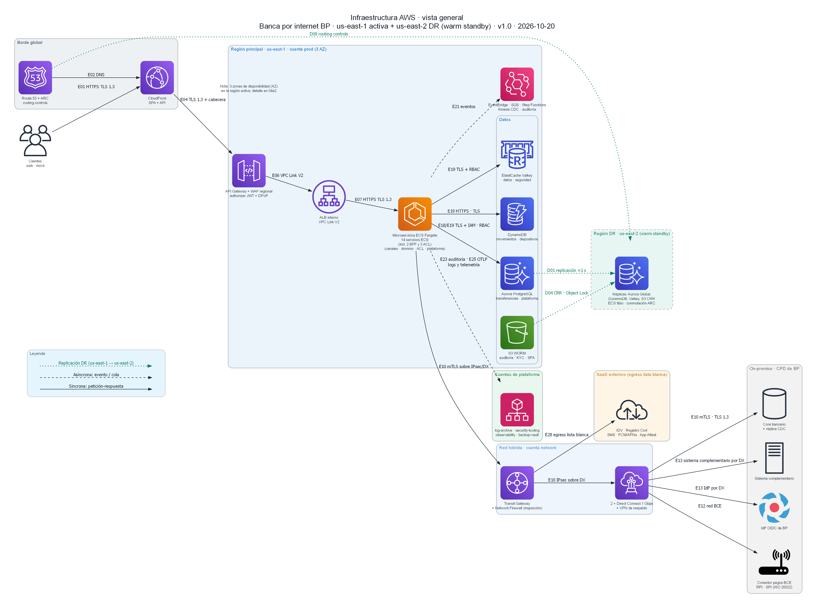

# Arquitectura de la banca por internet - BP

**[Documento final en PDF](docs/Arquitectura-BancaInternet-BP.pdf)** · versión 1.0 · 2026-10-20

Diseño de arquitectura de solución para un sistema de banca por internet: consulta de movimientos, transferencias y pagos propios e interbancarios, y apertura de cuentas con reconocimiento facial. La solución se modela con C4 y se despliega en AWS, con alta disponibilidad, recuperación ante desastres y estimación de costos. Incluye requisitos y supuestos, 14 decisiones de arquitectura (ADR) con alternativas evaluadas, seguridad y normativa, y una prueba de concepto.

## Cómo leer este repositorio

1. **Documento PDF** (`docs/Arquitectura-BancaInternet-BP.pdf`): resumen ejecutivo y documento completo.
2. **Decisiones** (`docs/adr/`): los 14 ADR; el índice está en [docs/adr/README.md](docs/adr/README.md).
3. **Documentos de soporte** (`docs/01` a `docs/04`): requisitos, seguridad y normativa, nube, costos y modelo C4.
4. **Diagramas** (`diagrams/`): fuentes editables en Mermaid (`.mmd`) y Python (`.py`); las imágenes exportadas están en `diagrams/png/`.
5. **Regenerar el PDF:** script `docs/pdf/build.ps1`.

## Decisiones de arquitectura (ADR)

| ADR | Decisión |
|---|---|
| [001](docs/adr/ADR-001-estilo-arquitectonico-y-eventos.md) | Estilo y eventos: microservicios por dominio, eventos y *outbox* |
| [002](docs/adr/ADR-002-plataforma-aws-region-y-computo.md) | Región y cómputo en AWS |
| [003](docs/adr/ADR-003-api-gateway-y-bff.md) | API Gateway y BFF por canal |
| [004](docs/adr/ADR-004-integracion-core-y-modelo-lectura.md) | Integración con el Core y modelo de lectura |
| [005](docs/adr/ADR-005-spa-framework-y-arquitectura.md) | Framework y arquitectura de la SPA |
| [006](docs/adr/ADR-006-app-movil-multiplataforma.md) | Aplicación móvil multiplataforma |
| [007](docs/adr/ADR-007-autenticacion-oauth2-oidc.md) | Autenticación OAuth 2.0 / OIDC, métodos y step-up |
| [008](docs/adr/ADR-008-onboarding-reconocimiento-facial.md) | Onboarding con reconocimiento facial |
| [009](docs/adr/ADR-009-orquestacion-transferencias-y-pagos.md) | Orquestación de transferencias y pagos |
| [010](docs/adr/ADR-010-notificaciones-multicanal.md) | Notificaciones multicanal |
| [011](docs/adr/ADR-011-persistencia-y-clientes-frecuentes.md) | Persistencia y clientes frecuentes |
| [012](docs/adr/ADR-012-auditoria-inmutable.md) | Auditoría inmutable |
| [013](docs/adr/ADR-013-ha-dr-y-resiliencia.md) | Alta disponibilidad, DR y resiliencia |
| [014](docs/adr/ADR-014-observabilidad-y-slo.md) | Observabilidad y objetivos de nivel de servicio |

## Estructura del repositorio

| Carpeta | Contenido |
|---|---|
| `docs/` | Documento final (PDF y fuente Markdown), requisitos, seguridad, nube, modelo C4, ADR y costos |
| `diagrams/` | Diagramas C4 e infraestructura: fuentes editables y PNG |
| `poc/` | Prueba de concepto ejecutable (Java 21 · Spring Boot · docker compose): idempotencia, outbox, caché con circuit breaker y auditoría con cadena de hashes. 25 pruebas en verde. Ver `poc/README.md` |
| `infra/terraform/` | Módulo Terraform de referencia (VPC en 3 AZ + ECS), solo `terraform validate` |
| `.github/workflows/` | CI de la PoC (build y pruebas con JDK 21) |

---

Versión 1.0 · 20 de octubre de 2026
