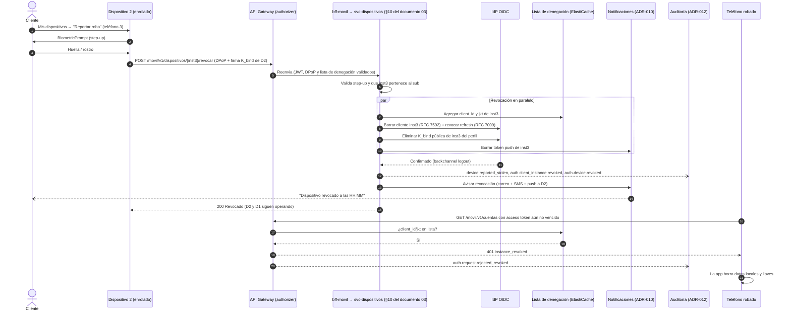

# 02 · Seguridad, identidad y normativa

> **Proyecto:** Banca por internet BP (reto de arquitectura de solución).
> **Contenido:** seguridad, identidad y normativa.
> **Fecha:** 2026-10-18 · **Estado:** propuesta para validación con BP (§11.2).
> **Fuentes de entrada:** [`01-requisitos.md`](01-requisitos.md) (RF/RNF/S), [`adr/`](adr/README.md) (en especial ADR-003, 006, 007, 008, 009, 012, 013).
> **Rúbrica cubierta:** #10 Autenticación · #11 Onboarding · #12 Auditoría · #13 Regulaciones y estándares de seguridad (y aporta a #8, #9, #14).
> **Absorbe:** los ADR tentativos 021 (perímetro / *zero trust*) y 022 (cifrado, llaves y secretos) de la lista inicial de decisiones candidatas.

## Convenciones de verificación

Toda norma o capacidad de producto lleva una marca:

| Marca | Significado |
|---|---|
| **[V]** | Verificado el 2026-10-18 en fuente primaria (texto oficial, Registro Oficial, documentación del fabricante). |
| **[S]** | Fuente secundaria confiable (estudio jurídico, gremio, prensa especializada); no se leyó el texto oficial. |
| **[NV]** | No verificado en esta versión. Se usa como supuesto y queda en la lista de validación con BP (§11). |

"Término" en la normativa ecuatoriana se cuenta en días hábiles (Código Orgánico Administrativo); confirmar con el área legal de BP.

---

## 1. Arquitectura de seguridad en una página (defensa en profundidad)

La seguridad se organiza en seis capas. Ninguna depende de que otra funcione: si una falla, la siguiente sigue protegiendo (NIST SP 800-207 *Zero Trust*; AWS Well-Architected, pilar de Seguridad).

| Capa | Qué protege | Controles principales | Dónde se decide |
|---|---|---|---|
| **1. Borde** | Disponibilidad y superficie expuesta | CloudFront (TLS 1.2+/1.3), AWS WAF (reglas gestionadas, Bot Control, ATP en login, ACFP en onboarding, *rate limiting*), Shield Advanced, Route 53 | §2.1–2.2 · ADR-003 |
| **2. Identidad** | Quién es el cliente y desde qué dispositivo | IdP OIDC con Code + PKCE + PAR (FAPI 2.0), BFF *token handler* en web, cliente confidencial por instancia en móvil, DPoP, *device binding*, *step-up* con firma de transacción | ADR-007 · ADR-008 · §4–§6 |
| **3. Aplicación / API** | Que cada petición esté autorizada | Validación JWT + DPoP + `acr` en el gateway (móvil) o en cada servicio con la prueba DPoP de `bff-web` (web), y re-validación en cada servicio (BOLA), validación de esquema, idempotencia, límites transaccionales, motor de fraude | ADR-003 · ADR-009 |
| **4. Datos** | Confidencialidad e integridad de PII, biometría y transacciones | KMS por dominio de datos, TLS en todo salto, tokenización / seudonimización, minimización, auditoría WORM con cadena de *hashes* | §3 · ADR-011 · ADR-012 |
| **5. Red** | Movimiento lateral y exfiltración | Cuentas separadas (Organizations + SCP), subredes privadas, *security groups* por servicio, VPC *endpoints*, *egress* por lista blanca, cifrado sobre Direct Connect | §2.3–2.6 · ADR-004 |
| **6. Operación** | Detección, respuesta y cadena de suministro | CloudTrail organizacional, GuardDuty, Security Hub, Config, Inspector, Macie, SIEM/SOC 24×7, SDLC seguro, *break-glass* con doble control | §2.7 · §10 · ADR-014 |

**Principios transversales**: mínimo privilegio; nada confía en la red interna; ningún secreto ni token utilizable en el navegador; la biometría del cliente nunca sale de su teléfono; todo evento de seguridad llega a la auditoría inmutable (ADR-012).

---

## 2. Perímetro y *zero trust* (antes ADR-021)

### 2.1 Borde: CloudFront + AWS WAF

| Control | Configuración propuesta | Riesgo mitigado |
|---|---|---|
| TLS en el borde | Política de seguridad de CloudFront con TLS 1.2 mínimo y TLS 1.3 preferido; HSTS con `preload`; certificados en ACM | Interceptación / degradación de protocolo |
| Reglas gestionadas de WAF | *Core rule set*, *Known bad inputs*, SQL *database*, *Amazon IP reputation*, *Anonymous IP list* (como señal de riesgo, no bloqueo ciego) | OWASP Top 10 (inyección, *exploits* conocidos), tráfico desde infraestructura maliciosa |
| **Bot Control** (nivel *targeted*) | Solo en rutas sensibles (`/login`, `/par`, `/onboarding`, `/register`) para contener costo | Relleno de credenciales, creación masiva de cuentas, *scraping* |
| **Account Takeover Prevention (ATP)** | En el *endpoint* de login web | Credenciales filtradas, ataques de fuerza bruta distribuidos |
| **Account Creation Fraud Prevention (ACFP)** | En el inicio del onboarding | Identidades sintéticas / cuentas mula a escala |
| *Rate-based rules* | Por IP, por ASN y por cabecera (`client_id` de instancia, *hash* de cédula en onboarding); límites distintos por ruta | Consumo no restringido (OWASP API4), abuso de flujos de negocio (API6) |
| Geografía | Sin bloqueo por país (clientes en el exterior); la geolocalización alimenta el motor de riesgo | Fraude transfronterizo sin castigar al cliente que viaja |
| Origen protegido | API Gateway acepta solo tráfico de CloudFront (cabecera secreta rotada por Secrets Manager + WAF regional); S3 de la SPA solo vía OAC | Evasión del borde |

### 2.2 Shield Advanced — costo/beneficio

| Opción | Costo (referencia pública) | Beneficio | Veredicto |
|---|---|---|---|
| Shield Standard (incluido) | USD 0 | Protección L3/L4 automática en CloudFront y Route 53 | Base en todos los entornos |
| **Shield Advanced** | **USD 3.000/mes con compromiso de 1 año** + transferencia de datos; una suscripción cubre todas las cuentas de la organización; incluye el uso de WAF de los recursos protegidos hasta 50.000 M de solicitudes/mes **[S]** (página de precios de AWS citada por fuentes secundarias) | Mitigación L7 automática, equipo de respuesta de AWS (SRT) 24×7, protección de costos ante escalado por DDoS, métricas y alertas de eventos | **Recomendado solo en producción** (CloudFront, Route 53, API Gateway y ALB expuestos) |

Justificación: (1) la banca por internet es un objetivo recurrente de DDoS de extorsión, y la continuidad del canal es una obligación de gestión de riesgo operativo y continuidad (Codificación SB, Libro I, Título IX, Cap. V, arts. 23–26, §8); (2) NIST CSF 2.0 RS/RC y la ISO/IEC 27001:2022 A.5.29–A.5.30 piden capacidad de respuesta y continuidad TIC. El costo representa ~7–12 % del presupuesto S-16, pero se compensa en parte con las tarifas de WAF incluidas. **Entra a la estimación de costos (documento 03).**

### 2.3 Cuentas y gobierno (AWS Organizations)

- **OU Security**: cuenta `log-archive` (CloudTrail organizacional, auditoría WORM de ADR-012, logs de VPC/WAF) y cuenta `security-tooling` (administrador delegado de GuardDuty, Security Hub, Inspector, Macie, Detective).
- **OU Infrastructure**: cuenta `network` (Transit Gateway, Direct Connect Gateway, Network Firewall, DNS).
- **OU Workloads**: `prod`, `staging`, `qa`, `dev` y `dr` separadas (S-17).
- **SCP mínimas**: denegar regiones distintas de `us-east-1`/`us-east-2`; denegar desactivar CloudTrail, GuardDuty, Config o Security Hub; denegar `s3:PutBucketObjectLockConfiguration` y borrado de la auditoría salvo rol *break-glass*; denegar programar el borrado de llaves KMS salvo *break-glass*; denegar S3 público; denegar salir de la organización.
- **Acceso humano**: IAM Identity Center con MFA resistente a *phishing* y permisos temporales; sin usuarios IAM ni llaves de larga vida; producción solo lectura por defecto; *break-glass* con doble control y alerta inmediata.

### 2.4 Segmentación de red

| Subred | Contenido | Entrada permitida | Salida permitida |
|---|---|---|---|
| Privada de integración | VPC Link / ALB interno | Solo API Gateway (VPC Link) | Tareas BFF |
| Privada de aplicación | BFF, `svc-*`, `acl-*` (Fargate) | *Security group* por servicio: solo los llamadores declarados | VPC *endpoints*, Network Firewall (lista blanca), Transit Gateway hacia on-prem |
| Aislada de datos | Aurora, ElastiCache, (DynamoDB/S3 vía *gateway endpoints*) | Solo el *security group* del servicio dueño del dato | Ninguna a Internet |

- **VPC *endpoints*** (PrivateLink) para KMS, Secrets Manager, ECR, STS, CloudWatch Logs, Kinesis, SQS, EventBridge, Step Functions; *gateway endpoints* para S3 y DynamoDB con políticas que solo admiten los recursos de BP (anti-exfiltración).
- ***Egress* controlado**: AWS Network Firewall con lista blanca por dominio (proveedor IDV, proveedores de SMS/correo, FCM/APNs, *endpoints* de atestación de Apple/Google); Route 53 Resolver DNS Firewall. Todo lo demás se deniega y alerta.

### 2.5 Tráfico interno servicio a servicio — opciones evaluadas

| Criterio (peso) | A. TLS 1.3 de ECS Service Connect + identidad por token | B. mTLS de aplicación en todos los saltos (certificados de AWS Private CA) | C. Amazon VPC Lattice con políticas de autorización IAM (SigV4) |
|---|---|---|---|
| Cifrado y autenticación del servidor (25 %) | 5 | 5 | 5 |
| Autenticación del llamador (25 %) | 4 (JWT de usuario propagado + token de servicio) | 5 | 5 |
| Costo y complejidad operativa (25 %) | 5 (certificados emitidos y rotados por ECS) | 2 (gestión de certificados en cada servicio) | 3 |
| Encaje con ADR-013 (Service Connect ya elegido) (25 %) | 5 | 3 | 2 |
| **Puntaje** | **4,75** | **3,75** | **3,75** |

**Decisión**: **opción A en el interior de la VPC**, **mTLS de aplicación (B) solo al cruzar la frontera de confianza hacia on-premise** (`acl-core`, `acl-complementario`, `acl-interbancario`).

- Service Connect provisiona, distribuye y rota certificados de **AWS Private CA en modo de vida corta** (máx. 7 días, rotación por defecto cada 5) y usa **TLS 1.3** **[V]** (guía de ECS, "Encrypt Amazon ECS Service Connect traffic"). La documentación describe cifrado y certificados de servidor, **no autenticación mutua**: la identidad del llamador se asegura con *security groups* por servicio, el *access token* del usuario propagado (cada servicio re-valida `aud`/*scopes*/propiedad del recurso) y, para llamadas sin usuario, un token de servicio (*client credentials* con `private_key_jwt`). En el canal web el *access token* que propaga `bff-web` va siempre con una **prueba DPoP por llamada** (llave efímera de la sesión) que cada servicio verifica contra `cnf.jkt`, con `jti` anti-*replay* en el ElastiCache de seguridad: ni dentro de la VPC el *token* circula como *bearer* (ADR-007 §2.3).
- Justificación: NIST SP 800-207 (cada solicitud se autentica y autoriza, sin confianza implícita en la red) y OWASP API Security Top 10 2023 (API1 BOLA, API5 BFLA: la autorización se resuelve en el servicio, no en la red).
- **Ajuste de coherencia aplicado** en ADR-001, ADR-003 y ADR-007: donde decía "mTLS interno (Service Connect)" ahora dice "TLS 1.3 (Service Connect) + identidad por token; mTLS en los ACL hacia on-premise".

### 2.6 Cifrado sobre Direct Connect

Direct Connect **no cifra** por defecto. Opciones:

| Opción | Requisito | Veredicto |
|---|---|---|
| **MACsec** (802.1AE, L2) | Solo conexiones **dedicadas de 10/100/400 Gbps** en ubicaciones DX seleccionadas; **no disponible en conexiones *hosted*** ni en 1 Gbps **[V]** (guía de AWS Direct Connect, MACsec) | **Preferida** si BP contrata conexiones dedicadas de 10 Gbps |
| **VPN IPsec sobre DX** (*private IP VPN* en Transit Gateway) | Funciona con conexiones hospedadas de menor capacidad | **Respaldo** si no hay MACsec |
| Solo TLS/mTLS de aplicación | — | Insuficiente como única capa para datos financieros; se mantiene como capa adicional |

Decisión: **MACsec o IPsec en el enlace + mTLS de aplicación en los ACL** (doble capa). Actualiza el punto abierto de ADR-004 §3.2.

### 2.7 Detección y respuesta

GuardDuty (incluido *runtime monitoring* de ECS y protección de S3), Security Hub con los estándares *AWS Foundational Security Best Practices* y CIS, AWS Config con paquetes de conformidad, Inspector sobre imágenes de ECR, Macie sobre los *buckets* de evidencias KYC y auditoría, Detective para investigación. Hallazgos críticos → EventBridge → SIEM/SOC 24×7 de BP y *runbooks* (ADR-014). Las alertas de identidad (altas de dispositivos anómalas, reuso de tokens, intentos de *step-up* fallidos en serie) se definen en §5.

---

## 3. Cifrado, llaves y secretos (antes ADR-022)

### 3.1 AWS KMS vs. AWS CloudHSM

| Criterio (peso) | **AWS KMS (llaves gestionadas por el cliente)** | AWS CloudHSM (clúster dedicado) | KMS con *custom key store* respaldado por CloudHSM |
|---|---|---|---|
| Aseguramiento del módulo (25 %) | 5 (HSM validados FIPS 140-3 nivel 3 según AWS **[NV]** en este documento) | 5 (FIPS 140-3 nivel 3, mono-inquilino) | 5 |
| Control exclusivo de la llave (20 %) | 3 (multi-inquilino, políticas de llave y CloudTrail) | 5 | 5 |
| Integración con servicios AWS (S3, Aurora, DynamoDB, Kinesis, Secrets) (20 %) | 5 | 1 (requiere integración propia) | 5 |
| Costo (20 %) | 5 (USD 1/llave/mes + solicitudes) | 1 (≈ USD 1,5/h por HSM × ≥ 2 para HA ⇒ ≈ USD 2.200+/mes por región **[NV]**, a precisar en la estimación de costos) | 2 |
| Operación (15 %) | 5 | 2 (usuarios del HSM, respaldos, parches de cliente) | 3 |
| **Puntaje** | **4,60** | **2,80** | **4,05** |

**Decisión**: **AWS KMS** para todas las llaves; **CloudHSM solo si BP o el supervisor exigen custodia mono-inquilino**, y en ese caso mediante *custom key store* de KMS para no cambiar la integración. Si la verificación de S-21 exigiera llaves custodiadas en Ecuador, la opción es **KMS External Key Store (XKS)** contra un HSM de BP on-premise (§9.2).

### 3.2 Inventario de llaves críticas

| Llave | Tipo / uso | Quién puede usarla | Rotación |
|---|---|---|---|
| Firma del ***software statement*** del registro DCR (`bff-movil`) | Asimétrica ECC P-256, `Sign` | Solo el rol de tarea de `bff-movil`; política con condición de VPC *endpoint* | Anual con superposición de JWKS; revocación inmediata ante incidente |
| ***Initial access token*** de DCR | Secreto en Secrets Manager | Solo `bff-movil` | 30 días |
| `private_key_jwt` de `bff-web` (y de `bff-movil` en el respaldo b) | Asimétrica, `Sign` | Rol del BFF | Anual, publicada por JWKS |
| Llave DPoP **efímera por sesión** de `bff-web` | ECC P-256 generada por el BFF al iniciar sesión; guardada cifrada (llave KMS de sesiones) en el ElastiCache de seguridad | Solo `bff-web` | Una por sesión; se destruye al cerrar o vencer la sesión |
| **Sello de auditoría** (raíz Merkle horaria, ADR-012) | Asimétrica, `Sign`, en cuenta `log-archive` | Solo la Lambda de sellado; verificación pública por llave pública | Nunca se borra (las firmas antiguas deben seguir verificándose); nueva versión anual |
| Datos por dominio (transacciones, perfil, sesiones BFF, evidencias KYC, auditoría) | Simétricas, cifrado de sobre | Rol del servicio dueño | Automática anual |
| **Evidencias KYC / biométricas** (ADR-008) | Simétrica dedicada | Servicio de Onboarding + rol de revisión con doble control | Automática anual; acceso humano solo *break-glass* |
| Tokenización de cédula (HMAC) | HMAC en KMS (`GenerateMac`) | Servicio de bóveda de tokens | Versionada; sin reemplazo destructivo |

Las llaves de dispositivo (`K_inst`, `K_bind`) **no existen en AWS**: se generan y quedan en el Secure Enclave / StrongBox del teléfono (ADR-007); AWS solo guarda las llaves públicas.

### 3.3 Secretos

- **Secrets Manager** para credenciales de terceros (IDV, SMS, correo, Registro Civil), con rotación automática (90 días o según el proveedor) y réplica a `us-east-2`.
- Aurora con contraseña maestra gestionada por Secrets Manager y acceso de servicios por **IAM *database authentication*** donde sea viable.
- **Nunca** secretos en repositorio, imagen o variable de entorno en texto plano: los inyecta ECS desde Secrets Manager; *secret scanning* con bloqueo en *push* (§10).
- CI/CD sin llaves de larga vida: GitHub Actions → AWS por **OIDC** con roles de alcance mínimo.

### 3.4 Tokenización, seudonimización y minimización

| Dato | Tratamiento | Motivo |
|---|---|---|
| Número de cédula | Token determinista (HMAC con llave KMS) en todos los servicios salvo `acl-core` y Onboarding; valor real solo en la bóveda | Minimización (LOPDP art. 39 privacidad desde el diseño) y reducción del impacto de una fuga |
| `sub` en logs y auditoría | Seudónimo estable; la tabla de correspondencia vive fuera de la auditoría | Permite atender derechos del titular sin romper el WORM (§9.1) |
| Números de cuenta en logs / notificaciones | Enmascarados (últimos 4) | Exposición en canales no seguros (pantalla bloqueada, correo) |
| Biometría | **BP no guarda plantillas**; solo evidencia KYC mínima cifrada (imágenes y puntuaciones) y el proveedor opera con retención cero | Dato sensible (LOPDP art. 4 y 26); minimización |
| Datos de tarjeta (PAN) | El canal **no** muestra ni procesa el PAN completo; usa alias de producto del Core | Mantener el canal fuera del alcance de PCI DSS (§8) |

### 3.5 TLS

TLS 1.2 mínimo y 1.3 preferido en el borde y API Gateway (políticas de seguridad modernas, sin suites CBC heredadas); TLS 1.3 en el interior (Service Connect); mTLS hacia on-premise. En la app: *pinning* de llave pública con **conjunto de respaldo** (dos raíces/intermedias de la propia PKI o de la CA pública elegida, nunca un único certificado hoja) para no romper la app en una rotación, siguiendo OWASP MASVS-NETWORK.

---

## 4. Matriz de brechas del IdP (S-20)

El enunciado dice que BP ya tiene un producto OAuth configurable; no sabemos cuál. Esta matriz le dice a BP **qué capacidades tiene que confirmar** y qué pasa con el diseño según la respuesta.

Leyenda: **Sí [V]** = confirmado hoy en documentación oficial · **Sí [NV]** = documentado por el fabricante según conocimiento previo, no re-verificado hoy (confirmar en RFP/PoC) · **No [V]** = ausencia verificada · **?** = no verificado.

| Capacidad requerida | Para qué | Keycloak 26.x | Amazon Cognito | Ping (PingFederate / PingAM, ex ForgeRock) | Curity Identity Server | Okta / Auth0 | Microsoft Entra External ID |
|---|---|---|---|---|---|---|---|
| **DCR RFC 7591** protegido (*initial access token* / *software statement*) | Opción c (cliente por instancia) | Sí [NV] (*Client Registration Service* con *initial access token*); *software statement* nativo ? | **No [V]**: no expone *endpoint* de registro (solo API de administración de *app clients*, con cuota por *user pool* ?) | Sí [NV] | **Sí [V]**: DCR por instancia móvil con plantilla y atestación (HAAPI) | Auth0: DCR abierto ? (sin *initial access token* confirmado) | **No [V]** (Entra ID no publica *endpoint* RFC 7591; External ID ?) |
| `private_key_jwt` con JWKS por cliente | Autenticación FAPI | Sí [NV] | ? | Sí [NV] | Sí [NV] | Sí [NV] | ? |
| **PAR** (RFC 9126) | FAPI 2.0 obligatorio | Sí [NV] | **No [V]** (sin *endpoint* `/par` en la lista oficial de *endpoints*) | Sí [NV] | Sí [NV] | **Sí [V]** (Auth0, add-on *Highly Regulated Identity*, plan Enterprise) | ? |
| **DPoP** (RFC 9449), incluido refresh | Tokens ligados | **Sí [V]** (soportado desde 26.4; ligado de refresh) | No listado [V] | Sí [NV] | **Sí [V]** | **Sí [V]** (solo plan Enterprise) | ? |
| Perfil FAPI 2.0 | Conformidad | **Sí [V]** (perfiles `fapi-2-dpop-*` en 26.4) | No | Sí [NV] | ? (certificación FAPI 1.0 histórica) | Sí [S] (vía HRI) | ? |
| `acr_values` / `max_age` (base del *step-up* RFC 9470) | *Step-up* | **Sí [V]** (ACR ↔ nivel de autenticación) | ? | Sí [NV] | Sí [NV] | Sí [NV] | ? |
| **RAR** (RFC 9396, `authorization_details`) | Firma de transacción | ? (parcial / experimental) | No ? | Sí [NV] | Sí [NV] | Sí [S] (HRI) | ? |
| Refresh **sin rotación** y ligado al remitente | FAPI 2.0 §5.3.2.1 | Sí [NV] (rotación configurable) | ? | Sí [NV] | Sí [NV] | ? | ? |
| Pasos de autenticación personalizados (reto `K_bind`, comprobante de onboarding) | ADR-007/008 | Sí [NV] (SPI de *authenticators*) | Parcial [NV] (*custom auth challenge* con Lambda) | Sí [NV] (árboles / *journeys*) | Sí [NV] | Sí [NV] (*Actions*) | Parcial ? |
| API de administración / SCIM | Alta desde Onboarding, revocación | **Sí [V]** (Admin REST API y SCIM documentados) | Sí [V] (API de *user pools*) | Sí [NV] | Sí [NV] | Sí [NV] | Sí [NV] (Microsoft Graph) |
| Revocación por cliente / dispositivo (RFC 7592 / RFC 7009 / *backchannel logout*) | §5–§6 | Sí [NV] | Revocación de refresh [V] | Sí [NV] | Sí [NV] | Sí [NV] | ? |
| **CIBA** (OpenID Connect CIBA, perfil FAPI-CIBA) | Evolución del *step-up* web: "aprobar desde la app" sin redirigir la SPA (ADR-007 §3.6). **No es requisito** | Sí [NV] | No ? | Sí [NV] | ? | ? | ? |
| Escala de registros de cliente (hasta **~2,4 M** instancias: 800 mil clientes activos × 3) | Opción c | ? (prueba de carga) | No aplica | ? | Sí [V] (patrón diseñado para esto) | ? | No aplica |

### 4.1 Conclusión

- **Opción c (cliente confidencial por instancia)** se elige si el IdP de BP cumple **todas** estas capacidades mínimas: (1) DCR RFC 7591 protegido por *initial access token* o equivalente administrativo **sin cuota que impida ~2,4 M registros**; (2) `private_key_jwt` con JWKS por cliente; (3) PAR; (4) DPoP ligando *access* y *refresh*; (5) `acr_values` + `max_age`; (6) paso de autenticación personalizado para el reto de `K_bind`; (7) borrado/revocación de un cliente concreto con efecto inmediato sobre sus tokens. Productos que, según la evidencia, pueden cumplirlo: **Keycloak 26.4+, Curity, Ping** (los dos últimos a confirmar en RFP).
- **Respaldo b (BFF Móvil confidencial)** si faltan (1) o (7) o la escala: requiere del IdP solo (2)–(6) para **un** cliente (`bff-movil`). Encaja con **Auth0 con HRI** y, potencialmente, Entra External ID si confirma PAR/DPoP.
- **Amazon Cognito no cumple el perfil FAPI 2.0 de este diseño** (sin PAR ni DCR [V]): si el producto existente de BP fuera Cognito, se declara la brecha, se usa b y se documenta la desviación FAPI (sin PAR → JAR firmado; sin DPoP → refresh rotativo de vida corta + atestación), o se recomienda un IdP FAPI delante.
- El reto RFC 9470 lo emite el ***authorizer* del gateway** en móvil y el **servicio de dominio** en web (ADR-003), así que esa parte no depende del IdP; el IdP solo debe honrar `acr_values`/`max_age`. El *step-up* web usa redirección (Code + PKCE + PAR con `authorization_details`); **CIBA / FAPI-CIBA** solo se evalúa como evolución si el IdP lo soporta.

---

## 5. Política de dispositivos e instancias

| Regla | Valor propuesto (parametrizable) | Justificación |
|---|---|---|
| Máximo de dispositivos activos por cliente | **3** | Cubre teléfono + tableta + reemplazo; limita la superficie de fraude y el volumen de DCR (~2,4 M). SB: banca móvil solo desde "dispositivos autorizados" (§8) |
| Alta de un dispositivo nuevo | Requiere ***step-up*** con un dispositivo ya enrolado (firma con su `K_bind`) **o**, si no tiene ninguno, **re-verificación facial** contra el Registro Civil (ADR-008) | Evita que la clave robada baste para enrolar un teléfono del atacante |
| Notificación de alta | **≥ 2 canales**: *push* a los otros dispositivos + correo y/o SMS, con enlace "no fui yo" que revoca en un toque | Detección temprana por el titular; alineado a la notificación de accesos exigida por la SB |
| Periodo de enfriamiento del dispositivo nuevo | **24 h** con límites reducidos (sin alta de beneficiarios, tope interbancario bajo) | Contiene el daño si el alta fue fraudulenta |
| Cuarto dispositivo | Rechazado hasta revocar uno (desde un dispositivo enrolado, la web con *step-up* o el centro de contacto) | Mantiene el tope |
| Revocación por autoservicio | App ("Mis dispositivos") y banca web, con *step-up* | Respuesta inmediata del titular |
| Revocación asistida | Centro de contacto tras verificar identidad (preguntas + OTP a canal no comprometido, o videollamada), mediante la API de *backoffice* de `svc-dispositivos` accesible **solo por red corporativa/DX con SSO corporativo + MFA** (S-32) | Cliente sin otro dispositivo |
| Revocación automática | **180 días sin uso**; **cambio de biometría** enrolada (la llave `K_bind` se invalida en el hardware); atestación fallida en re-chequeo periódico; señal de *root*/reempaquetado; decisión del motor de fraude | ADR-007; OWASP MASVS (MASWE-0022) |
| *Rate limiting* del registro DCR | Por cliente: ≤ 3 altas / 24 h; por IP/ASN y global con alarma por desviación; registro solo por `bff-movil` con *initial access token* tras atestación válida | Evita altas masivas de instancias falsas y agotamiento del IdP |
| Limpieza de huérfanas | *Job* diario: instancias registradas que no completaron login en 24 h se borran; reinstalación = instancia nueva y la anterior expira por inactividad o la revoca el cliente | Higiene del IdP; reduce credenciales vivas sin dueño |
| Contenido en pantalla bloqueada | Notificaciones *push* sin montos completos ni OTP | Evita filtrar información con el teléfono bloqueado |

---

## 6. Escenario del usuario: "Tengo la app en 3 dispositivos y me roban uno"

### 6.1 Qué puede y qué no puede hacer el ladrón

| Situación | Qué puede hacer | Qué **no** puede hacer | Control que lo impide |
|---|---|---|---|
| **Teléfono bloqueado** (lo más común) | Ver notificaciones de la pantalla bloqueada (sin montos ni OTP); sacar la SIM; apagar el teléfono; restablecerlo de fábrica | Abrir la app; usar `K_inst`/`K_bind`; recibir OTP útiles; transferir | Bloqueo del SO; llaves no exportables en hardware; restablecer de fábrica **destruye** las llaves; notificaciones sin datos sensibles |
| **Teléfono desbloqueado y app abierta** (arrebato en la calle) | Durante **≤ 2 min** de inactividad (o ≤ 30 s si la app pasa a segundo plano): ver saldos y movimientos ya cargados; transferir **entre cuentas propias** del cliente | Transferir a terceros o interbancarias, agregar beneficiarios, cambiar datos de contacto, límites o clave, enrolar otro dispositivo | Todas esas operaciones exigen ***step-up* con firma de `K_bind`**, que pide **biometría fuerte en cada uso** (no la del desbloqueo del SO) y firma monto + destino (RAR, vinculación dinámica) |
| **App bloqueada por inactividad** | Ver la pantalla de bloqueo | Reanudar la sesión | Reanudar = biometría local + firma de reto con `K_bind` (ADR-007); el servidor también marca la sesión inactiva y responde `401` |
| **Conoce el PIN del teléfono** (lo vio por encima del hombro) | Desbloquear el teléfono; enrolar **su** huella en el SO | Usar la app con su huella | `K_bind` se crea con `biometryCurrentSet` / `setInvalidatedByBiometricEnrollment`: **una huella nueva invalida la llave**; y no se permite usar el PIN del SO como alternativa para `K_bind`. La app exige re-enrolamiento con verificación facial contra el Registro Civil, que el ladrón no supera |
| **Conoce además la clave de banca** del cliente | Intentar login de respaldo (clave + OTP) | Usar el respaldo para transferir a terceros | El respaldo clave + OTP SMS da un nivel bajo: solo consultas y operaciones propias; terceros exigen `K_bind` o passkey; un beneficiario nuevo tiene enfriamiento; el motor de fraude marca la SIM/dispositivo como de riesgo |
| **Rootea el teléfono / usa herramientas de *hooking*** | Intentar extraer llaves o inyectar llamadas | Extraer `K_inst`/`K_bind` (no exportables) | Hardware seguro; RASP y atestación periódica → revocación automática de la instancia |

Riesgo residual honesto: con el teléfono **desbloqueado y la app abierta**, el ladrón puede **ver** información financiera durante una ventana corta (≤ 2 min) y mover dinero **entre las propias cuentas del cliente**. No puede sacar dinero hacia terceros. El bloqueo en segundo plano y los 2 minutos reducen esa ventana a lo mínimo razonable para la usabilidad.

### 6.2 Cómo reporta el cliente

1. **Desde otro de sus dispositivos** (los otros 2 siguen funcionando): *Ajustes → Mis dispositivos → "Reportar robo"* con biometría. Es la vía más rápida.
2. **Desde la banca web**: login con passkey o clave + aprobación en otro dispositivo → *Mis dispositivos → Reportar robo* con *step-up*.
3. **Centro de contacto / línea de emergencia 24×7**: verificación de identidad (preguntas + OTP a un canal no comprometido, o videollamada); el operador ejecuta la revocación con su identidad registrada en la auditoría.
4. **Enlace "no fui yo"** de cualquier notificación de seguridad reciente.

Si el cliente no sabe qué está comprometido, puede elegir **"Bloquear todo"**: revoca todas las instancias, termina todas las sesiones y obliga a cambiar la clave y a re-enrolar con verificación facial.

### 6.3 Qué se revoca (por defecto, **solo la instancia robada**)

| Elemento | Acción | Efecto |
|---|---|---|
| Registro de la instancia en el IdP (`client_id` de DCR) | Borrado (RFC 7592) o desactivación por API de administración | El ladrón ya no puede autenticar el cliente en `/par` ni `/token` |
| Sesiones y *refresh tokens* de esa instancia | Revocación (RFC 7009) + *backchannel logout* | No hay renovación posible |
| *Access tokens* vigentes (≤ 5 min) | El `client_id` y el `jkt` de la instancia entran a una **lista de denegación** en ElastiCache que consulta el *authorizer* del gateway | Rechazo **inmediato**, sin esperar al vencimiento |
| Llave pública de `K_bind` en el perfil del usuario | Eliminada | Sus firmas de *step-up* dejan de ser válidas; se cancelan aprobaciones pendientes desde ese dispositivo |
| *Token* de notificaciones *push* del dispositivo | Eliminado | El teléfono robado deja de recibir avisos y OTP |
| Clave de banca | **No** se cambia por defecto; se recomienda cambiarla si el cliente la tenía guardada en el teléfono; en "Bloquear todo" es obligatorio | Proporcionalidad: no castigar los otros dispositivos |

**Los otros 2 dispositivos siguen operando** con normalidad: sus instancias, llaves y sesiones son independientes. Objetivo de servicio: revocación efectiva en **≤ 60 s** desde el reporte. Si el teléfono robado vuelve a conectarse, recibe `401 instance_revoked` y la app borra sus datos locales y llaves.

### 6.4 Qué se audita y qué se notifica

- **Auditoría** (ADR-012): `device.reported_stolen` (canal del reporte, operador si aplica), `auth.client_instance.revoked`, `auth.device.revoked`, `auth.session.terminated`, `auth.token.revoked`, `auth.denylist.added`, intentos posteriores rechazados desde la instancia revocada (`auth.request.rejected_revoked`, útil como evidencia para la denuncia) y `notificacion.enviada`. Sin tokens, llaves ni datos biométricos; `sub` seudonimizado.
- **Notificación** por **≥ 2 canales** (correo + SMS + *push* a los dispositivos restantes): "Revocamos el dispositivo X a las HH:MM; si no fuiste tú, llama al…".
- El motor de fraude eleva el riesgo de la cuenta 72 h (*step-up* más frecuente, límites interbancarios reducidos) y revisa las operaciones de las últimas horas.

### 6.5 Secuencia de revocación

### 6.6 Amenaza → control → norma

| Amenaza | Control | Norma / estándar |
|---|---|---|
| Uso de la app en el teléfono robado | Bloqueo a 2 min / segundo plano, reanudación biométrica, inactividad impuesta en servidor | SB, Codificación Lib. I, Tít. IX, Cap. V, Sección VIII (tiempo máximo de inactividad, origen Res. SB-2018-771 art. 20 d) **[V]**; OWASP ASVS 5.0 V7; PSD2 RTS art. 4(3)(d) |
| Transferencia a terceros desde el teléfono robado | *Step-up* con firma `K_bind` + RAR; doble factor | SB Sección VIII (2 de 3 factores, segundo factor a cuentas no registradas; origen art. 20 h) **[V]**; PSD2 RTS art. 5; RFC 9396/9470 |
| Enrolar la huella del ladrón | Invalidación de `K_bind` al cambiar biometría; sin alternativa de PIN | OWASP MASVS-AUTH / MASWE-0022; NIST SP 800-63B-4 (biometría ligada a autenticador físico) |
| Extraer credenciales del dispositivo | Llaves no exportables en hardware; RASP; atestación | OWASP MASVS-STORAGE/CRYPTO/RESILIENCE; ISO/IEC 27001:2022 A.8.24 |
| Tokens vigentes tras el reporte | Lista de denegación inmediata + revocación en IdP | RFC 7009; FAPI 2.0 (tokens ligados); NIST CSF 2.0 RS.MI |
| Alta fraudulenta de un 4.º dispositivo | Tope de 3, *step-up* o IDV facial, notificación ≥ 2 canales, enfriamiento 24 h | SB Sección VIII: banca móvil solo desde dispositivos autorizados (origen art. 21) **[V]** |
| Disputa posterior ("yo no fui") | Auditoría WORM con cadena de *hashes* y eventos de revocación | ISO/IEC 27001:2022 A.8.15; ADR-012 |
| Exposición de datos personales del cliente | Notificaciones sin datos sensibles; si hubo acceso indebido a datos, evaluar notificación de vulneración | LOPDP arts. 37, 43 y 46 **[V]** |

---

## 7. Modelo de amenazas STRIDE (flujos críticos)

Categorías: **S** suplantación · **T** manipulación · **R** repudio · **I** divulgación · **D** denegación de servicio · **E** elevación de privilegios. Riesgo residual: **B** bajo · **M** medio · **A** alto.

### 7.1 Login web (SPA + `bff-web`)

| Amenaza | STRIDE | Control | Referencia | Residual |
|---|---|---|---|---|
| *Phishing* de credenciales en un sitio clon | S | Passkeys ligadas al origen como método preferente; aprobación *push* con número de coincidencia | ADR-007 §3.5 | M (clientes sin passkey) |
| Relleno de credenciales / fuerza bruta | S, D | WAF ATP + Bot Control + *rate limiting*; bloqueo progresivo en el IdP | §2.1 | B |
| Robo de tokens por XSS | I, E | Tokens solo en el BFF; cookie `__Host-` HttpOnly SameSite=Strict; CSP estricta | ADR-007 §3.2 · RFC 10017 | B |
| CSRF sobre operaciones | T | SameSite=Strict + cabecera anti-CSRF + verificación de `Origin` | ADR-007 §3.2 | B |
| Inyección/interceptación del código de autorización | S, T | PAR + PKCE S256 + `iss` (RFC 9207) + `state`/`nonce` | ADR-007 §3.1 | B |
| Secuestro de sesión del BFF | S | Sesión cifrada en ElastiCache, inactividad 5 min / absoluta 30 min, rotación del id de sesión al autenticar | ADR-007 §3.4 | B |
| Reuso del *access token* web capturado dentro de la VPC (servicio comprometido, *logs*) | I, E | DPoP de punta a punta: prueba por llamada con la llave efímera de sesión de `bff-web`; cada servicio verifica `cnf.jkt` y `jti` | ADR-007 §2.3 | B |
| Negar haber iniciado sesión | R | `auth.login.*` en auditoría WORM + notificación de cada acceso | ADR-012 | B |

### 7.2 Login móvil (cliente por instancia)

| Amenaza | STRIDE | Control | Referencia | Residual |
|---|---|---|---|---|
| App clonada o reempaquetada que se hace pasar por la oficial | S | Registro solo tras atestación (App Attest / Play Integrity); `private_key_jwt` por instancia | ADR-007 §3.3 | B |
| Robo de tokens (malware, *proxy*) | I | DPoP con llave en hardware; tokens de 5 min | ADR-007 §2.3 | B |
| *Redirect* secuestrado por otra app | S | App Links / Universal Links HTTPS + PKCE; navegador del sistema, nunca WebView | RFC 8252 | B |
| Malware bancario Android con superposición o servicios de accesibilidad | T, E | Detección de *overlay* / accesibilidad (RASP), `FLAG_SECURE`, firma de transacción mostrando monto y destino | OWASP MASVS-PLATFORM/RESILIENCE | M |
| Dispositivo rooteado | E | Atestación periódica, RASP, el motor de fraude reduce límites o revoca | §5 | M |
| Saturación del IdP por arranques en frío masivos | D | *Rate limiting* por instancia; JWKS en caché; IdP multi-AZ | ADR-013 | B |

### 7.3 Onboarding con reconocimiento facial

| Amenaza | STRIDE | Control | Referencia | Residual |
|---|---|---|---|---|
| Foto, video, máscara o *deepfake* frente a la cámara | S | Prueba de vida evaluada según ISO/IEC 30107-3 con conformidad nivel 2 de iBeta (laboratorio NVLAP) | ADR-008 §3.2 | M |
| Inyección de video (cámara virtual, emulador, *hooking*) | S, T | Atestación de app, detección de inyección (CEN/TS 18099), decisión en servidor | ADR-008 §3.4 | M |
| Documento falso o identidad sintética | S | OCR + autenticidad documental + validación contra Registro Civil + listas AML; WAF ACFP | ADR-008 §3.5 · §2.1 | B |
| Manipulación de puntuaciones en el cliente | T | Resultados servidor a servidor desde el proveedor | ADR-008 §3.4 | B |
| Fuga de imágenes biométricas | I | Sin plantillas en BP; bóveda cifrada con llave dedicada; retención cero en el proveedor; Macie | §3.2–3.4 | B |
| Reutilización del comprobante de verificación | S, E | JWT de un solo uso, 5 min, ligado al `jkt` | ADR-008 §3.6 | B |
| Caída del proveedor o del Registro Civil | D | *Circuit breaker*, motor alterno de liveness, expediente pendiente (nunca aprobación automática) | ADR-008 §3.8 | B |
| Negar el consentimiento biométrico | R | Evento `onboarding.consent.granted` con versión del texto | ADR-008 §3.9 | B |

### 7.4 Transferencia interbancaria

| Amenaza | STRIDE | Control | Referencia | Residual |
|---|---|---|---|---|
| *Man-in-the-browser* que cambia destino o monto | T | RAR + firma del dispositivo sobre monto, moneda y destino; el servicio exige coincidencia exacta con `authorization_details` | ADR-007 §3.6 · ADR-009 §3.1 | B |
| Reenvío de una solicitud (doble débito) | T | `Idempotency-Key` + referencias únicas por asiento | ADR-009 | B |
| Acceso a cuenta ajena (BOLA) | E | Re-validación de propiedad de la cuenta en el servicio | ADR-003 | B |
| Fraude con credenciales legítimas (ingeniería social al cliente) | S | Motor de fraude (beneficiario nuevo, monto, geovelocidad), enfriamiento de beneficiarios, límites diarios | §5 · ADR-009 | M (riesgo de mercado inherente) |
| Mensaje alterado hacia la red interbancaria | T, I | mTLS en `acl-interbancario`, cifrado del enlace, mensajes ISO 20022 firmados o en canal autenticado según exija el BCE | §2.5–2.6 · §9.3 | B |
| Negar haber ordenado la transferencia | R | Firma `K_bind` del contenido + auditoría WORM | ADR-012 | B |
| Pérdida de estado ante caída regional | D | Saga idempotente rehidratada en DR | ADR-013 | B |

### 7.5 Registro y revocación de instancia

| Amenaza | STRIDE | Control | Referencia | Residual |
|---|---|---|---|---|
| Alta masiva de instancias falsas | S, D | Solo `bff-movil` registra, tras atestación; *initial access token*; *rate limiting* | §5 | B |
| Robo de la llave del *software statement* | S, E | Llave en KMS con política restringida al rol de `bff-movil`; alarma de uso anómalo; rotación con JWKS superpuesto | §3.2 | B |
| Alta de un dispositivo del atacante con la clave robada | S | *Step-up* con dispositivo enrolado o IDV facial; notificación ≥ 2 canales; enfriamiento | §5 | B |
| Revocación maliciosa de los dispositivos del cliente (DoS dirigido) | D | La revocación exige *step-up*; el centro de contacto verifica identidad; notificación | §6 | B |
| Tokens vivos tras la revocación | E | Lista de denegación en el gateway | §6.3 | B |

### 7.6 Reanudación de sesión

| Amenaza | STRIDE | Control | Referencia | Residual |
|---|---|---|---|---|
| Uso de la sesión por un tercero con el teléfono desbloqueado | S | Bloqueo a 2 min / segundo plano; reanudar con biometría + `K_bind` | ADR-007 §3.4 | M (ventana ≤ 2 min de solo lectura) |
| Biometría falsificada en el sensor | S | Biometría de clase fuerte del SO (Android *Class 3*, Face ID/Touch ID) | NIST SP 800-63B-4 | B |
| Reanudar tras la sesión absoluta | E | Sesión absoluta 30 min impuesta en servidor | ADR-007 §3.4 | B |
| Captura de la pantalla en el selector de apps | I | Contenido oculto en segundo plano | OWASP MASWE-0024 | B |

---

## 8. Matriz normativa

| Norma | Requisito concreto | Control en la arquitectura | Dónde |
|---|---|---|---|
| **Código Orgánico Monetario y Financiero (COMF)**, art. 62 num. 30 **[V]** (citado en Circular SB-INRE-2022-0021-C) | La SB dispone controles estrictos sobre banca electrónica y canales; la entidad informa al cliente las medidas de seguridad sobre claves | Controles de canal (ADR-007), comunicación de seguridad al cliente en onboarding y en cada alta de dispositivo | ADR-007 · §5 |
| **Codificación de Normas de la SB, Libro I, Título IX, Cap. V "Norma de control para la gestión del riesgo operativo", Sección VIII (seguridad de la información en canales electrónicos)** **[V]** (vigencia de la Sección VIII confirmada por Circular SB-INRE-2022-0021-C, 14-oct-2022). Contenido originado en **Res. SB-2018-771** (30-jul-2018), arts. 20–21 **[V]**; la numeración actual de esos artículos dentro de la Codificación es **[NV]** | Tiempo máximo de inactividad (sin cifra: la fija la entidad); notificar cada acceso; informar último ingreso; usuario distinto a la cédula; 2 de 3 factores para transacciones monetarias, segundo factor siempre a cuentas no registradas; banca móvil solo desde dispositivos autorizados | Inactividad 2 min móvil / 5 min web; notificación de login; último ingreso; *step-up*; política de dispositivos (§5) | ADR-007 §3.4–3.6 · §5 · §6 |
| Misma Codificación SB, Cap. V, **arts. 23–26** **[V]** (citados en Circulares SB-INRE-2025-0019-C y SB-IG-2026-0021-C) | Marco de **ciberseguridad** con capacidades de identificar, proteger, detectar, responder y recuperar; la SB mide madurez con referencia a **NIST CSF 2.0** (circular de 24-jul-2026) | Este documento organizado por capas + detección y respuesta (§2.7) + HA/DR (ADR-013) + mapeo a NIST CSF 2.0 (abajo) | §1 · §2.7 · ADR-013 · ADR-014 |
| Circular **SB-INRE-2022-0021-C** **[V]** | Antes de ofrecer una actividad por canales electrónicos, presentar a la SB la descripción del proceso, **participantes y proveedores externos**, pantallas y la evidencia de cumplimiento de la Sección VIII | Paquete documental: este documento + C4 + lista de proveedores (AWS, IDV, SMS, IdP) | §9.2 · §11 |
| **Codificación JPRF** (hoy "Junta de Política y Regulación Financiera y Monetaria" **[V]**, según el COMF citado en Res. BCE-GG-007-2026), Libro I, Tít. II, Cap. XXV, art. 4 y Cap. VII, art. 3 **[V]** (citados en la Circular de 2022) | Servicios ofertados solo por canales registrados y autorizados con medidas de seguridad; gestión integral de riesgos propia | Registro del canal ante la SB; gestión de riesgo por servicio (STRIDE §7) | §7 · §11 |
| Reformas de la Codificación SB posteriores a 2022 (p. ej. SB-2025-02324 y -02325, RO 29-oct-2025) | SB-2025-02324 reforma la norma de entidades Fintech **[V]** (no aplica a este canal); el resto **[NV]** | Revisión legal antes de producción | §11 |
| **LOPDP** (RO 5.º Supl. 459, 26-may-2021) **[V]**: art. 4 y 25–26 | Datos **biométricos = datos sensibles**; tratamiento prohibido salvo causales (consentimiento explícito, entre otras) | Consentimiento explícito y separado antes de abrir la cámara; sin plantillas en BP; llave KMS dedicada | ADR-008 §3.7 · §3.4 |
| LOPDP art. 37, 39, 40 **[V]** | Seguridad según categoría y estado de la técnica; **protección de datos desde el diseño y por defecto**; análisis de riesgos, amenazas y vulnerabilidades con metodología | Cifrado, tokenización, minimización; STRIDE (§7) como metodología documentada | §3 · §7 |
| LOPDP art. 42 **[V]** | **Evaluación de impacto** cuando el tratamiento implique alto riesgo | EIPD obligatoria del onboarding biométrico y del perfilamiento antifraude antes de producción | §11 |
| LOPDP art. 43 **[V]** | Notificar la vulneración a la Autoridad de Protección de Datos **y a ARCOTEL** a más tardar en el **término de 5 días** desde que se tuvo constancia; el encargado avisa al responsable en **2 días** | *Runbook* de incidentes de datos con reloj de 5 días; cláusula de 2 días en contratos con AWS, IDV y proveedores de notificación | §2.7 · ADR-014 |
| LOPDP art. 46 **[V]** | Notificar al **titular** en el **término de 3 días** cuando haya riesgo para sus derechos | Plantillas de notificación por ≥ 2 canales (ADR-010) | ADR-010 |
| Norma técnica de notificación de vulneraciones, Res. **SPDP-SPD-2026-0040-R** (09-sep-2026, RO 1.er Supl. 376, 24-sep-2026) **[V] parcial** (resumen oficial de Lexis; texto íntegro no leído) | Formulario y procedimiento ante la Superintendencia de Protección de Datos; el **encargado** informa al responsable en un **plazo máximo de 2 días**; el **responsable** notifica a la autoridad en el **término de 5 días**; contenido mínimo de la comunicación al titular | Ajustar el *runbook* al formulario oficial | §11 |
| LOPDP art. 48 **[V]** | **Delegado de protección de datos** obligatorio, entre otros, en tratamiento a gran escala de categorías especiales | BP designa DPO (biometría de miles de clientes); el DPO aprueba la EIPD y el registro de actividades | §11 |
| LOPDP arts. 55–60 **[V]** | **Transferencia internacional** permitida a países con nivel adecuado (56), con **garantías adecuadas en instrumento jurídico vinculante** (57), normas corporativas vinculantes (58), con **autorización de la Autoridad** en los demás casos (59) o en casos excepcionales (60) | Ver §9.2 (efecto sobre ADR-002) | §9.2 · ADR-002 |
| **Reglamento General de la LOPDP**, Decreto Ejecutivo 904 (RO 3.er Supl. 435, 13-nov-2023) **[S]** | Criterios de nivel adecuado; apoderado en Ecuador para responsables no establecidos; la Autoridad regulará plazos de conservación | Aplicable a proveedores extranjeros que actúen como responsables; retención §9.1 | §9 |
| **Ley Orgánica de Prevención, Detección y Combate del Delito de Lavado de Activos y de la Financiación de Otros Delitos** (RO 4.º Supl. 610, 29-jul-2024, vigente desde 29-jul-2025) **[S]**; reporte de operación sospechosa en 5 días **[S]**; reglamento de 2026 **[S]** | Debida diligencia del cliente, reportes a la UAFE, conservación de registros | Cribado AML en onboarding (ADR-008), auditoría y evidencias KYC conservadas (§9.1), alertas del motor de fraude al oficial de cumplimiento | ADR-008 · ADR-012 |
| **Ley de Comercio Electrónico, Firmas Electrónicas y Mensajes de Datos** (2002) **[NV]** en artículos | Validez jurídica de mensajes de datos y aceptación electrónica | Aceptación de términos y consentimiento con evidencia (hash del texto, hora, dispositivo) en la auditoría | ADR-008 · ADR-012 |
| **BCE — Sistema Central de Pagos / Red de Pagos Instantáneos** (Res. BCE-GG-008-2025 y BCE-GG-007-2026) **[V]** | Mensajería ISO 20022 (`pacs.008` / `pacs.002`) para pagos en tiempo real | `acl-interbancario` con traductor ISO 20022 (ver §9.3) | ADR-009 · §9.3 |
| **PCI DSS v4.0.1** (jun-2024) | Aplica solo si el canal almacena, procesa o transmite el PAN | **Fuera de alcance por diseño**: el canal usa alias de producto; si llegara a mostrar PAN, enmascarado (Req. 3.4.1) y segmentación del entorno de datos de tarjeta; el emisor/procesador queda en su propio alcance | §3.4 |
| **ISO/IEC 27001:2022** (Anexo A) | A.5.15 control de acceso, A.5.23 servicios en la nube, A.5.24–5.28 incidentes, A.5.29–5.30 continuidad TIC, A.5.34 privacidad de PII, A.8.5 autenticación segura, A.8.15 registro, A.8.16 monitoreo, A.8.20–8.22 seguridad y segmentación de redes, A.8.24 criptografía, A.8.25–8.29 desarrollo seguro | Capas §1–§3, auditoría ADR-012, SDLC §10, DR ADR-013 | Todo el documento |
| **NIST CSF 2.0** (feb-2024) | GV (gobierno, cadena de suministro GV.SC), ID, PR (PR.AA identidad y acceso, PR.DS datos, PR.PS plataforma), DE (DE.CM monitoreo), RS, RC | GV: Organizations/SCP, proveedores (§9.2); PR.AA: ADR-007/§5; PR.DS: §3; DE: §2.7; RS/RC: §6, ADR-013 | §1 |
| **OWASP ASVS 5.0** (2025) | V6 autenticación, V7 sesiones, V8 autorización, V9 tokens autocontenidos, V10 OAuth/OIDC, V11 criptografía, V16 registro | Criterio de aceptación de pruebas de seguridad de BFF y servicios | §10 |
| **OWASP MASVS v2** / MASTG | STORAGE, CRYPTO, AUTH, NETWORK, PLATFORM, CODE, RESILIENCE, PRIVACY | Módulo nativo de seguridad de la app (ADR-006), §5–§6 | ADR-006 · §10 |
| **OWASP API Security Top 10 2023** | API1 BOLA, API2 autenticación rota, API4 consumo no restringido, API5 BFLA, API6 flujos sensibles, API8 mala configuración, API10 consumo inseguro de APIs | Re-validación por recurso, *rate limiting*, límites de negocio, ACL con validación de respuestas de terceros | ADR-003 · ADR-004 · §2.1 |
| **OpenID FAPI 2.0 Security Profile** (Final) | Clientes confidenciales, PAR, PKCE S256, tokens ligados, sin rotación de refresh | ADR-007 | ADR-007 |
| **NIST SP 800-63B-4** / **800-63A-4** | AAL2/AAL3, biometría solo con autenticador físico; IAL2 remoto con fuente autoritativa | ADR-007 §3.5, ADR-008 §3.5 | ADR-007 · ADR-008 |
| **ISO/IEC 30107-3**, **CEN/TS 18099** | PAD evaluado según la norma, con conformidad nivel 2 de iBeta (laboratorio NVLAP); detección de inyección | Condición de adjudicación del IDV | ADR-008 |
| **ISO 22301** | Continuidad del negocio | DR *warm standby*, ensayos semestrales | ADR-013 |
| Referencia de mercado: **SEPS**, Res. SEPS-IGT-IGS-INSESF-INR-INGINT-INSEPS-009 (14-abr-2023), art. 30 **[V]** (aplica a cooperativas, no a bancos) | Cierre de sesión > 2 min de inactividad en canales electrónicos | Valor de 2 min adoptado para móvil | ADR-007 |

---

## 9. Supuestos cerrados

### 9.1 S-10 — Retención de registros, auditoría y evidencias KYC

| Pregunta | Resultado | Estado |
|---|---|---|
| ¿Hay un plazo legal de conservación de registros de clientes/operaciones? | La LOPDP (art. 10 i) limita la conservación al tiempo necesario y el Reglamento deja a la Autoridad regular plazos por materia **[S]**. La ley antilavado de 2024 exige conservación de registros a los sujetos obligados, pero **el plazo exacto en años no se verificó** en el texto oficial **[NV]**. | **Parcialmente cerrado** |
| Decisión | Se **mantiene 10 años** (12 meses en caliente + archivo WORM, ADR-012) como valor conservador hasta que el oficial de cumplimiento y legal de BP confirmen el plazo vigente. Evidencias KYC del onboarding: **mismo plazo, contado desde el fin de la relación con el cliente** (práctica antilavado habitual **[NV]**). | Supuesto |
| Tensión con derechos del titular (supresión) | La auditoría WORM no puede borrarse; por eso guarda solo el `sub` **seudonimizado**. La tabla de correspondencia vive fuera del WORM y, vencido el plazo legal, se elimina: los eventos quedan anonimizados sin romper la cadena de *hashes*. Base legal de la conservación: cumplimiento de obligación legal. | Diseño |

### 9.2 S-21 — Nube fuera de Ecuador

- **LOPDP [V]**: la transferencia internacional (AWS `us-east-1`/`us-east-2` = EE. UU.) **está permitida bajo condiciones** (arts. 55–60). No se verificó que la Autoridad haya declarado a EE. UU. con nivel adecuado **[NV]**, así que la vía prevista es **art. 57**: instrumento jurídico **vinculante** (acuerdo de tratamiento de datos de AWS + adenda con los estándares de la LOPDP y tutela efectiva para el titular), o **autorización de la Autoridad (art. 59)** si legal lo considera necesario.
- **SB [V]**: la Circular SB-INRE-2022-0021-C obliga a declarar **los proveedores externos** del canal y la evidencia de la Sección VIII antes de ofrecerlo. **No se encontró** una norma SB/JPRFM específica que prohíba o regule la nube fuera del país **[NV]**: debe confirmarse con BP (norma de servicios provistos por terceros dentro de la gestión de riesgo operativo).
- **Efecto sobre ADR-002**: la decisión `us-east-1` + DR `us-east-2` **se mantiene**, con tres condiciones nuevas: (1) adenda contractual art. 57 y, si legal lo pide, autorización art. 59; (2) declaración de AWS y demás proveedores ante la SB; (3) **plan B híbrido documentado**: si el supervisor exigiera residencia local para ciertos datos, las evidencias biométricas y la bóveda de tokens de cédula se mueven a infraestructura de BP en Ecuador (o se cifran con **KMS XKS** contra un HSM de BP), y el resto del canal sigue en AWS. Se agrega una nota en ADR-002 que apunta a esta sección.

### 9.3 S-22 — Red de pagos interbancarios del BCE

- El **Sistema Central de Pagos** del BCE está integrado por: Sistema de Pagos Interbancarios (**SPI**), Sistema de Cobros Interbancarios, Cámara de Compensación de Cheques, Cámaras de Compensación Especializadas, Sistema de Pago en Línea, Sistema Integrador de Pagos (SIP) y **Red de Pagos Instantáneos (RPI)** **[V]** (Codificación de la Junta de Política y Regulación Monetaria, art. 91, citada en Res. BCE-GG-007-2026).
- **Res. BCE-GG-008-2025** (15-may-2025): interoperabilidad de transferencias en tiempo real para pagos **hasta USD 15.000**, con mensajería **ISO 20022** **[V]** (citada en BCE-GG-007-2026).
- **Res. BCE-GG-007-2026** (RO 2.º Supl. 245, 17-mar-2026) **[V]**: órdenes en tiempo real en **`pacs.008`** y respuesta en **`pacs.002`**; el tiempo máximo lo define el BCE; las redes e integrantes deben implementar el estándar para pagos intra-redes **hasta el 30-nov-2026**.
- La modalidad del SPI tradicional (ciclos/lotes intradía) **[NV]** en este documento.
- **Efecto sobre ADR-009** (nota de revisión; ADR-009 no se modifica): `acl-interbancario` debe implementar dos estrategias de riel — **RPI/tiempo real** (confirmación en segundos, tope USD 15.000) y **SPI** (confirmación diferida) — con traducción a ISO 20022 en el ACL; el `TimeoutSeconds` de la saga se parametriza por riel. Encaja sin cambios de estructura con la saga y la compensación ya decididas.

---

## 10. SDLC seguro (resumen para el anexo CI/CD)

| Etapa | Control | Herramienta de referencia | Bloquea el *merge* / despliegue |
|---|---|---|---|
| Diseño | Modelado de amenazas por épica (STRIDE §7), requisitos ASVS/MASVS como criterios de aceptación | Plantilla de amenazas en el repositorio | Sí, para cambios en identidad o pagos |
| Código | SAST | CodeQL o Semgrep; SonarQube para calidad | Hallazgos altos/críticos |
| Dependencias | SCA + SBOM (CycloneDX) | Dependabot / OWASP Dependency-Check | CVE crítico explotable |
| Secretos | *Secret scanning* con bloqueo en *push* | GitHub *push protection* + gitleaks en *pre-commit* | Siempre |
| Infraestructura como código | Escaneo de Terraform | Checkov / tfsec | Desviaciones críticas (p. ej. S3 público, KMS sin rotación) |
| Imágenes | Escaneo de vulnerabilidades + imagen base mínima | Amazon Inspector (ECR) / Trivy | CVE crítico |
| Firma y procedencia | Firma de imágenes y atestación de procedencia (SLSA nivel 2+) | AWS Signer (Notation) o Sigstore *cosign*; el *pipeline* solo despliega *digests* firmados | Sí |
| App móvil | MAST + revisión de ofuscación, RASP y *pinning* | MobSF, pruebas MASTG | Hallazgos altos |
| Pruebas dinámicas | DAST en *staging* | OWASP ZAP con perfil de API (OpenAPI) | Altos |
| Revisión humana | 2 revisores en código de identidad, pagos y criptografía; uno del equipo de seguridad | Reglas de rama protegida | Sí |
| Pentest | Pruebas de penetración externas antes de salir a producción y al menos anuales, con alcance web, móvil y API; *red team* periódico | Proveedor independiente | Hallazgos críticos abiertos |
| Acceso del *pipeline* | OIDC GitHub → AWS, roles por entorno, sin llaves estáticas | IAM | — |

---

## 11. Riesgos residuales y pendientes a validar con BP

### 11.1 Riesgos residuales

| ID | Riesgo | Nivel | Tratamiento |
|---|---|---|---|
| RS-01 | El IdP existente no soporta DCR/PAR/DPoP (p. ej. Cognito o Entra) | Alto | Matriz §4 en la RFP; respaldo b o IdP FAPI delante |
| RS-02 | Ventana de ≤ 2 min de lectura con teléfono desbloqueado robado | Medio | Aceptado por usabilidad; bloqueo en segundo plano |
| RS-03 | Fraude por ingeniería social con credenciales legítimas | Medio | Motor de fraude, enfriamiento de beneficiarios, educación al cliente |
| RS-04 | *Deepfakes* inyectados mejores que los detectores | Medio | Doble motor, monitoreo de tasas, revisión humana |
| RS-05 | Malware bancario Android (accesibilidad / superposición) | Medio | RASP, firma de transacción con monto y destino visibles |
| RS-06 | Interpretación de la transferencia internacional de datos (S-21) | Medio | Adenda art. 57 / autorización art. 59; plan B híbrido |
| RS-07 | Plazo legal de retención no verificado (S-10) | Bajo | 10 años conservador; confirmar |
| RS-08 | Costo de seguridad de borde (Shield Advanced) | Bajo | Solo en producción; incluido en la estimación de costos |

### 11.2 Pendientes a validar con BP

1. Producto IdP y versión exactos; respuestas a la matriz §4 (incluida la escala de ~2,4 M registros).
2. Numeración vigente de los artículos de la Sección VIII de la Codificación SB y reformas posteriores a 2022; si existe una cifra regulatoria de inactividad.
3. Plazo de conservación antilavado vigente (ley de 2024 y su reglamento) y de evidencias KYC.
4. Posición de legal y del DPO sobre la transferencia internacional (art. 57 vs. art. 59) y existencia de una norma SB/JPRFM sobre servicios de nube o terceros.
5. Modalidad del SPI y estado de la conexión de BP a la RPI; catálogos técnicos ISO 20022 del BCE.
6. Si BP exige custodia mono-inquilino de llaves (CloudHSM) o llaves en Ecuador (XKS).
7. Disponibilidad de MACsec en la ubicación de Direct Connect elegida.
8. Designación del DPO, EIPD del onboarding biométrico y del motor antifraude.
9. Proceso del centro de contacto para verificar identidad en reportes de robo.

---

## Fuentes consultadas (2026-10-18)

- Superintendencia de Bancos: Res. SB-2018-771 (PDF oficial, superbancos.gob.ec); Circular SB-INRE-2022-0021-C (14-oct-2022); Circular SB-INRE-2025-0019-C (16-oct-2025); Circular SB-IG-2026-0021-C (24-jul-2026); Res. SB-2025-02324 — copias publicadas por Asobanca (asobanca.org.ec).
- LOPDP, Registro Oficial 5.º Supl. 459 (26-may-2021), copia de FAOLEX (faolex.fao.org/docs/pdf/ecu213345.pdf).
- Reglamento LOPDP, DE 904: alerta legal de EY Ecuador (nov-2023) y repositorio ESPOL.
- Banco Central del Ecuador: Res. BCE-GG-007-2026, RO 2.º Supl. 245 (17-mar-2026), copia de Asobanca.
- Ley antilavado 2024: nota de NMS Abogados (nmslaw.com.ec).
- Norma técnica SPDP-SPD-2026-0040-R: Lexis, "Registro Oficial del día: SPDP expide norma técnica de notificación de vulneraciones de datos" (https://www.lexis.com.ec/noticias/registro-oficial-del-dia-spdp-expide-norma-tecnica-de-notificacion-de-vulneraciones-de-datos), leída 2026-10-19.
- AWS: guía de ECS "Encrypt Amazon ECS Service Connect traffic"; guía de Cognito "Identity provider and relying party endpoints"; página de precios de Shield (vía fuentes secundarias).
- Keycloak 26.4 *release notes* y *Server Administration Guide*; Curity (DCR y atestación HAAPI); Auth0 (PAR y disponibilidad de DPoP); Microsoft Learn (DCR no disponible en Entra ID).
- Estándares: RFC 6749, 7009, 7591, 7592, 7636, 8252, 9126, 9207, 9396, 9449, 9470, 9700, 10017; OpenID FAPI 2.0 Security Profile; NIST SP 800-63-4, 800-207, CSF 2.0; ISO/IEC 27001:2022, 30107-3, 22301; CEN/TS 18099; OWASP ASVS 5.0, MASVS v2, API Security Top 10 2023; PCI DSS v4.0.1.
