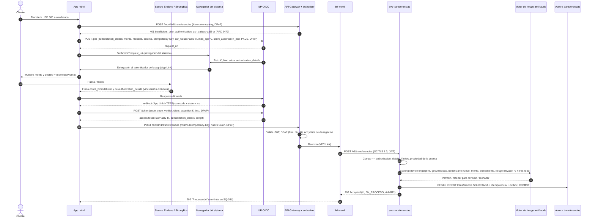
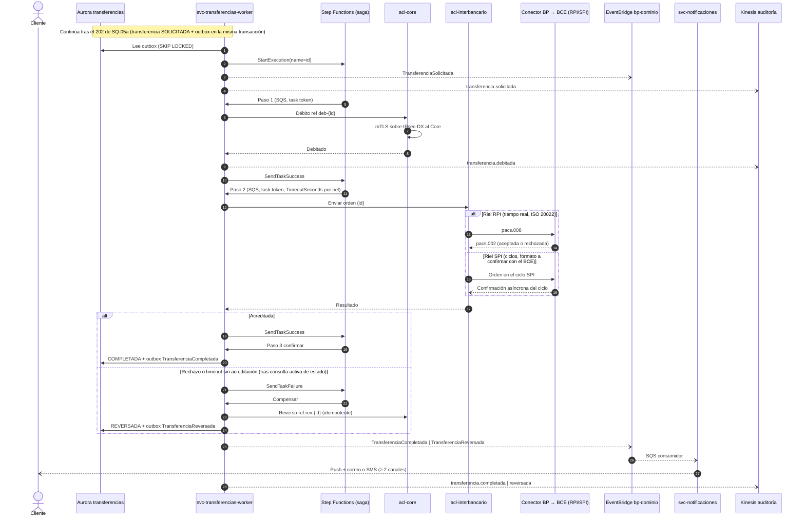
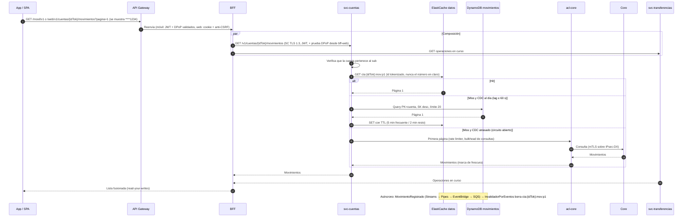

# 04 · Modelo C4 — especificación de diagramas

> **Proyecto:** Banca por internet BP (reto de arquitectura de solución).
> **Contenido:** diagramas C4 (especificación).
> **Fecha:** 2026-10-19 · **Estado:** versión final.
> **Entradas:** [`01-requisitos.md`](01-requisitos.md), [`adr/`](adr/README.md) (catálogo de servicios en ADR-001 §3), [`02-seguridad-y-normativa.md`](02-seguridad-y-normativa.md), [`03-nube-ha-dr-monitoreo-costos.md`](03-nube-ha-dr-monitoreo-costos.md) (decisiones de diseño de su §10).
> **Rúbrica cubierta:** #2 Calidad y profundidad de los diagramas C4 (aporta evidencia visual a #3–#8, #10–#15).
> **Uso:** este documento es la **fuente única** de cada diagrama. Quien dibuje (librería Python `diagrams`, módulo `diagrams.c4`, y Mermaid) no debe interpretar: cada caja, flecha, etiqueta y límite está aquí. Al terminar, el dibujo se valida contra la lista de comprobación de §8.

## Índice de diagramas

| ID | Diagrama | Nivel C4 | Audiencia | Herramienta | Archivo de salida sugerido |
|---|---|---|---|---|---|
| **DC-01** | Contexto del sistema | 1 · Contexto | Negocio, no técnica | `diagrams.c4` | `diagrams/png/01-contexto.png` |
| **DC-02** | Contenedores | 2 · Contenedores | Técnica (incluye nube AWS) | `diagrams.c4` | `diagrams/png/02-contenedores.png` |
| **DC-03a** | Componentes — `svc-transferencias` (+ *worker*, saga y `acl-interbancario`) | 3 · Componentes | Técnica | `diagrams.c4` | `diagrams/png/03a-componentes-transferencias.png` |
| **DC-03b** | Componentes — identidad de canal: *authorizer*, `bff-movil`, `svc-dispositivos` | 3 · Componentes | Técnica / seguridad | `diagrams.c4` | `diagrams/png/03b-componentes-identidad.png` |
| **DC-03c** | Componentes — consultas: `svc-cuentas` (CQRS) y clientes frecuentes | 3 · Componentes | Técnica | `diagrams.c4` | `diagrams/png/03c-componentes-consultas.png` |
| **DC-03d** | Componentes — `svc-auditoria` | 3 · Componentes | Técnica / auditoría | `diagrams.c4` | `diagrams/png/03d-componentes-auditoria.png` |
| **DC-03e** | Componentes — `svc-onboarding` (alta digital con reconocimiento facial) | 3 · Componentes | Técnica / seguridad / cumplimiento | Mermaid | `diagrams/png/03e-componentes-onboarding.png` |
| **DC-06** | Arquitectura interna de los canales (SPA Angular y app Flutter) | Complementario | Técnica / front | Mermaid | `diagrams/png/06-arquitectura-front-movil.png` |
| **DI-01** | Infraestructura AWS (despliegue), 5 láminas | Complementario | Técnica / operaciones | `diagrams` (íconos AWS) | `04` vista general, `04a` borde y entrada, `04a2` cómputo y datos, `04c` red híbrida y cuentas, `04b` DR (en `diagrams/png/`) — **contenido en `03` §7, no se repite aquí** (ver §4) |
| **SQ-01..07** | Secuencias | Complementario | Técnica | Mermaid | `diagrams/png/05-sq*.png` (ver §5) |

---

## 0. Convenciones comunes

### 0.1 Leyenda de colores (C4 estándar, la misma en todos los diagramas)

| Tipo C4 | Relleno | Texto | Forma | Uso |
|---|---|---|---|---|
| Person | `#08427B` | blanco | Persona | Actores humanos |
| Software System (en alcance) | `#1168BD` | blanco | Rectángulo | "Banca por Internet BP" |
| Software System existente de BP | `#6B7B8C` | blanco | Rectángulo | Core, sistema complementario, IdP, conector de pagos, SOC (no se construyen, pero son de BP) |
| External System (tercero) | `#999999` | blanco | Rectángulo | BCE, proveedores, Registro Civil, Apple/Google |
| Container (código propio) | `#438DD5` | blanco | Rectángulo | SPA, app, BFF, `svc-*`, `acl-*` |
| Container gestionado AWS | `#438DD5` con **borde discontinuo** | blanco | Rectángulo | CloudFront, API Gateway, Lambda, Step Functions, Firehose, Athena… |
| Database | `#438DD5` | blanco | Cilindro | Aurora, DynamoDB, ElastiCache, S3 |
| Queue / Stream | `#438DD5` | blanco | Rectángulo con texto "[Cola]" o "[Stream]" en la tecnología (en `diagrams.c4` no existe forma de cola: usar `Container` con `shape="cds"` si se ve bien, si no, rectángulo) | EventBridge, SQS, Kinesis |
| Component | `#85BBF0` | negro | Rectángulo | Componentes internos (nivel 3) |
| Boundary | sin relleno, borde gris discontinuo | gris oscuro | Marco | Límites de sistema, de dominio o de cuenta/región AWS |

Cada caja muestra tres líneas: **nombre**, **[tipo: tecnología]** y **descripción de una línea** (la de las tablas).

### 0.2 Convención de flechas

| Estilo | Significado |
|---|---|
| Línea **sólida** | Llamada **síncrona** (el llamador espera respuesta) |
| Línea **discontinua** | Mensaje **asíncrono** (evento, cola, *stream*) |
| Línea **punteada gris** | Replicación / DR (solo en DI-01) |
| Etiqueta | `Verbo en presente` + salto de línea + `[protocolo · seguridad]`. Ej.: "Consulta movimientos\n[HTTP/2 · TLS 1.3 Service Connect · JWT]" |

Abreviaturas permitidas en etiquetas: **SC** = ECS Service Connect (HTTP/2 + TLS 1.3, certificados de AWS Private CA de vida corta); **JWT** = *access token* propagado y re-validado (`aud`, *scopes*, propiedad del recurso); **DX** = Direct Connect; **mTLS/IPsec-DX** = mTLS de aplicación sobre IPsec sobre Direct Connect; **VPCE** = VPC *endpoint* (PrivateLink o *gateway*); **IAM** = firma SigV4 con rol de tarea.

### 0.3 Identificadores

`P*` personas · `S0` el sistema · `E*` externos (contexto) · `C*` contenedores · `D*` datos · `Q*` mensajería · `X*` externos (contenedores) · `R*` relaciones · componentes con prefijo del diagrama (`T*`, `I*`, `M*`, `A*`). La columna **Nodo 03 §7** enlaza cada contenedor con el nodo del diagrama de infraestructura.

---

## 1. DC-01 — Diagrama de contexto

**Propósito:** mostrar qué hace la banca por internet, quién la usa y con qué sistemas conversa, sin tecnología. **Audiencia:** directivos, negocio, cumplimiento.

### 1.1 Elementos

| ID | Nombre | Tipo C4 | Tecnología | Descripción (lenguaje de negocio) |
|---|---|---|---|---|
| P1 | Cliente persona natural | Person | — | Consulta sus cuentas y movimientos, transfiere y paga desde la web o la app |
| P2 | Persona que quiere ser cliente | Person | — | Abre su cuenta desde la app validando su identidad con su rostro y su cédula |
| P3 | Asesor del centro de contacto | Person | — | Atiende al cliente y bloquea teléfonos robados o perdidos |
| P4 | Auditor / oficial de cumplimiento | Person | — | Revisa el registro de todas las acciones de los clientes |
| S0 | **Banca por Internet BP** | Software System (en alcance) | — | Web y app del banco para consultar, transferir, pagar y abrir cuentas; avisa de cada movimiento y guarda un registro inalterable |
| E1 | Core bancario | Software System existente de BP | — | Fuente oficial de clientes, productos, saldos y movimientos; registra los débitos y créditos |
| E2 | Sistema complementario de datos del cliente | Software System existente de BP | — | Datos de detalle del cliente (contacto ampliado, preferencias) que se consultan solo cuando se necesitan |
| E3 | Servicio de identidad del banco (IdP OAuth 2.0 / OIDC) | Software System existente de BP | — | Producto que ya tiene BP: verifica la clave, la huella o la llave del dispositivo y emite los permisos de acceso |
| E4 | Conector de pagos de BP | Software System existente de BP | — | Enlace oficial del banco con la red de pagos del Banco Central |
| E5 | Banco Central del Ecuador — RPI y SPI | External System | — | Red que lleva el dinero a otros bancos: en segundos (RPI, hasta USD 15.000) o por ciclos (SPI) |
| E6 | Proveedor de verificación de identidad (biometría) | External System | — | Comprueba que la persona frente a la cámara está viva y coincide con la foto de su cédula |
| E7 | Registro Civil (DIGERCIC) | External System | — | Fuente oficial de identidad: confirma la cédula y la fotografía registrada |
| E8 | Listas de control KYC/AML | External System | — | Revisa que la persona no esté en listas de lavado de activos ni sanciones |
| E9 | Servicios de notificaciones *push* (Apple y Google) | External System | — | Entregan los avisos al teléfono del cliente |
| E10 | Servicios de correo electrónico y SMS (principal y alterno) | External System | — | Entregan avisos por correo y mensaje de texto; si uno falla, actúa el alterno |
| E11 | Verificación de integridad de la app (Apple App Attest / Google Play Integrity) | External System | — | Confirma que la app es la original y que el teléfono no fue alterado |
| E12 | Centro de operaciones de seguridad (SOC) de BP | Software System existente de BP | — | Recibe y atiende alertas de seguridad |

### 1.2 Relaciones

| ID | Origen → destino | Etiqueta (verbo) | Protocolo / seguridad (texto pequeño, opcional en DC-01) | Sínc./asínc. |
|---|---|---|---|---|
| R01 | P1 → S0 | Consulta movimientos, transfiere y paga | Web o app, conexión cifrada | Síncrono |
| R02 | P2 → S0 | Abre su cuenta con su rostro y su cédula | App móvil, conexión cifrada | Síncrono |
| R03 | P1 → E3 | Ingresa con clave, huella o llave del dispositivo en la página segura del banco | Conexión cifrada | Síncrono |
| R04 | P3 → S0 | Bloquea dispositivos robados del cliente | Red interna del banco con inicio de sesión corporativo | Síncrono |
| R05 | P4 → S0 | Consulta el registro de acciones de los clientes | Acceso con rol de auditor | Síncrono |
| R06 | S0 → E3 | Delega el inicio de sesión y valida los permisos | Estándar OAuth 2.0 / OpenID Connect | Síncrono |
| R07 | S0 → E1 | Lee datos, saldos y movimientos; registra débitos y créditos | Enlace privado cifrado | Síncrono (y copia continua de movimientos) |
| R08 | S0 → E2 | Pide el detalle del cliente cuando se necesita | Enlace privado cifrado | Síncrono |
| R09 | S0 → E4 | Envía transferencias a otros bancos | Enlace privado cifrado, estándar ISO 20022 | Asíncrono (se confirma después) |
| R10 | E4 → E5 | Liquida la transferencia con el otro banco | Red del Banco Central | Asíncrono |
| R11 | S0 → E6 | Verifica rostro y prueba de vida | Conexión cifrada | Síncrono |
| R12 | S0 → E7 | Confirma identidad con la fuente oficial | Conexión cifrada | Síncrono |
| R13 | S0 → E8 | Revisa listas de control | Conexión cifrada | Síncrono |
| R14 | S0 → E9 | Envía avisos *push* de cada movimiento | Conexión cifrada | Asíncrono |
| R15 | S0 → E10 | Envía avisos por correo y SMS (mínimo 2 canales por movimiento) | Conexión cifrada | Asíncrono |
| R16 | E9 → P1 | Entrega el aviso en el teléfono | — | Asíncrono |
| R17 | E10 → P1 | Entrega el correo o el SMS | — | Asíncrono |
| R18 | S0 → E11 | Comprueba que la app y el teléfono son confiables | Conexión cifrada | Síncrono |
| R19 | S0 → E12 | Reporta alertas de seguridad | Integración del SIEM | Asíncrono |

### 1.3 Límites

| Límite | Contiene |
|---|---|
| **Banco BP** (marco grande) | S0, E1, E2, E3, E4, E12 |
| **Terceros** (sin marco o marco gris claro) | E5–E11 |
| Fuera de marcos | P1–P4 |

### 1.4 Notas para el dibujante

- Distribución sugerida (izquierda → derecha): personas a la izquierda; S0 al centro, grande; sistemas de BP a la derecha dentro del marco "Banco BP"; terceros abajo (identidad: E6, E7, E8, E11) y arriba a la derecha (pagos y avisos: E5, E9, E10).
- **Sin nombres de tecnología** en las cajas (ni AWS, ni Angular, ni Flutter). La columna "Protocolo" se puede omitir en el dibujo; si se incluye, en fuente pequeña.
- R16 y R17 como flechas discontinuas que vuelven a P1 (muestran que el aviso llega al cliente).
- Tamaño de lienzo: horizontal A4; 17 cajas caben sin cruces si E5 queda a la derecha de E4.

### 1.5 Texto explicativo para el PDF

> La banca por internet de BP es una aplicación web y una app móvil desde las que el cliente consulta sus cuentas, transfiere y paga, y desde la que una persona nueva puede abrir su cuenta validando su rostro contra su cédula y el Registro Civil. La plataforma no reemplaza los sistemas del banco: lee y registra la información en el Core, pide el detalle al sistema complementario solo cuando hace falta y delega el inicio de sesión al servicio de identidad que BP ya posee. Las transferencias a otros bancos salen por el conector de pagos de BP hacia las redes del Banco Central (inmediata o por ciclos). Cada movimiento se avisa por al menos dos canales (push, correo o SMS, con proveedor alterno) y toda acción queda en un registro que nadie puede modificar, consultable por auditoría. El centro de contacto puede bloquear al instante un teléfono robado sin afectar los demás dispositivos del cliente.

---

## 2. DC-02 — Diagrama de contenedores

**Propósito:** mostrar las aplicaciones, servicios, bases de datos y mensajería que componen la solución, su tecnología, dónde corren en AWS y cómo se comunican (protocolo y seguridad en cada flecha). **Audiencia:** arquitectos, equipos de desarrollo, operaciones y seguridad.

### 2.1 Elementos

**Personas y sistemas externos** (mismos que DC-01, en gris):

| ID | Nombre | Tipo C4 | Tecnología | Descripción | Nodo 03 §7 |
|---|---|---|---|---|---|
| P1 | Cliente persona natural | Person | — | Usa web y app | N01, N02 |
| P2 | Persona que quiere ser cliente | Person | — | Onboarding en la app | N02 |
| P3 | Asesor del centro de contacto | Person | — | Revocación asistida de dispositivos | — |
| P4 | Auditor | Person | — | Consulta auditoría | — |
| X01 | Core bancario (+ réplica para CDC) | Software System existente de BP | On-premise; REST/SOAP/mensajería interna | Fuente de verdad; réplica/standby legible por CDC (S-27) | N82 |
| X02 | Sistema complementario | Software System existente de BP | REST (on-prem o SaaS) | Detalle del cliente bajo demanda | N83 |
| X03 | IdP OAuth 2.0 / OIDC de BP | Software System existente de BP | OIDC: PAR, DCR, DPoP, RAR, SCIM | Autentica y emite *tokens* ligados | N86 |
| X04 | Conector de pagos BP | Software System existente de BP | ISO 20022 | Puerta hacia RPI/SPI | N84 |
| X05 | BCE — RPI / SPI | External System | `pacs.008` / `pacs.002` | Liquidación interbancaria | N85 |
| X06 | Proveedor IDV (FacePhi recomendado) | External System | HTTPS API + SDK móvil | *Liveness* + 1:1 | N87 |
| X07 | Registro Civil (DIGERCIC) | External System | Servicio web | Validación demográfica y biométrica | N88 |
| X08 | Listas KYC/AML | External System | HTTPS API | Revisión de listas | — (egress N47) |
| X09 | FCM / APNs | External System | HTTPS | Entrega *push* | N90 |
| X10 | Proveedor alterno de SMS/correo | External System | HTTPS API | Respaldo de notificaciones | N89 |
| X11 | Apple App Attest / Google Play Integrity | External System | HTTPS | Verificación de atestación | N91 |
| X12 | SIEM / SOC de BP | Software System existente de BP | Integración SIEM | Recibe hallazgos y alertas | N58 |

**Contenedores de la solución** (agrupados por *boundary*; todo lo que no es cliente ni externo va dentro del marco **"AWS · cuenta prod · us-east-1"**, salvo B7, que va en el marco **"AWS · cuenta log-archive"**):

| ID | Boundary | Nombre | Tipo C4 | Tecnología | Descripción (1 línea) | Nodo 03 §7 |
|---|---|---|---|---|---|---|
| C01 | Clientes (fuera de AWS) | SPA banca web | Container | Angular, monorepo Nx, *lazy loading* | Interfaz web; no guarda *tokens* (solo cookie `__Host-sid`) | N01 |
| C02 | Clientes (fuera de AWS) | App móvil | Container | Flutter + módulo nativo de seguridad (Secure Enclave/StrongBox, DPoP, RASP, *pinning*) | Cliente OAuth por instancia; onboarding con SDK IDV | N02 |
| C03 | B1 Borde | CloudFront + AWS WAF + Shield Advanced | Container gestionado | CloudFront, WAF (Bot Control, ATP, ACFP, *rate-based*), Shield Adv. | CDN y protección perimetral de SPA y API | N05–N07 |
| C04 | B1 Borde | Bucket `spa-web` | Database | S3 (OAC, cifrado KMS) | Estáticos de la SPA | N18 |
| C05 | B1 Borde | API Gateway | Container gestionado | API Gateway REST regional + WAF regional, *usage plans* | Puerta única de la API; *throttling*, validación de esquema, enrutamiento `/web/v1`, `/movil/v1` | N10 |
| C06 | B1 Borde | *Lambda authorizer* | Container gestionado | AWS Lambda ARM64 (Node.js/Go), en VPC | Valida JWT, DPoP, `acr` (*step-up*) y lista de denegación; modo *fail-static* | N11 |
| C07 | B2 Canales/BFF | `bff-web` | Container | Java 21 / Spring Boot, ECS Fargate | BFF web y *token handler* (cliente OAuth confidencial) | N25 |
| C08 | B2 Canales/BFF | `bff-movil` | Container | Java 21 / Spring Boot, ECS Fargate | BFF móvil: agregación, atestación y registro DCR; inactividad 2 min | N26 |
| C09 | B3 Dominio · Clientes | `svc-clientes` | Container | Java 21 / Spring Boot, ECS Fargate | Datos básicos (Core) y detalle (complementario); detector de clientes frecuentes | N28 |
| C10 | B3 Dominio · Cuentas | `svc-cuentas` | Container | Java 21 / Spring Boot, ECS Fargate | API de lectura CQRS: posición, saldos y movimientos | N29 |
| C11 | B3 Dominio · Cuentas | `svc-cuentas-proyector` | Container | Java 21 / Spring Boot (KCL), ECS Fargate | Proyecta el CDC del Core al modelo de lectura | N30 |
| C12 | B3 Dominio · Transferencias | `svc-transferencias` | Container | Java 21 / Spring Boot, ECS Fargate | Comando de transferencia/pago, idempotencia, RAR, beneficiarios frecuentes | N31 |
| C13 | B3 Dominio · Transferencias | `svc-transferencias-worker` | Container | Java 21 / Spring Boot, ECS Fargate | *Relay* de outbox y *workers* de la saga | N32 |
| C14 | B3 Dominio · Transferencias | Saga interbancaria | Container gestionado | AWS Step Functions Standard | Coordina débito → envío por riel → confirmación / compensación | N17 |
| C15 | B3 Dominio · Notificaciones | `svc-notificaciones` | Container | Java 21 / Spring Boot, ECS Fargate | Envío multicanal (Strategy + Adapter) con proveedor alterno | N33 |
| C16 | B3 Dominio · Identidad | `svc-onboarding` | Container | Java 21 / Spring Boot, ECS Fargate | Expediente de alta digital (IDV, Registro Civil, KYC/AML, alta en IdP) | N35 |
| C17 | B3 Dominio · Identidad | `svc-dispositivos` | Container | Java 21 / Spring Boot, ECS Fargate | Política de dispositivos (máx. 3), revocación y lista de denegación (§10 del documento 03) | N27 |
| C18 | B4 Integración/ACL | `acl-core` | Container | Java 21 / Spring Boot, ECS Fargate | ACL hacia el Core; presupuesto de TPS, *pools* separados, *circuit breaker* | N36 |
| C19 | B4 Integración/ACL | `acl-complementario` | Container | Java 21 / Spring Boot, ECS Fargate | ACL hacia el sistema complementario; caché 24 h | N37 |
| C20 | B4 Integración/ACL | `acl-interbancario` | Container | Java 21 / Spring Boot, ECS Fargate | ACL de pagos: estrategias de riel RPI/SPI, traducción ISO 20022 | N38 |
| D01 | B5 Datos | BD `transferencias` | Database | Aurora PostgreSQL Multi-AZ + Global Database | Transferencias, idempotencia, outbox, beneficiarios | N39 |
| D02 | B5 Datos | BD `plataforma` (base `onboarding`) | Database | Aurora PostgreSQL `db.r8g.large` | Expedientes y outbox de onboarding | N40 |
| D03 | B5 Datos | Tabla `movimientos` | Database | DynamoDB on-demand, Global Table, TTL 13 meses | Modelo de lectura CQRS | N12 |
| D04 | B5 Datos | Tabla `perfil-digital` | Database | DynamoDB Global Table | Alias, contacto digital, marca de frecuencia | N12 |
| D05 | B5 Datos | Tablas `notificaciones` y `preferencias` | Database | DynamoDB Global Table | Estado de entregas y canales elegidos | N12 |
| D06 | B5 Datos | Tabla `dispositivos` | Database | DynamoDB Global Table | Instancias registradas y revocadas | N12 |
| D07 | B5 Datos | Caché de datos | Database | ElastiCache for Valkey, *cluster mode*, Multi-AZ | Cache-Aside / Refresh-Ahead de clientes frecuentes | N41 |
| D08 | B5 Datos | Caché de seguridad | Database | ElastiCache for Valkey, 3 nodos, Global Datastore | Sesiones web, `jti` DPoP, lista de denegación | N42 |
| D09 | B5 Datos | Bucket `kyc-evidencias` | Database | S3 + KMS dedicada (Macie) | Evidencia mínima KYC (*claim check*) | N18 |
| Q01 | B6 Plataforma de eventos | Bus `bp-dominio` | Queue (bus) | EventBridge + *schema registry* + Pipes | Eventos de dominio CloudEvents 1.0 | N15 |
| Q02 | B6 Plataforma de eventos | Colas de consumidores | Queue | SQS + DLQ por consumidor | Nivelación de carga hacia cada consumidor | N16 |
| Q03 | B6 Plataforma de eventos | Colas de tareas de la saga | Queue | SQS (`.waitForTaskToken`) | Tareas de Step Functions para el *worker* | N16 |
| Q04 | B6 Plataforma de eventos | Stream `cdc-movimientos` | Queue (stream) | Kinesis Data Streams on-demand (partición = cuenta) | Cambios del Core en orden por cuenta | N13 |
| Q05 | B6 Plataforma de eventos | Replicación CDC | Container gestionado | AWS DMS Multi-AZ | Lee el *log* de la réplica del Core | N21 |
| Q06 | B7 Auditoría | Stream `auditoria` | Queue (stream) | Kinesis Data Streams (partición = cliente) | Ingesta de eventos de auditoría | N13 |
| C21 | B7 Auditoría | `svc-auditoria` | Container | Java 21 / Spring Boot (KCL), ECS Fargate (cuenta prod) | Valida, minimiza y encadena SHA-256 | N34 |
| C22 | B7 Auditoría | Entrega a S3 | Container gestionado | Amazon Data Firehose (Parquet) | Escribe lotes en el almacén WORM | N14 |
| D10 | B7 Auditoría | Almacén de auditoría | Database | S3 Object Lock Compliance 10 años → Glacier Deep Archive (cuenta log-archive) | Registro inmutable | N52 |
| D11 | B7 Auditoría | Sellos Merkle | Database | S3 Object Lock | Raíces horarias firmadas | N53 |
| C23 | B7 Auditoría | Sellador horario | Container gestionado | Lambda + KMS asimétrica | Firma la raíz Merkle de cada hora | N56 |
| C24 | B7 Auditoría | Consulta de auditoría | Container gestionado | Athena + Glue Catalog + Lake Formation | Consulta con PII enmascarada | N54 |
| C25 | B8 Envío gestionado | Correo | Container gestionado | Amazon SES (SPF, DKIM, DMARC) | Canal correo primario | N20 |
| C26 | B8 Envío gestionado | SMS y *push* | Container gestionado | AWS End User Messaging | SMS primario y *push* alterno | N20 |
| C27 | B9 Transversal | Observabilidad | Container gestionado | ADOT (sidecar) → CloudWatch, Application Signals, X-Ray, Managed Grafana, Synthetics, RUM | Métricas, *logs*, trazas, SLO | N59–N63 |
| C28 | B9 Transversal | Seguridad de plataforma | Container gestionado | KMS, Secrets Manager, Private CA, GuardDuty, Security Hub | Llaves, secretos, certificados, detección | N19, N57 |

Total DC-02: **4 personas + 12 externos + 46 contenedores/datos/colas = 62 elementos.**

### 2.2 Relaciones

| ID | Origen → destino | Etiqueta | Protocolo · seguridad | Sínc./asínc. |
|---|---|---|---|---|
| R01 | P1 → C01 | Usa la banca web | HTTPS (navegador) | Síncrono |
| R02 | P1, P2 → C02 | Usa la app / abre su cuenta | — (app instalada) | Síncrono |
| R03 | C01 → C03 | Descarga la SPA y llama `/web/v1/*` | HTTPS TLS 1.3 (1.2 mín.) · HSTS · cookie `__Host-sid` (HttpOnly, Secure, SameSite) + cabecera anti-CSRF | Síncrono |
| R04 | C02 → C03 | Llama `/movil/v1/*` | HTTPS TLS 1.3 · *pinning* de llave pública · `Authorization: DPoP` + prueba DPoP | Síncrono |
| R05 | C03 → C04 | Sirve estáticos | HTTPS · OAC (SigV4) | Síncrono |
| R06 | C03 → C05 | Reenvía la API | HTTPS TLS 1.3 · cabecera secreta de origen rotada · WAF regional | Síncrono |
| R07 | C05 → C06 | Delega la autorización de cada solicitud | Invocación Lambda (IAM) | Síncrono |
| R08 | C06 → D08 | Verifica `jti` DPoP y lista de denegación | Valkey TLS + AUTH · *timeout* ≤ 30 ms · copia en memoria (15–30 s) · *fail-static* | Síncrono |
| R09 | C06 → X03 | Obtiene llaves públicas (JWKS) | HTTPS TLS 1.3 · caché en memoria | Síncrono (cacheado) |
| R10 | C05 → C07 | Enruta `/web/v1/*` | VPC Link V2 → ALB interno · TLS 1.3 | Síncrono |
| R11 | C05 → C08 | Enruta `/movil/v1/*` | VPC Link V2 → ALB interno · TLS 1.3 | Síncrono |
| R12 | C07 → X03 | Inicia sesión como cliente confidencial (PAR, *token*, *refresh*) | HTTPS TLS 1.3 · `private_key_jwt` (llave en KMS) · DPoP · PKCE · por DX (on-prem) o egress inspeccionado (SaaS) | Síncrono |
| R13 | C07 → D08 | Guarda sesión, *tokens* y llave DPoP efímera cifrados | Valkey TLS + AUTH/RBAC | Síncrono |
| R14 | C02 → X03 | Autentica la instancia (PAR, `/authorize`, `/token`) | HTTPS TLS 1.3 · PKCE · `private_key_jwt` con `K_inst` · DPoP | Síncrono |
| R15 | C08 → X11 | Verifica la atestación de la app | HTTPS TLS 1.3 · egress con lista blanca | Síncrono |
| R16 | C08 → C17 | Pide autorizar el alta / revocar una instancia | SC · JWT | Síncrono |
| R17 | C08 → X03 | Registra la instancia (DCR, RFC 7591) | HTTPS TLS 1.3 · *initial access token* · *software statement* firmado (KMS) | Síncrono |
| R18 | C07 → C17 | Gestiona "Mis dispositivos" (web) | TLS 1.3 (SC) + JWT + DPoP · *step-up* | Síncrono |
| R19 | P3 → C17 | Revoca instancias tras verificar identidad | API de *backoffice* solo por red corporativa/DX · SSO corporativo + MFA (S-32; consola fuera de alcance) | Síncrono |
| R20 | C17 → D06 | Lee y escribe instancias | HTTPS · VPCE *gateway* · IAM | Síncrono |
| R21 | C17 → D08 | Escribe la lista de denegación (TTL = vida del *token*) | Valkey TLS + AUTH | Síncrono |
| R22 | C17 → X03 | Borra el cliente (RFC 7592) y revoca *refresh* (RFC 7009) | HTTPS TLS 1.3 · `private_key_jwt` | Síncrono |
| R23 | C07, C08 → C09 | Consulta datos del cliente | TLS 1.3 (SC) + JWT + DPoP desde C07 (`jti` en D08) · SC + JWT desde C08 (DPoP validado en C06) | Síncrono |
| R24 | C07, C08 → C10 | Consulta posición, saldos y movimientos | TLS 1.3 (SC) + JWT + DPoP desde C07 (`jti` en D08) · SC + JWT desde C08 (DPoP validado en C06) | Síncrono |
| R25 | C07, C08 → C12 | Solicita transferencia/pago y consulta su estado | TLS 1.3 (SC) + JWT con `authorization_details` + DPoP desde C07 · SC + JWT desde C08 (DPoP validado en C06) · `Idempotency-Key` | Síncrono |
| R26 | C08 → C16 | Gestiona el expediente de onboarding | SC · JWT de onboarding ligado a `jkt` | Síncrono |
| R27 | C09 → C18 | Pide datos básicos y productos | SC · token de servicio (`client_credentials` + `private_key_jwt`) | Síncrono |
| R28 | C09 → C19 | Pide detalle del cliente | SC · token de servicio | Síncrono |
| R29 | C09 → D04, D07 | Lee/escribe perfil digital y caché | VPCE · IAM / Valkey TLS + RBAC | Síncrono |
| R30 | C10 → D03 | Lee movimientos proyectados | HTTPS · VPCE · IAM | Síncrono |
| R31 | C10 → D07 | Lee/escribe caché (Cache-Aside, Refresh-Ahead) | Valkey TLS + RBAC | Síncrono |
| R32 | C10 → C18 | Pide saldos; primera página si el CDC se atrasa | SC · token de servicio | Síncrono |
| R33 | C12 → D01 | Guarda transferencia + idempotencia + outbox (una transacción) | PostgreSQL TLS · IAM auth | Síncrono |
| R34 | C12 → C18 | Contabiliza propias/terceros BP (asiento único, referencia única) | SC · token de servicio | Síncrono |
| R35 | C13 → D01 | Lee outbox (`SKIP LOCKED`) y actualiza estados | PostgreSQL TLS · IAM auth | Síncrono |
| R36 | C13 → C14 | Inicia la saga (`StartExecution`, nombre = id) y devuelve resultados de tareas | API AWS · VPCE · IAM | Síncrono |
| R37 | C14 → Q03 | Encola cada paso con *task token* | API AWS · IAM | Asíncrono |
| R38 | Q03 → C13 | Entrega tareas al *worker* | SQS long polling · IAM | Asíncrono |
| R39 | C13 → C18 | Débito / reverso de la saga (`deb-{id}`, `rev-{id}`) | SC · token de servicio | Síncrono |
| R40 | C13 → C20 | Envía la orden interbancaria por el riel elegido | SC · token de servicio | Síncrono (confirmación asíncrona) |
| R41 | C18 → X01 | Consulta y contabiliza | **mTLS** sobre **IPsec sobre DX** (2 DX + VPN de respaldo) | Síncrono |
| R42 | C19 → X02 | Consulta detalle | mTLS sobre IPsec-DX (on-prem) o HTTPS TLS 1.3 por egress (SaaS) | Síncrono |
| R43 | C20 → X04 | Envía `pacs.008` y recibe `pacs.002` | mTLS sobre IPsec-DX · ISO 20022 | Asíncrono (*callback*) |
| R44 | X04 → X05 | Liquida en RPI o SPI | Red del BCE (fuera de AWS) | Asíncrono |
| R45 | X01 → Q05 | Entrega el *log* transaccional de la réplica | TLS a la BD de la réplica por DX | Asíncrono (CDC) |
| R46 | Q05 → Q04 | Publica cambios ordenados por cuenta | API Kinesis · VPCE · IAM | Asíncrono |
| R47 | Q04 → C11 | Entrega cambios al proyector | KCL · IAM | Asíncrono |
| R48 | C11 → D03 | Escribe la proyección (idempotente por secuencia) | HTTPS · VPCE · IAM | Síncrono |
| R49 | D03 → Q01 | Publica `MovimientoRegistrado` | DynamoDB Streams → EventBridge Pipes · CloudEvents 1.0 | Asíncrono |
| R50 | C13 → Q01 | Publica eventos de transferencia (`bp.transferencias.*.v1`) | API EventBridge · VPCE · CloudEvents 1.0 + `traceparent` | Asíncrono |
| R51 | C16, C17 → Q01 | Publican `onboarding.*` (outbox) y `auth.device.*` (Streams + Pipes) | CloudEvents 1.0 | Asíncrono |
| R52 | Q01 → Q02 | Enruta por patrón de evento a la cola de cada consumidor | Reglas EventBridge | Asíncrono |
| R53 | Q02 → C15 | Entrega eventos a notificar | SQS + DLQ | Asíncrono |
| R54 | Q02 → C09, C10 | Entrega eventos de invalidación de caché y `auth.login.succeeded` (frecuencia) | SQS + DLQ | Asíncrono |
| R55 | C15 → D05 | Registra estado de cada envío | VPCE · IAM | Síncrono |
| R56 | C15 → C25 | Envía correos | API SES · VPCE | Síncrono |
| R57 | C15 → C26 | Envía SMS y *push* alterno | API End User Messaging · VPCE | Síncrono |
| R58 | C15 → X09 | Envía *push* primario | HTTPS TLS 1.3 · egress con lista blanca | Síncrono |
| R59 | C15 → X10 | Conmuta al proveedor alterno (*circuit breaker*) | HTTPS TLS 1.3 · egress con lista blanca | Síncrono |
| R60 | C25, C26, X09, X10 → P1 | Entregan el aviso | Correo / SMS / *push* | Asíncrono |
| R61 | C16 → D02, D09 | Guarda expediente; guarda evidencia KYC (*claim check*) | PostgreSQL TLS + IAM / S3 SSE-KMS dedicada | Síncrono |
| R62 | C16 → X06, X07, X08 | Verifica *liveness* + 1:1, identidad oficial y listas | HTTPS TLS 1.2+ · credenciales en Secrets Manager · egress con lista blanca | Síncrono |
| R63 | C16 → X03 | Crea el usuario (SCIM/API de administración) | HTTPS TLS 1.3 · `private_key_jwt` | Síncrono |
| R64 | B2, B3 (todos los `bff-*`/`svc-*`), X03 → Q06 | Emiten eventos de auditoría (outbox en transaccionales; librería con búfer en lecturas) | API Kinesis · VPCE · IAM | Asíncrono |
| R65 | Q06 → C21 | Entrega eventos (partición = cliente) | KCL · IAM | Asíncrono |
| R66 | C21 → C22 → D10 | Entrega lotes encadenados al almacén WORM | Firehose cross-account · SSE-KMS · Object Lock | Asíncrono |
| R67 | C23 → D11 | Firma y guarda la raíz Merkle horaria | KMS `Sign` (asimétrica) · Object Lock | Asíncrono (programado) |
| R68 | P4 → C24 → D10 | Consulta la auditoría | IAM Identity Center + MFA · Lake Formation (PII enmascarada) | Síncrono |
| R69 | C06, C27 → X12 | Reporta `auth.degraded_mode` y hallazgos de seguridad | Métrica/alarma P1 → EventBridge → SIEM | Asíncrono |

Total DC-02: **69 relaciones** (R64 y R60 se dibujan como una flecha desde el *boundary*, no una por servicio).

### 2.3 Límites (*boundaries*)

| Límite | Tipo | Contiene |
|---|---|---|
| **Clientes** | Límite lógico (fuera de AWS) | P1, P2, C01, C02 |
| **AWS · cuenta prod · us-east-1** (marco exterior; leyenda: "3 AZ; DR *warm standby* en us-east-2, ver DI-01") | Límite de despliegue | B1–B6, B8, B9 y C21 |
| B1 **Borde** | Sub-límite | C03, C04, C05, C06 |
| B2 **Canales / BFF** | Sub-límite | C07, C08 |
| B3 **Dominio** (con sub-marcos por *bounded context*: Clientes, Cuentas, Transferencias, Notificaciones, Identidad) | Sub-límite | C09–C17 |
| B4 **Integración / ACL** | Sub-límite | C18, C19, C20 |
| B5 **Datos** (cada base junto a su dueño si el dibujo lo permite; si no, en esta franja con el nombre del dueño en la descripción) | Sub-límite | D01–D09 |
| B6 **Plataforma de eventos** | Sub-límite | Q01–Q05 |
| B7 **Auditoría** (Q06 y C21 en cuenta prod; C22–C24, D10, D11 en el marco **"AWS · cuenta log-archive"**) | Sub-límite + límite de cuenta | Q06, C21–C24, D10, D11 |
| B8 **Envío gestionado** | Sub-límite | C25, C26 |
| B9 **Transversal** (franja inferior, sin flechas individuales) | Sub-límite | C27, C28 |
| **On-premise BP** | Límite externo | X01, X02, X03 (si es on-prem), X04, X12 |
| **Terceros** | Límite externo | X05–X11 |

### 2.4 Notas para el dibujante

- Orientación **izquierda → derecha**: Clientes → Borde → Canales → Dominio → Integración/ACL → On-premise; Datos debajo de Dominio; Plataforma de eventos y Auditoría en la franja inferior; Terceros a la derecha arriba (identidad y notificaciones).
- **Legibilidad:** 62 elementos no caben legibles en una sola página A4. Producir **dos láminas** con los mismos IDs: **DC-02a "Flujo de solicitudes"** (Clientes, B1, B2, B3, B4, B5, On-premise, R01–R48 excepto eventos) y **DC-02b "Eventos, notificaciones y auditoría"** (B3 resumido, B6, B7, B8, terceros de notificación, R45–R69). Además, una **DC-02 completa** en A3 para el anexo.
- C27 y C28 sin flechas: nota al pie "Todos los contenedores envían telemetría OTLP (sidecar ADOT) a C27 y usan C28 para llaves y secretos".
- El ALB interno, NAT, Network Firewall, Transit Gateway y Direct Connect **no** se dibujan aquí (son infraestructura, DI-01); se mencionan en la etiqueta de la flecha.
- Flechas a X03 desde varios contenedores (R09, R12, R14, R17, R22, R63): agrupar entrando por un mismo lado de X03.
- Usar el color "Container gestionado" (borde discontinuo) para C03, C05, C06, C14, C22–C28, Q05.

### 2.5 Texto explicativo para el PDF

> La solución corre en AWS (us-east-1, tres zonas de disponibilidad, con réplica tibia en us-east-2). El tráfico de la SPA Angular y de la app Flutter entra solo por CloudFront con WAF y Shield, pasa por API Gateway —donde un *Lambda authorizer* valida el *token*, la prueba DPoP, el nivel de autenticación y la lista de denegación de dispositivos— y llega a un BFF por canal: `bff-web` custodia los *tokens* de la SPA (el navegador solo tiene una cookie `HttpOnly`) y `bff-movil` atesta la app y registra cada instalación en el IdP. Los BFF componen respuestas a partir de microservicios por *bounded context* (clientes, cuentas, transferencias, notificaciones, onboarding y dispositivos), cada uno con su propia base. Ningún microservicio habla directamente con sistemas de BP o terceros: lo hacen los ACL, con mTLS sobre IPsec por Direct Connect y presupuesto de capacidad para proteger al Core. Lo que no requiere respuesta inmediata viaja por eventos (EventBridge + SQS con DLQ): notificaciones por al menos dos canales, invalidación de caché y auditoría. Los movimientos se leen de una proyección CQRS alimentada por CDC del Core, y la auditoría termina en S3 Object Lock en una cuenta aislada, sellada criptográficamente cada hora.

---

## 3. DC-03 — Diagramas de componentes

### 3.1 DC-03a — `svc-transferencias` (API, *worker*, saga) y `acl-interbancario`

**Propósito:** mostrar cómo se recibe una transferencia de forma segura e idempotente y cómo se coordina la interbancaria sin dobles débitos. **Audiencia:** equipo de transferencias, arquitectura, auditoría de riesgos.

#### Elementos

| ID | Nombre | Tipo C4 | Tecnología | Descripción | Patrón |
|---|---|---|---|---|---|
| — | `bff-web` / `bff-movil` | Container (vecino) | Spring Boot | Llamadores | BFF |
| T01 | `TransferenciasController` | Component | Spring Web MVC, OpenAPI 3.1 | `POST /v1/transferencias`, `GET /v1/transferencias/{id}` | — |
| T02 | `FiltroSeguridadJwt` | Component | Spring Security Resource Server | Re-valida firma, `aud`, *scopes* y que la cuenta origen pertenece al `sub` | Zero trust · defensa BOLA (OWASP API1) |
| T03 | `ValidadorAutorizacionRar` | Component | Java | Exige `acr` mínimo por tipo y que el cuerpo coincida con `authorization_details` (monto, moneda, destino, `Idempotency-Key`) | Vinculación dinámica (RFC 9396) |
| T04 | `ServicioIdempotencia` | Component | Java + tabla `idempotencia` | Misma clave + mismo *hash* ⇒ respuesta guardada; otro *hash* ⇒ 422; en curso ⇒ 409 | Idempotency Key |
| T05 | `IniciarTransferenciaUseCase` | Component | Java (capa de aplicación, hexagonal) | Valida límites y beneficiario; abre la transacción local | Puertos y adaptadores |
| T06 | `SelectorEstrategiaTransferencia` | Component | Java | `PropiaStrategy`, `TerceroBpStrategy`, `PagoProductoStrategy`, `InterbancariaStrategy` | **Strategy** |
| T07 | `RepositorioTransferencias` | Component | Spring Data JDBC | Persiste transferencia, idempotencia y beneficiarios frecuentes | Repository |
| T08 | `OutboxWriter` | Component | Java (misma transacción) | Inserta el evento en la tabla `outbox` junto con el cambio de negocio | **Transactional Outbox** |
| T09 | `ClienteCoreResiliente` (API) | Component | Resilience4j (*timeout* 3 s, *circuit breaker*, *bulkhead* de contabilización) | Contabiliza propias en asiento único con referencia = id; *timeout* ⇒ `EN_VERIFICACION` y consulta por referencia | **Circuit Breaker**, Bulkhead, sin reintento ciego |
| T10 | `OutboxRelay` | Component (en *worker*) | Java, `SELECT … FOR UPDATE SKIP LOCKED` | Publica eventos al bus y a auditoría; inicia la saga con `StartExecution(name = id)` | **Polling Publisher** |
| T11 | `SagaInterbancaria` | Component gestionado | Step Functions Standard (`TimeoutSeconds` por riel, *heartbeat*) | Débito → envío → confirmación; compensación con reverso | **Saga orquestada** |
| T12 | `WorkerTareasSaga` | Component (en *worker*) | Java, consumidor SQS `.waitForTaskToken` | Ejecuta cada paso y devuelve `SendTaskSuccess/Failure`; actualiza el estado | Competing Consumers |
| T13 | `ClienteCoreResiliente` (*worker*) | Component | Resilience4j | Débito `deb-{id}` y reverso `rev-{id}` idempotentes | Circuit Breaker, Retry con *backoff* + *jitter* (solo idempotentes) |
| T14 | `ClienteInterbancarioResiliente` | Component | Resilience4j (*timeout* 5 s) | Llama a `acl-interbancario` | Circuit Breaker |
| T15 | `ColaIntervencionManual` | Component | SQS + alarma P1 | Compensaciones que agotaron reintentos (nunca se descartan) | Dead Letter Channel |
| T16 | `ApiPagos` (`acl-interbancario`) | Component | Spring Web | Contrato canónico interno de orden de pago | **Anti-Corruption Layer** |
| T17 | `SelectorRiel` | Component | Java | RPI si monto ≤ USD 15.000 y destino adherido; si no, SPI; RPI → SPI solo antes de enviar | **Strategy** |
| T18 | `RielRpiStrategy` / `RielSpiStrategy` | Component | Java | Implementan envío y consulta de estado por riel | Strategy |
| T19 | `TraductorIso20022` | Component | Java (JAXB / esquemas ISO 20022) | Canónico ⇄ `pacs.008` / `pacs.002` | **Adapter**, Message Translator (EIP) |
| T20 | `AdaptadorConectorPagos` | Component | Cliente HTTP mTLS (certificado de Private CA) | Envía al conector de pagos de BP y recibe *callbacks* | Adapter |
| D01 | BD `transferencias` | Database | Aurora PostgreSQL | Tablas `transferencias`, `idempotencia`, `outbox`, `beneficiarios` | Database per Service |
| Q01 | Bus `bp-dominio` | Queue | EventBridge | Eventos `bp.transferencias.*.v1` | Publish-Subscribe |
| Q06 | Stream `auditoria` | Queue | Kinesis | Eventos de auditoría | — |
| Q03 | Colas de tareas | Queue | SQS | Pasos de la saga | — |
| C18 | `acl-core` | Container (vecino) | Spring Boot | ACL al Core | ACL |
| X04 | Conector de pagos BP | External | ISO 20022 | → BCE | — |

#### Relaciones

| ID | Origen → destino | Etiqueta | Protocolo · seguridad | Sínc./asínc. |
|---|---|---|---|---|
| RT01 | BFF → T01 | Envía la solicitud con `Idempotency-Key` | SC (HTTP/2 + TLS 1.3) · JWT con `authorization_details` | Síncrono |
| RT02 | T01 → T02 | Autentica y autoriza el recurso | En proceso | Síncrono |
| RT03 | T01 → T03 | Verifica `acr` y coincidencia RAR | En proceso | Síncrono |
| RT04 | T01 → T04 | Reserva la clave de idempotencia | En proceso | Síncrono |
| RT05 | T04 → T05 | Ejecuta el caso de uso | En proceso | Síncrono |
| RT06 | T05 → T06 | Elige la estrategia por tipo | En proceso | Síncrono |
| RT07 | T05 → T07, T08 | Guarda transferencia + outbox en una transacción | JDBC · PostgreSQL TLS · IAM auth → D01 | Síncrono |
| RT08 | T06 (Propia/TerceroBp/PagoProducto) → T09 → C18 | Contabiliza en asiento único | SC · token de servicio | Síncrono (`201`) |
| RT09 | T06 (Interbancaria) → T01 | Responde `202 Accepted` con estado `EN_PROCESO` | — | Síncrono |
| RT10 | T10 → D01 | Lee eventos pendientes | PostgreSQL TLS · `SKIP LOCKED` | Síncrono |
| RT11 | T10 → Q01, Q06 | Publica eventos de dominio y de auditoría | CloudEvents 1.0 · VPCE · IAM | Asíncrono |
| RT12 | T10 → T11 | Inicia la saga (idempotente por nombre) | API Step Functions · VPCE · IAM | Síncrono |
| RT13 | T11 → Q03 → T12 | Encola y entrega cada paso con *task token* | SQS · IAM | Asíncrono |
| RT14 | T12 → T13 → C18 | Débito / reverso | SC · token de servicio | Síncrono |
| RT15 | T12 → T14 → T16 | Envía la orden por riel | SC · token de servicio | Síncrono |
| RT16 | T16 → T17 → T18 → T19 → T20 | Selecciona riel, traduce y envía | En proceso | Síncrono |
| RT17 | T20 → X04 | Envía `pacs.008`; recibe `pacs.002` | **mTLS sobre IPsec-DX** | Asíncrono (*callback*) |
| RT18 | T12 → T11 | Devuelve resultado del paso | `SendTaskSuccess/Failure` · IAM | Síncrono |
| RT19 | T12 → D01 | Actualiza estado y escribe outbox (`TransferenciaCompletada/Reversada`) | PostgreSQL TLS | Síncrono |
| RT20 | T11 → T15 | Deriva compensación agotada a intervención manual | SQS + alarma P1 | Asíncrono |

Límites: **`svc-transferencias` (API)** = T01–T09; **`svc-transferencias-worker`** = T10, T12, T13, T14; **Step Functions** = T11; **`acl-interbancario`** = T16–T20; ambos procesos dentro del marco del *bounded context* **"Pagos y transferencias"**. Total: **20 componentes + 6 vecinos; 20 relaciones**.

Notas para el dibujante: rotular el patrón en la caja entre «» (p. ej. «Strategy», «Transactional Outbox», «Saga orquestada»); dibujar T11 con sus tres estados (Débito → Envío → Confirmación) y una rama discontinua roja "Compensación (rev-{id})"; RT08 y RT09 como dos salidas de T06 para mostrar el camino síncrono vs. asíncrono.

Texto para el PDF:

> El servicio de transferencias sigue una arquitectura hexagonal. La solicitud se acepta solo si el *token* tiene el nivel de autenticación exigido y su `authorization_details` coincide exactamente con el cuerpo (monto, destino, clave de idempotencia), lo que impide que un *token* firmado para una operación se use para otra. La clave de idempotencia y el evento de salida se guardan en la misma transacción que la transferencia (*Transactional Outbox*), de modo que los reintentos del cliente nunca generan dos débitos y ningún evento se pierde. Las propias se contabilizan en un solo asiento del Core; las interbancarias responden `202` y un *relay* inicia una saga en Step Functions (débito, envío por el riel RPI o SPI elegido por *Strategy*, confirmación), con reverso compensatorio idempotente si la red no acredita. La traducción a ISO 20022 vive solo en `acl-interbancario`, de modo que el dominio no conoce los formatos del BCE.

### 3.2 DC-03b — Identidad de canal: *authorizer*, `bff-movil` y `svc-dispositivos`

**Propósito:** mostrar el registro de instancias móviles, la política de 3 dispositivos, la revocación inmediata y el comportamiento del *authorizer* ante falla de su caché (decisiones de §10 del documento 03). **Audiencia:** seguridad, identidad, arquitectura.

#### Elementos

| ID | Nombre | Tipo C4 | Tecnología | Descripción | Patrón |
|---|---|---|---|---|---|
| — | App móvil (C02) | Container (vecino) | Flutter + módulo nativo | `K_inst`, `K_bind` en hardware; DPoP | — |
| I01 | `ClasificadorRuta` | Component (*authorizer*) | Lambda (Node.js/Go) | Marca la ruta como **monetaria** (método + recurso, p. ej. `POST /transferencias*`) o **lectura** | — |
| I02 | `ValidadorJwt` | Component (*authorizer*) | JOSE, JWKS en caché | Firma, `iss`, `aud`, `exp`, `nbf`, `cnf.jkt` | — |
| I03 | `VerificadorDpop` | Component (*authorizer*) | RFC 9449 | `htm`, `htu`, `iat` ± 60 s, `jti` anti-*replay* | Sender-constrained tokens |
| I04 | `VerificadorAcr` | Component (*authorizer*) | RFC 9470 | `acr` mínimo por ruta; si falta ⇒ `401 insufficient_user_authentication` + `acr_values` | Step-up |
| I05 | `ConsultorListaDenegacion` | Component (*authorizer*) | Cliente Valkey (*timeout* ≤ 30 ms) | ¿`client_id`/`jkt` revocado? ⇒ `401 instance_revoked` | — |
| I06 | `CopiaLocalListaDenegacion` | Component (*authorizer*) | Memoria del entorno Lambda, refresco 15–30 s | Última copia conocida de la lista; en arranque en frío sin copia la carga del índice `revocadas-vigentes` de D06 y, si no responde, el entorno queda *fail-closed* | **Fail-static** (estabilidad estática) |
| I07 | `ControladorModoDegradado` | Component (*authorizer*) | Temporizador 15 min + métrica EMF | Si cae la caché: monetarias *fail-closed*; lecturas omiten solo `jti` (`iat` ≤ 60 s, token ≤ 5 min); a los 15 min *fail-closed* total; emite `auth.degraded_mode` | **Circuit Breaker**, degradación acotada |
| I08 | `RegistroController` | Component (`bff-movil`) | Spring Web | `POST /movil/v1/instancias` (alta), `DELETE …/{id}` (revocar) | BFF |
| I09 | `VerificadorAtestacion` | Component (`bff-movil`) | Adaptadores App Attest / Play Integrity | Valida atestación y *key attestation* | **Adapter** |
| I10 | `RegistradorDcr` | Component (`bff-movil`) | Cliente RFC 7591 | Registra la instancia con *initial access token* (Secrets Manager) y *software statement* firmado (KMS) | Adapter |
| I11 | `GestorSesionMovil` | Component (`bff-movil`) | Spring + Valkey | Inactividad 2 min / segundo plano ⇒ `401` hasta reanudar | — |
| I12 | `ClienteDispositivosResiliente` | Component (`bff-movil`) | Resilience4j | Llama a `svc-dispositivos` | Circuit Breaker |
| I13 | `DispositivosController` | Component (`svc-dispositivos`) | Spring Web | API de alta, listado ("Mis dispositivos") y revocación | — |
| I14 | `PoliticaDispositivos` | Component (`svc-dispositivos`) | Java (dominio) | Máx. 3 activos, enfriamiento 24 h, ≤ 3 altas/24 h, revocación por 180 días | Domain Model (DDD) |
| I15 | `RevocarInstanciaUseCase` | Component (`svc-dispositivos`) | Java (aplicación) | Orquesta revocación en paralelo; objetivo ≤ 60 s | — |
| I16 | `RepositorioDispositivos` | Component | AWS SDK DynamoDB | Instancias, estado y `jkt` | Repository |
| I17 | `PublicadorListaDenegacion` | Component | Cliente Valkey | `SET deny:{client_id|jkt}` con TTL = vida del *access token* | — |
| I18 | `AdaptadorAdminIdp` | Component | Cliente HTTP (`private_key_jwt`) | RFC 7592 (borrar cliente), RFC 7009 (revocar *refresh*), borrar `K_bind` del perfil | **Adapter** |
| I19 | `JobHigieneInstancias` | Component | EventBridge Scheduler → tarea ECS | Borra huérfanas (24 h) y revoca por inactividad (180 días) | — |
| D06 | Tabla `dispositivos` | Database | DynamoDB Global Table + Streams | Fuente de verdad de instancias | — |
| D08 | Caché de seguridad | Database | ElastiCache Valkey, Global Datastore | Lista de denegación, `jti`, sesiones web | — |
| Q01 | Bus `bp-dominio` | Queue | EventBridge (vía Pipes desde Streams de D06) | `auth.device.enrolled|revoked` | Outbox nativo |
| Q06 | Stream `auditoria` | Queue | Kinesis | `auth.client_instance.*`, `auth.denylist.added`, `auth.degraded_mode` | — |
| X03 | IdP de BP | External | OIDC | DCR, revocación | — |
| X11 | Apple / Google | External | HTTPS | Atestación | — |
| C27 | Observabilidad | Container gestionado | CloudWatch + alarma P1 → SOC | Recibe `auth.degraded_mode` | — |

#### Relaciones

| ID | Origen → destino | Etiqueta | Protocolo · seguridad | Sínc./asínc. |
|---|---|---|---|---|
| RI01 | App → API Gateway → I01 | Envía solicitud con `Authorization: DPoP` + prueba | HTTPS TLS 1.3 · *pinning* | Síncrono |
| RI02 | I01 → I02 → I03 → I04 → I05 | Encadena validaciones | En proceso | Síncrono |
| RI03 | I05 → D08 | Consulta lista de denegación y registra `jti` | Valkey TLS + AUTH | Síncrono |
| RI04 | I06 → D08 | Refresca la copia local cada 15–30 s | Valkey TLS + AUTH | Síncrono (en segundo plano) |
| RI04b | I06 → D06 | Carga la lista desde `revocadas-vigentes` en arranque en frío si D08 no responde | HTTPS · VPCE · IAM | Síncrono |
| RI05 | I05 → I07 | Informa falla de D08 | En proceso | Síncrono |
| RI06 | I07 → I06 | Usa la última copia conocida | En proceso | Síncrono |
| RI07 | I07 → C27 | Emite `auth.degraded_mode` (P1 + SOC) | Métrica EMF → CloudWatch alarma | Asíncrono |
| RI08 | App → I08 | Solicita alta de instancia con atestación y llaves públicas | HTTPS TLS 1.3 vía borde | Síncrono |
| RI09 | I08 → I09 → X11 | Verifica atestación | HTTPS TLS 1.3 · egress con lista blanca | Síncrono |
| RI10 | I08 → I12 → I13 | Pide autorización de alta / revocación | SC · JWT | Síncrono |
| RI11 | I13 → I14 | Aplica la política (máx. 3, enfriamiento, límites) | En proceso | Síncrono |
| RI12 | I08 → I10 → X03 | Registra la instancia (DCR) | HTTPS TLS 1.3 · *initial access token* · *software statement* KMS | Síncrono |
| RI13 | I13 → I15 | Ejecuta la revocación | En proceso | Síncrono |
| RI14 | I15 → I16 → D06 | Marca la instancia como revocada | VPCE · IAM | Síncrono |
| RI15 | I15 → I17 → D08 | Agrega `client_id` y `jkt` a la lista de denegación | Valkey TLS + AUTH | Síncrono |
| RI16 | I15 → I18 → X03 | Borra el cliente y revoca *refresh tokens* | HTTPS TLS 1.3 · `private_key_jwt` | Síncrono |
| RI17 | D06 → Q01 | Publica `auth.device.revoked` (notificar ≥ 2 canales) | DynamoDB Streams → Pipes · CloudEvents | Asíncrono |
| RI18 | I15, I05 → Q06 | Audita revocación y rechazos `auth.request.rejected_revoked` | Kinesis · VPCE · IAM | Asíncrono |
| RI19 | I19 → I15 | Revoca por inactividad / limpia huérfanas | En proceso (programado) | Asíncrono |
| RI20 | I11 → D08 | Lee/escribe estado de inactividad | Valkey TLS + AUTH | Síncrono |

Límites: **Lambda authorizer** (I01–I07), **`bff-movil`** (I08–I12), **`svc-dispositivos`** (I13–I19), dentro del marco **"Contexto Identidad + canal móvil"**. Total: **19 componentes + 7 vecinos; 21 relaciones**.

Notas para el dibujante: dibujar dentro del *authorizer* un pequeño cuadro de estados junto a I07: **Sano → Degradado (≤ 15 min, monetarias bloqueadas) → Fail-closed total**. Rotular I06/I07 con «Fail-static». Distinguir con color de borde rojo las flechas RI15/RI16 (revocación) para el escenario de robo.

Texto para el PDF:

> La app móvil es un cliente OAuth por instalación: `bff-movil` solo comprueba la atestación de Apple/Google y registra la instancia en el IdP por DCR, mientras que la regla de negocio —máximo tres dispositivos, enfriamiento de 24 h, revocación— vive en `svc-dispositivos`, para no convertir el BFF en un servicio "gordo". Al reportar un robo, `svc-dispositivos` revoca la instancia en el IdP y, en paralelo, la agrega a una lista de denegación en ElastiCache que el *authorizer* de API Gateway consulta en cada solicitud, de modo que incluso un *token* aún vigente se rechaza en segundos. Si toda la caché de seguridad falla, el *authorizer* aplica la última copia conocida de la lista (*fail-static*): bloquea las operaciones monetarias, permite lecturas con controles acotados y, pasados 15 minutos, se cierra por completo, alertando al SOC. Así se equilibra la revocación inmediata con la disponibilidad del canal.

### 3.3 DC-03c — Consultas: `svc-cuentas` (CQRS) y clientes frecuentes

**Propósito:** mostrar el modelo de lectura de movimientos (CQRS alimentado por CDC), la caché de clientes frecuentes y la degradación hacia el Core. **Audiencia:** equipo de cuentas/consultas, datos, arquitectura.

#### Elementos

| ID | Nombre | Tipo C4 | Tecnología | Descripción | Patrón |
|---|---|---|---|---|---|
| X01 | Core (réplica) | External | BD on-prem | Origen del CDC | — |
| Q05 | AWS DMS | Container gestionado | DMS CDC Multi-AZ | Lee el *log* de la réplica (carga inicial 13 meses) | Change Data Capture |
| Q04 | `cdc-movimientos` | Queue (stream) | Kinesis (partición = cuenta) | Orden por cuenta | — |
| M01 | `ConsumidorCdc` | Component (`svc-cuentas-proyector`) | KCL | Lee el *stream* con *checkpoint* | — |
| M02 | `TraductorModeloCore` | Component (proyector) | Java | Modelo del Core ⇒ `Movimiento` canónico | **Anti-Corruption Layer** |
| M03 | `ProyectorMovimientos` | Component (proyector) | Java | *Upsert* idempotente por `cuenta + secuencia` | **CQRS** (lado de proyección), Materialized View |
| D03 | `movimientos` | Database | DynamoDB (PK `cuentaId`, SK `fechaContable#secuencia`), Streams | Modelo de lectura | Materialized View |
| Q01 | Bus `bp-dominio` | Queue | EventBridge Pipes desde Streams | `MovimientoRegistrado` | Outbox nativo |
| M04 | `MovimientosController` | Component (`svc-cuentas`) | Spring Web | `GET /v1/cuentas/{id}/movimientos`, `GET /v1/posicion` | — |
| M05 | `FiltroSeguridadJwt` | Component | Spring Security | Re-valida `aud`/*scopes*; la cuenta pertenece al `sub` | Zero trust, anti-BOLA |
| M06 | `ConsultarMovimientosQuery` | Component | Java | Manejador de consultas paginadas (13 meses) | **CQRS** (lado de consulta) |
| M07 | `RepositorioCacheado` | Component | Valkey + *single-flight* + expiración temprana probabilística | Busca en caché; si falla, lee la fuente y guarda con TTL | **Cache-Aside** |
| M08 | `MonitorFrescura` | Component | Métrica `IteratorAge` / *lag* DMS | Si *lag* > 60 s abre el circuito hacia la proyección | **Circuit Breaker** |
| M09 | `ClienteCoreResiliente` | Component | Resilience4j (800 ms, 2 reintentos solo lectura, *bulkhead* de consultas) | Primera página directa al Core y **saldos** (siempre del Core, caché ≤ 30 s) | Circuit Breaker, Bulkhead, Retry + *jitter* |
| M10 | `InvalidadorPorEventos` | Component | Consumidor SQS | Borra `cta:{n}:mov:p1`, `cli:{id}:saldos` ante `MovimientoRegistrado`, `TransferenciaCompletada/Reversada` | Event-driven invalidation |
| M11 | `PrecargadorPerfil` | Component | Consumidor SQS de `auth.login.succeeded` | Para frecuentes, precarga perfil, productos y primera página | **Refresh-Ahead** |
| M12 | `DetectorFrecuencia` | Component (`svc-clientes`, vecino) | Valkey (ventana 30 días) + `perfil-digital` | Marca frecuente si ≥ 8 sesiones / 30 días | — |
| D07 | Caché de datos | Database | ElastiCache Valkey | Claves `cli:*`, `cta:*` (TTL por tabla de ADR-011) | — |
| D04 | `perfil-digital` | Database | DynamoDB | Marca de frecuencia | — |
| Q02 | Colas de consumidores | Queue | SQS + DLQ | Entrega de eventos | Queue-Based Load Leveling |
| C18 | `acl-core` | Container (vecino) | Spring Boot | Presupuesto de TPS al Core | ACL, Rate Limiter |
| C12 | `svc-transferencias` | Container (vecino) | Spring Boot | Operaciones en curso (*read-your-writes* en el BFF) | — |
| — | BFF | Container (vecino) | Spring Boot | Compone posición + movimientos + operaciones en curso | API Composition |

#### Relaciones

| ID | Origen → destino | Etiqueta | Protocolo · seguridad | Sínc./asínc. |
|---|---|---|---|---|
| RM01 | X01 → Q05 | Entrega el *log* transaccional | TLS a la BD por DX | Asíncrono |
| RM02 | Q05 → Q04 | Publica cambios por cuenta | Kinesis · VPCE · IAM | Asíncrono |
| RM03 | Q04 → M01 → M02 → M03 | Consume, traduce y proyecta | KCL · en proceso | Asíncrono |
| RM04 | M03 → D03 | Escribe la proyección | VPCE · IAM | Síncrono |
| RM05 | D03 → Q01 | Publica `MovimientoRegistrado` | Streams → Pipes · CloudEvents | Asíncrono |
| RM06 | BFF → M04 | Consulta movimientos / posición | SC · JWT | Síncrono |
| RM07 | M04 → M05 → M06 | Autoriza y ejecuta la consulta | En proceso | Síncrono |
| RM08 | M06 → M07 → D07 | Busca primera página en caché | Valkey TLS + RBAC | Síncrono |
| RM09 | M07 → D03 | En *miss*, lee la proyección (si M08 lo permite) | VPCE · IAM | Síncrono |
| RM10 | M07 → M09 → C18 | En *miss* con circuito abierto, primera página desde el Core; saldos siempre | SC · token de servicio | Síncrono |
| RM11 | M08 → M07 | Indica si la proyección está fresca | En proceso | Síncrono |
| RM12 | Q01 → Q02 → M10 | Entrega eventos de invalidación | SQS | Asíncrono |
| RM13 | M10 → D07 | Borra claves afectadas | Valkey TLS | Síncrono |
| RM14 | Q02 → M12 | Entrega `auth.login.succeeded` | SQS | Asíncrono |
| RM15 | M12 → D04 | Persiste la marca de frecuente | VPCE · IAM | Síncrono |
| RM16 | Q02 → M11 → M07 | Precarga para clientes frecuentes | SQS · en proceso | Asíncrono |
| RM17 | BFF → C12 | Fusiona operaciones en curso | SC · JWT | Síncrono |

Límites: **`svc-cuentas-proyector`** (M01–M03), **`svc-cuentas`** (M04–M11), **`svc-clientes`** (M12, vecino); todo dentro del marco **"Cuentas y consultas"**. Total: **12 componentes + 11 vecinos; 17 relaciones**.

Notas para el dibujante: dibujar dos carriles horizontales: arriba **"Escritura del modelo de lectura (CDC)"** (X01 → Q05 → Q04 → M01–M03 → D03 → Q01) y abajo **"Consulta"** (BFF → M04 … → D07/D03/C18). Rotular «CQRS» en ambos carriles y «Cache-Aside», «Refresh-Ahead», «Circuit Breaker» en M07, M11, M08.

Texto para el PDF:

> El histórico de movimientos no se consulta al Core en cada pantalla: un proceso de CDC (AWS DMS) copia los movimientos desde una réplica del Core hacia Kinesis y un proyector los escribe en DynamoDB, ordenados por cuenta y con 13 meses de historia (CQRS). La consulta lee primero una caché Valkey (*Cache-Aside*) que, para los clientes frecuentes, se precarga al iniciar sesión (*Refresh-Ahead*) y se invalida por eventos cuando hay un movimiento o una transferencia. Si la copia se atrasa más de 60 s, un *circuit breaker* envía la primera página directamente al Core a través de `acl-core`, que limita las solicitudes para no saturarlo. Los saldos siempre provienen del Core con caché de 30 s. Así la consulta de movimientos sigue disponible aunque el Core esté lento o en mantenimiento.

### 3.4 DC-03d — `svc-auditoria`

**Propósito:** mostrar cómo cada acción del cliente termina en un registro completo, inmutable y verificable. **Audiencia:** auditoría, cumplimiento, seguridad.

#### Elementos

| ID | Nombre | Tipo C4 | Tecnología | Descripción | Patrón |
|---|---|---|---|---|---|
| A01 | `LibreriaAuditoria` | Component (en cada `bff-*`/`svc-*`) | Java, esquema canónico versionado | Acciones transaccionales vía outbox; lecturas con búfer asíncrono | Transactional Outbox |
| Q06 | `auditoria` | Queue (stream) | Kinesis (partición = cliente, 7 días) | Ingesta ordenada | — |
| A02 | `ConsumidorAuditoria` | Component (`svc-auditoria`) | KCL | Lee por partición con *checkpoint* | — |
| A03 | `ValidadorEsquema` | Component | Schema registry | Rechaza eventos inválidos a DLQ | Message Validator (EIP) |
| A04 | `Minimizador` | Component | HMAC con llave KMS | Seudonimiza `sub`, enmascara PII (LOPDP) | Data minimization |
| A05 | `EncadenadorHash` | Component | SHA-256 | `hash = SHA-256(hashPrevio ‖ evento)` por partición | **Event Sourcing** (registro *append-only*), hash chain |
| A06 | `PublicadorFirehose` | Component | `PutRecordBatch` | Entrega lotes | — |
| C22 | Firehose `auditoria` | Container gestionado | Data Firehose → Parquet (Glue) | Particiona por fecha | — |
| D10 | Almacén WORM | Database | S3 Object Lock Compliance 10 años, SSE-KMS, CRR a us-east-2, ciclo a Glacier Deep Archive a los 12 meses | Registro inmutable (cuenta log-archive) | WORM |
| A07 | `SelladorMerkle` | Component | Lambda horaria + KMS asimétrica | Raíz Merkle del período firmada | Timestamping |
| D11 | Sellos | Database | S3 Object Lock | Raíces firmadas | — |
| A08 | `VerificadorIntegridad` | Component | *Job* diario (Athena + Lambda) | Recalcula cadenas y sellos; alarma ante discrepancia | — |
| A09 | `ConciliadorCompletitud` | Component | *Job* diario | Cruza por `correlationId` con *access logs* de API Gateway y eventos del IdP; brechas ⇒ alarma | Reconciliation |
| C24 | Athena + Glue + Lake Formation | Container gestionado | *Workgroup* de auditoría | Consulta con columnas PII enmascaradas | — |
| P4 | Auditor | Person | IAM Identity Center + MFA | Consulta y descarga evidencias | — |
| Q07 | DLQ de auditoría | Queue | SQS | Eventos inválidos o fallidos (alarma) | Dead Letter Channel |

#### Relaciones

| ID | Origen → destino | Etiqueta | Protocolo · seguridad | Sínc./asínc. |
|---|---|---|---|---|
| RA01 | A01 → Q06 | Emite eventos de auditoría | Kinesis · VPCE · IAM | Asíncrono |
| RA02 | Q06 → A02 → A03 → A04 → A05 → A06 | Consume, valida, minimiza, encadena y entrega | KCL · en proceso | Asíncrono |
| RA03 | A03 → Q07 | Desvía eventos inválidos | SQS · IAM | Asíncrono |
| RA04 | A06 → C22 → D10 | Escribe Parquet en el almacén WORM | Firehose cross-account · SSE-KMS · Object Lock | Asíncrono |
| RA05 | A07 → D10 | Lee los *hashes* de la hora | S3 · IAM | Síncrono (programado) |
| RA06 | A07 → D11 | Guarda la raíz firmada | KMS `Sign` · Object Lock | Síncrono |
| RA07 | A08 → D10, D11 | Verifica cadenas y sellos | Athena · IAM | Síncrono (diario) |
| RA08 | A09 → D10 | Concilia completitud contra fuentes independientes | Athena · IAM | Síncrono (diario) |
| RA09 | P4 → C24 → D10 | Consulta el registro | IAM Identity Center + MFA · Lake Formation | Síncrono |
| RA10 | D10 → D10 (us-east-2) | Replica con Object Lock | S3 CRR | Asíncrono |

Límites: **Servicios productores** (A01), **`svc-auditoria`** (A02–A06, cuenta prod), **cuenta log-archive** (C22, D10, A07, D11, A08, A09, C24). Total: **9 componentes + 7 vecinos; 10 relaciones**.

Notas para el dibujante: marcar el límite de la cuenta **log-archive** con un candado y la leyenda "SCP: nadie puede desactivar Object Lock"; mostrar la cadena de *hashes* como tres pequeñas cajas enlazadas dentro de A05.

Texto para el PDF:

> Cada servicio registra las acciones del cliente con una librería común: las operaciones transaccionales se auditan por el mismo outbox que la transacción (no pueden perderse) y las consultas, de forma asíncrona sin frenar al cliente. `svc-auditoria` valida el esquema, seudonimiza los datos personales y encadena cada evento con el *hash* del anterior; Firehose los guarda en S3 con Object Lock en modo Compliance durante 10 años, en una cuenta separada donde ni el administrador puede borrarlos. Cada hora una Lambda firma con KMS la raíz Merkle del período, y un proceso diario verifica la cadena y concilia contra los *logs* de API Gateway y del IdP para detectar huecos. El auditor consulta con Athena, con los datos personales enmascarados salvo autorización expresa.

---

### 3.5 DC-03e — `svc-onboarding`

**Propósito:** mostrar cómo el onboarding facial forma parte del flujo de autenticación: verificación de identidad, alta en el IdP y comprobante que habilita el registro de la instancia. **Audiencia:** técnica, seguridad y cumplimiento. **Fuente:** ADR-008, SQ-04 y SQ-02. **Archivo:** `diagrams/03e-componentes-onboarding.mmd`.

#### Elementos

| ID | Nombre | Tipo C4 | Tecnología | Descripción | Patrón |
|---|---|---|---|---|---|
| O01 | `OnboardingController` | Component | Spring Web | Crea el expediente y recibe las capturas | Puerto de entrada |
| O02 | `FiltroSeguridad` | Component | Spring Security | Valida JWT del BFF, atestación y consentimiento biométrico | Zero trust |
| O03 | `GestionarExpedienteUseCase` | Component | Java | Máquina de estados del expediente; compensa borrando el usuario del IdP | Process Manager / Saga |
| O04 | `MotorDecision` | Component | Java | Umbrales (FAR ≤ 0,01 %), riesgo, escalamiento adaptativo | Strategy |
| O05 | `AdaptadorIdvFacePhi` | Component | Cliente HTTPS + Resilience4j | Documento, liveness, inyección, 1:1 | Adapter + Circuit Breaker |
| O06 | `AdaptadorLivenessAlterno` | Component | AWS SDK | Liveness con Rekognition si el circuito de O05 abre | Fallback |
| O07 | `AdaptadorRegistroCivil` | Component | Cliente SOAP/HTTPS | Consulta demográfica + biométrica | Anti-Corruption Layer |
| O08 | `AdaptadorKycAml` | Component | Cliente HTTPS | Listas restrictivas y PEP | Adapter |
| O09 | `AdaptadorAdminIdP` | Component | Cliente SCIM / API de administración | Alta `pendiente_credenciales`; baja como compensación | Adapter |
| O10 | `EmisorComprobante` | Component | Java + KMS `Sign` | JWT firmado, 5 min, uso único, ligado al `jkt`; valida su consumo | — |
| O11 | `RepositorioExpedientes` | Component | Spring Data JPA | Expedientes, estados, `jti` consumidos, outbox | Repository |
| O12 | `BovedaEvidencias` | Component | AWS SDK S3 | Evidencia KYC mínima cifrada (sin plantillas) | Claim Check |
| O13 | `PublicadorEventos` | Component | Relé de outbox | Publica `onboarding.*` sin imágenes | Transactional Outbox |
| X01 | App móvil + SDK IDV | Container (vecino) | Flutter + módulo nativo | Captura y llave no exportable | — |
| X02 | `bff-movil` | Container (vecino) | Spring Boot | Atestación y registro DCR | — |
| X03 | Proveedor IDV (FacePhi) | Software System (externo) | SaaS / despliegue regional | PAD ISO/IEC 30107-3 nivel 2 | — |
| X04 | Rekognition Face Liveness | Container gestionado | AWS | Motor alterno | — |
| X05 | Registro Civil (DIGERCIC) | Software System (externo) | SOAP/HTTPS por convenio (a confirmar) | Fuente oficial de identidad | — |
| X06 | Listas KYC/AML | Software System (externo) | HTTPS | Listas restrictivas y PEP | — |
| X07 | IdP OIDC de BP | Software System (existente) | OIDC, SCIM, DCR | Usuario, instancia, clave, passkey | — |
| D02 | BD `onboarding` | Database | Aurora PostgreSQL (clúster `plataforma`) | Expedientes + outbox | — |
| D09 | `kyc-evidencias` | Database | S3 + KMS dedicada + Macie | Imágenes y puntuaciones | — |
| Q01/Q06 | Bus `bp-dominio` + stream `auditoria` | Queue | EventBridge + Kinesis | Eventos de dominio y auditoría | — |

#### Relaciones

| ID | Origen → destino | Etiqueta | Protocolo · seguridad | Sínc./asínc. |
|---|---|---|---|---|
| RO01 | X01 → X02 | Envía capturas cifradas | HTTPS TLS 1.3 + DPoP + atestación | Síncrono |
| RO02 | X02 → O01 | Crea expediente / adjunta capturas | Service Connect TLS + JWT | Síncrono |
| RO03 | O01 → O02 → O03 | Autoriza y ejecuta | En proceso | Síncrono |
| RO04 | O03 → O04 | Evalúa | En proceso | Síncrono |
| RO05 | O03 → O05 | Verifica documento y rostro | En proceso | Síncrono |
| RO06 | O05 → X03 | Documento, liveness e inyección | HTTPS mTLS por egress controlado | Síncrono |
| RO07 | O05 → O06 | Conmuta si el circuito abre | En proceso | Síncrono |
| RO08 | O06 → X04 | Liveness alterno | AWS SDK SigV4 · VPCE | Síncrono |
| RO09–RO10 | O03 → O07 → X05 | Consulta fuente oficial | SOAP/HTTPS por convenio (a confirmar) | Síncrono |
| RO11–RO12 | O03 → O08 → X06 | Cribado de listas | HTTPS | Síncrono |
| RO13–RO14 | O03 → O09 → X07 | Crea usuario `pendiente_credenciales` | SCIM/HTTPS + client credentials | Síncrono |
| RO15 | O03 → O10 | Emite comprobante | KMS `Sign` | Síncrono |
| RO16 | X07 → O10 | Valida el comprobante al registrar la instancia (DCR) | HTTPS mTLS | Síncrono |
| RO17 | O03 → O11 → D02; O03 → O12 → D09 | Guarda estado y evidencia | JDBC TLS + IAM; S3 VPCE + SSE-KMS | Síncrono |
| RO18 | O11 → O13 → Q01/Q06 | Publica `onboarding.*` | Outbox; EventBridge/Kinesis IAM | Asíncrono |

Límites: **`svc-onboarding`** (O01–O13, agrupados en "Entrada y caso de uso", "Puertos y adaptadores de salida" y "Persistencia y eventos"), dentro del *bounded context* **Identidad**. Total: **13 componentes + 10 vecinos; 18 relaciones**.

Texto para el PDF: ver la sección 5.1 del documento maestro (incluye la tabla de estados del expediente).

---

## 4. DI-01 — Infraestructura AWS (referencia)

Se dibuja en **5 láminas**: **04** vista general, **04a** borde y entrada, **04a2** cómputo y datos, **04c** red híbrida y cuentas, **04b** DR (archivos `diagrams/png/04*.png`). El contenido completo (nodos N01–N91 agrupados G0–G11, flechas E01–E30 con protocolo y seguridad, y elementos de DR D01–D10 en punteado) está en [`03-nube-ha-dr-monitoreo-costos.md` §7](03-nube-ha-dr-monitoreo-costos.md#7-lista-para-el-diagrama-de-infraestructura-aws). **No se repite aquí.** Ajustes a aplicar al dibujarlo, derivados de las decisiones de §10 del documento 03:

| Ajuste | Motivo |
|---|---|
| N40 = Aurora PostgreSQL `db.r8g.large` aprovisionado (corregido en `03` §7.1); E17 desde todos los servicios de la subred app; nueva E30 (N68 → DNS on-prem) | Correcciones de la revisión de dibujo |
| N04 se dibuja como **clúster de *routing control* de ARC** (no solo el plan Region switch) | Palanca descartada (§10 del documento 03) |
| N75 (Global Datastore de seguridad) en estilo **caliente** | Decisión de §10 (Global Datastore) |
| Rotular N11 con "lista de denegación + *fail-static*" | Decisión de §10 (modo degradado) |
| N27 `svc-dispositivos` presente en el clúster ECS y en el conteo Tier 1 de us-east-2 | Decisión de §10 (svc-dispositivos) |
| N78b representa los dos Pipes detenidos (`movimientos`, `dispositivos`) | I-03, ya en `03` §7.1 y §7.3 |

Texto para el PDF (DI-01):

> La plataforma se despliega en una cuenta de producción con VPC en tres zonas de disponibilidad de us-east-1 y una réplica tibia en us-east-2 dentro de la misma cuenta. El borde (Route 53, CloudFront, WAF, Shield) es global; API Gateway llega a los BFF por VPC Link y ALB interno. Los datos Tier 1 se replican de forma continua (Aurora Global Database, DynamoDB Global Tables, Global Datastore del clúster de seguridad, S3 CRR). La conexión con el centro de datos de BP usa dos Direct Connect en ubicaciones distintas con IPsec y una VPN por Internet de respaldo, compartidos por ambas regiones a través de un Direct Connect Gateway. El tráfico de salida a terceros pasa por una VPC de inspección con Network Firewall. La auditoría vive en una cuenta *log-archive*, las copias de seguridad en una bóveda aislada y la conmutación regional es una decisión humana ejecutada con Route 53 ARC.

---

## 5. Diagramas de secuencia

| ID | Secuencia | Fuente Mermaid | Ajuste antes de dibujar |
|---|---|---|---|
| SQ-01 | Login web por BFF (Authorization Code + PKCE + PAR) y *step-up* de transferencia | [`adr/ADR-007` §3, "login SPA (BFF) y step-up de transferencia"](adr/ADR-007-autenticacion-oauth2-oidc.md) | Ninguno |
| SQ-02 | Enrolamiento de instancia (DCR) y login móvil con biometría y DPoP | [`adr/ADR-007` §3, "enrolamiento de instancia y login móvil"](adr/ADR-007-autenticacion-oauth2-oidc.md) | Ya refleja que `bff-movil` pide a `svc-dispositivos` autorizar el alta (§10 del documento 03); opcional: agregar `svc-dispositivos` como participante |
| SQ-03 | Reanudación de sesión móvil tras segundo plano o inactividad | [`adr/ADR-007` §3, "reanudar tras segundo plano"](adr/ADR-007-autenticacion-oauth2-oidc.md) | Ninguno |
| SQ-04 | Onboarding con reconocimiento facial | [`adr/ADR-008` §3](adr/ADR-008-onboarding-reconocimiento-facial.md) | Ninguno |
| SQ-05a | **Transferencia interbancaria: autorización con *step-up* y scoring antifraude (hasta el 202)** | §5.1 · `diagrams/05-sq05a-transferencia-autorizacion-stepup.mmd` | — |
| SQ-05b | **Transferencia interbancaria: saga, rieles RPI/SPI, compensación y notificaciones** | §5.1b · `diagrams/05-sq05b-transferencia-saga.mmd` | — |
| SQ-06 | Robo de dispositivo: reporte y revocación | [`02-seguridad-y-normativa.md` §6.5](02-seguridad-y-normativa.md) | Participante ya renombrado a `bff-movil → svc-dispositivos` |
| SQ-07 | **Consulta de movimientos con caché y degradación al Core** (S-24) | **Nueva, §5.2** | — |

### 5.1 SQ-05a — Transferencia interbancaria: autorización con *step-up*

### 5.1b SQ-05b — Transferencia interbancaria: saga, rieles y compensación

### 5.2 SQ-07 — Consulta de movimientos con caché y degradación al Core

Notas para el dibujante: exportar con `npx -y @mermaid-js/mermaid-cli@11.4.2 -i <archivo>.mmd -o <archivo>.png -s 2`; SQ-05 se dividió en SQ-05a y SQ-05b (10 participantes cada una) para mantener la legibilidad.

---

## 6. Matriz de trazabilidad

### 6.1 Criterio de rúbrica → diagrama donde se evidencia

| # | Criterio | Evidencia en diagramas |
|---|---|---|
| 1 | Satisface requerimientos con justificación | DC-01 (alcance completo), DC-02 (todos los RF mapeados a contenedores, §6.2); cada caja cita su ADR en el texto del PDF |
| 2 | Calidad y profundidad de C4 | DC-01, DC-02 (a/b + completa), DC-03a–d, DI-01, SQ-01..07; leyenda y convención únicas (§0) |
| 3 | Segmentación y desacoplamiento | DC-02 *boundaries* B1–B9 y sub-marcos por *bounded context*; Database per Service (D01–D09); eventos R49–R54 |
| 4 | Patrones | DC-03a (Strategy, Outbox, Saga, Circuit Breaker, ACL, Adapter), DC-03b (Adapter, *fail-static*), DC-03c (CQRS, Cache-Aside, Refresh-Ahead, Materialized View), DC-03d (Event Sourcing de auditoría, Dead Letter Channel); DC-02 (BFF, API Gateway) |
| 5 | Integración con externos | DC-01 R06–R19; DC-02 B4 + R41–R45, R58–R63; DC-03a T16–T20; SQ-05b |
| 6 | Front-end y móvil | DC-02 C01, C02, C07, C08 (R03, R04, R14); DC-03b; SQ-01, SQ-02, SQ-03 |
| 7 | Acceso a datos | DC-02 B5; DC-03c (CQRS, caché, fallback); DC-03a (outbox, idempotencia); SQ-07 |
| 8 | Nube AWS | DC-02 (tecnología AWS en cada caja, marco de cuenta/región); DI-01 |
| 9 | Costos | No es diagramático: `03` §5 y `costos/estimacion-costos.csv`; DI-01 rotula los componentes con costo relevante |
| 10 | Autenticación | DC-02 C06, R07–R09, R12–R17; DC-03b; SQ-01, SQ-02, SQ-03 |
| 11 | Onboarding | DC-01 R02, R11–R13; DC-02 C16, R26, R61–R63; SQ-04 |
| 12 | Auditoría | DC-02 B7, R64–R68; DC-03d |
| 13 | Regulaciones y seguridad | DC-02 (protocolo y seguridad en cada flecha); DC-03b (revocación ≤ 60 s); DC-03d (WORM 10 años, seudonimización); SQ-06 |
| 14 | HA y tolerancia a fallos | DI-01 (3 AZ, DR, DX doble); DC-03a (*circuit breaker*, compensación); DC-03b (*fail-static*); DC-03c (degradación al Core); SQ-05b rama de compensación |
| 15 | Monitoreo | DC-02 C27 (nota de telemetría), R69; DC-03b RI07 (`auth.degraded_mode`); DI-01 cuenta observability |

### 6.2 Requisito → elemento

| Requisito | Elementos |
|---|---|
| RF-01 Histórico de movimientos | C10, C11, D03, Q04, Q05 · DC-03c · SQ-07 |
| RF-02/03/04 Transferencias y pagos | C12, C13, C14, C18, C20, D01 · DC-03a · SQ-05a/b |
| RF-05/07 Datos básicos y productos | C09, C18 |
| RF-06 Detalle complementario | C09, C19, X02 |
| RF-08 Notificaciones ≥ 2 | C15, C25, C26, X09, X10, Q01, Q02 · DC-01 R14–R17 |
| RF-09/10 SPA y app | C01, C02 |
| RF-11/13 Autenticación OAuth y métodos | C06, C07, C08, C17, X03 · DC-03b · SQ-01..03 |
| RF-12/14 Onboarding facial y herramientas | C16, X06, X07, X08, D09 · SQ-04 |
| RF-15 Auditoría | Q06, C21–C24, D10, D11 · DC-03d |
| RF-16 Clientes frecuentes | D07, M07, M11, M12 · DC-03c |
| RF-17 API Gateway | C03, C05, C06 |
| RF-18/19/20 Tres servicios base | C09, C10, C12 |
| RF-21 Servicios adicionales | C07, C08, C11, C13, C15, C16, C17, C18–C21 |
| RNF-05 Seguridad | Etiquetas de todas las flechas; C06; DC-03b |
| RNF-13 Idempotencia | T04, T08, T10, T13; SQ-01, SQ-05a |

---

## 7. Inconsistencias y vacíos detectados entre documentos

| ID | Hallazgo | Dónde | Resolución adoptada | Estado |
|---|---|---|---|---|
| I-01 | En el modo *fail-static*, un entorno Lambda **nuevo** (arranque en frío durante la caída del ElastiCache) no tiene copia en memoria de la lista de denegación | modo degradado (`03` §10), ADR-003, ADR-013 §3.4 | Fuente de respaldo para arranques en frío: consultar en DynamoDB `dispositivos` las instancias revocadas con TTL vigente (índice `revocadas-vigentes`); si tampoco responde, ese entorno aplica *fail-closed*. Agregar en ADR-013 §3.4 | **Incorporado** (documento 03, ADR-013 §3.4, DC-03b RI04b) |
| I-02 | El estado de ADR-001 a ADR-014 sigue en "Propuesto" aunque la consolidación de ADR se cerró el 2026-10-18 | `adr/README.md` y encabezados de ADR | Estado de los 14 ADR y del índice cambiado a "Aceptado (2026-10-19)" | Incorporado |
| I-03 | `svc-dispositivos` publica `auth.device.*` por DynamoDB Streams + Pipes (definido en este documento, igual que `svc-cuentas`); el *runbook* de DR (`03` §3.1 paso 4b) solo arranca **un** Pipe en us-east-2 | `03` §3.1, §3.2 | Paso 4b arranca los dos Pipes; `03` §1.7, §3.2, §7.1 (N78b) y §7.3 (D11) los listan detenidos | Incorporado |
| I-04 | ADR-011 ubica `DetectorFrecuencia` "en `svc-clientes` / `svc-cuentas`" sin decidir | ADR-011 §3.2 | Este documento lo fija en **`svc-clientes`** (dueño de `perfil-digital`); `PrecargadorPerfil`, `RepositorioCacheado` e `InvalidadorPorEventos` en `svc-cuentas` (y su equivalente en `svc-clientes` para perfil/productos) | Incorporado en ADR-011 §3.2 |
| I-05 | ADR-012 no indica dónde se persiste la cabeza de la cadena de *hashes* por partición | ADR-012 §3 | Persistirla con el *checkpoint* del consumidor (tabla de *leases* de KCL en DynamoDB), de forma atómica con el avance del *checkpoint* | Incorporado en ADR-012 §3 |
| I-06 | La revocación asistida por el centro de contacto (P3 → `svc-dispositivos`) no tiene canal definido (consola y red) | `02` §5–6, `03` §1.6 (SG "centro de contacto") | Supuesto: API de *backoffice* expuesta solo por red corporativa/DX con SSO corporativo + MFA; la consola del centro de contacto queda fuera de alcance | Incorporado: supuesto S-32 (`01` §4.3) y `02` §5 |
| I-07 | El *step-up* de SQ-05a se dibuja en la app móvil; en ADR-007 la secuencia de *step-up* está en la web | ADR-007 §3 | Coherente: ambos canales usan RAR + RFC 9470 con canal frontal (`/authorize`); SQ-01 cubre la web (redirección) y SQ-05a la móvil | Sin acción |

---

## 8. Lista de comprobación para validar el dibujo

| # | Comprobación | DC-01 | DC-02 | DC-03a–d |
|---|---|---|---|---|
| 1 | Están **todos** los elementos de la tabla, con el mismo nombre e ID | [ ] | [ ] | [ ] |
| 2 | Cada caja muestra nombre, [tipo: tecnología] y descripción | [ ] (sin tecnología) | [ ] | [ ] |
| 3 | Cada flecha tiene verbo y, salvo DC-01, protocolo + seguridad | [ ] | [ ] | [ ] |
| 4 | Síncrono = sólida, asíncrono = discontinua | [ ] | [ ] | [ ] |
| 5 | *Boundaries* exactamente como §1.3 / §2.3 / límites de cada DC-03 | [ ] | [ ] | [ ] |
| 6 | Colores según la leyenda §0.1 y leyenda visible en la imagen | [ ] | [ ] | [ ] |
| 7 | Patrones rotulados «…» en los componentes | — | — | [ ] |
| 8 | Ningún dato de clientes reales, IPs internas reales ni marcas no autorizadas | [ ] | [ ] | [ ] |
| 9 | Texto legible al 100 % en A4 (A3 solo para DC-02 completa) | [ ] | [ ] | [ ] |
| 10 | Título del diagrama + fecha + versión en la esquina | [ ] | [ ] | [ ] |
