

Reto de arquitectura · Banca por internet BP

<h1 class="portada-titulo">Arquitectura de la banca por internet</h1>

Documento maestro de arquitectura de solución: requisitos, decisiones, seguridad, nube AWS, alta disponibilidad, costos y riesgos

<table class="portada-ficha">
<tr><th>Autor</th><td>Mateo Villacís</td></tr>
<tr><th>Fecha</th><td>2026-10-20</td></tr>
<tr><th>Versión</th><td>1.0</td></tr>
<tr><th>Estado</th><td>Propuesta para revisión. Supuestos marcados como "a validar con BP".</td></tr>
<tr><th>Ámbito</th><td>Canales web (SPA) y móvil, backend de servicios, integración con Core, sistema complementario, red de pagos del BCE y nube AWS.</td></tr>
<tr><th>Repositorio</th><td><a href="https://github.com/villacismateo/Reto-BP">https://github.com/villacismateo/Reto-BP</a></td></tr>
</table>

Documento de lectura para evaluación. Los anexos detallados (requisitos, seguridad, nube, ADR y diagramas) están en el repositorio (enlace arriba).

<!-- fin-portada -->

::: {.resumen}
# 1. Resumen ejecutivo

**Problema de negocio.** BP quiere que sus clientes consulten movimientos, transfieran dinero a cuentas propias y de terceros, paguen a sus productos, envíen transferencias interbancarias y abran una cuenta desde el móvil con reconocimiento facial. Todo debe funcionar sobre el Core bancario existente, cumplir la normativa de la Superintendencia de Bancos y la Ley Orgánica de Protección de Datos Personales, y mantenerse disponible y auditable en los picos de quincena y fin de mes.

**Solución propuesta.** Una plataforma de servicios por dominio desplegada en AWS, con una aplicación web y una aplicación móvil. Cada canal tiene su propio intermediario de servicios (BFF, *Backend for Frontend*), y la identidad se resuelve con el estándar OAuth 2.0 / OpenID Connect en su perfil de seguridad financiera (FAPI 2.0).

**Valor para BP.**

- **Seguridad sin fricción.** El cliente entra con su clave y su teléfono. Las operaciones sensibles piden una confirmación adicional solo cuando hace falta, y los tokens nunca quedan expuestos en el navegador.
- **Disponibilidad en los picos.** Tres zonas de disponibilidad y recuperación regional: si falla una zona, el canal sigue operando; si falla la región, los servicios críticos vuelven en 30 minutos desde una región alterna.
- **Cumplimiento y trazabilidad.** Cada acción queda registrada en un libro de auditoría inmutable, con retención total de 10 años.
- **Costo controlado.** Costo estimado de unos USD 28 mil al mes con contingencia, con palancas de ahorro identificadas.

**Tres diferenciadores.**

1. **Un intermediario por canal y ningún token en el navegador.** La web usa una cookie de sesión segura; el móvil guarda sus llaves en el hardware del teléfono.
2. **Protección del Core.** Las consultas se atienden desde un modelo de lectura alimentado por los cambios del Core, así el canal no compite con las operaciones contables.
3. **Transferencias seguras.** Cada operación es idempotente: un reintento nunca duplica un débito, y las interbancarias se procesan con un proceso con compensación.

**Flujo de autenticación recomendado: Authorization Code + PKCE + PAR; prohibidos Implicit y ROPC.**

**Componentes principales.**

- **Entrada segura.** Protección del borde contra ataques y robots, y un punto de entrada que valida la identidad y el nivel de autenticación de cada operación.
- **Intermediario por canal (BFF).** Gestiona la sesión y la atestación del dispositivo; no contiene reglas de negocio.
- **Autenticación.** El móvil se registra como cliente por instancia, con llaves no exportables; la web liga sus tokens con DPoP de punta a punta.
- **Onboarding facial.** Servicio propio que coordina un proveedor de verificación de identidad con prueba de vida, la consulta al Registro Civil y la validación de listas KYC/AML.
- **Servicios de negocio.** Clientes, cuentas (movimientos con modelo de lectura), transferencias (idempotencia y compensación), notificaciones, auditoría, onboarding y dispositivos.
- **Integración.** Un traductor dedicado por sistema externo (Core, complementario, red interbancaria), con presupuesto de capacidad sobre el Core y conectividad híbrida redundante.
- **Notificaciones.** Cada movimiento se notifica por al menos dos canales, con proveedor alterno.
- **Observabilidad.** Objetivos por recorrido (login y transferencia propia al 99,9 %) y alertas por consumo del presupuesto de error.

**Cifras clave**

| Concepto | Valor | Referencia |
|---|---|---|
| Costo mensual AWS (producción + DR, sin contingencia) | USD 24.181 | Sección 15 |
| Costo mensual con contingencia del 15 % | ≈ USD 27.800 (unos USD 28 mil) | Sección 15 |
| Disponibilidad objetivo de login y transferencia propia | 99,9 % mensual (≈ 43 min de indisponibilidad) | Sección 14 |
| Disponibilidad objetivo de consulta de movimientos | 99,95 % mensual | Sección 14 |
| Disponibilidad del IdP de BP | Supuesto actual 99,95 %; se solicita a BP ≥ 99,99 % | Sección 13 |
| RTO (recuperación regional) | ≤ 30 min (Tier 1) · ≤ 1 h (Tier 2) · 24 h (Tier 3) | Sección 13 |
| RPO (pérdida máxima de datos) | ≤ 1 min (Tier 1) · ≤ 5 min (Tier 2) | Sección 13 |
| Volumen de diseño | 2 M de clientes; 800 mil activos al mes; 8 M de sesiones al mes; pico de diseño de 1.000 req/s y 50 TPS | Sección 2 |
| Decisiones de arquitectura | 14 ADR, cada uno con al menos dos alternativas evaluadas | Sección 6 |

:::

---

# 2. Requisitos y supuestos

El detalle completo de los requisitos (21 funcionales, 17 no funcionales y 9 del entregable), los criterios de aceptación y la trazabilidad a la rúbrica está en `docs/01-requisitos.md`. Esta sección resume los que más condicionan la arquitectura.

| Grupo | Requisitos clave | Impacto en la arquitectura |
|---|---|---|
| Funcionales | RF-01 histórico de movimientos; RF-02 a RF-04 transferencias y pagos propios e interbancarios; RF-05 a RF-07 datos del cliente, complementario y productos; RF-08 notificación por al menos dos sistemas | Servicios por dominio, CQRS para lecturas, saga para interbancarias, `svc-notificaciones` con dos canales |
| Canales | RF-09 SPA; RF-10 app móvil multiplataforma con dos opciones evaluadas; RF-17 API Gateway como capa de integración | Angular y Flutter (sección 11); API Gateway con BFF por canal |
| Identidad | RF-11 OAuth 2.0 con un flujo recomendado; RF-12 onboarding facial integrado al flujo de autenticación; RF-13 ingreso posterior por clave, huella u otro método; RF-14 herramientas de industria | ADR-007 y ADR-008; FacePhi recomendado, con Veridas y Jumio como alternativas |
| Datos | RF-15 auditoría de todas las acciones; RF-16 persistencia para clientes frecuentes con patrones de diseño | ADR-011 y ADR-012 |
| No funcionales | RNF-02 HA; RNF-03 tolerancia a fallos; RNF-04 DR con RTO/RPO; RNF-08 auto-healing; RNF-09 AWS con baja latencia; RNF-13 idempotencia en movimientos monetarios; RNF-16 protección de datos | ADR-013, ADR-002, ADR-009, sección 7 |

## 2.1 Trazabilidad del enunciado

Cada frase del enunciado tiene una respuesta concreta en el diseño y un lugar donde verla.

| Frase del enunciado | Solución en la arquitectura | Dónde se ve |
|---|---|---|
| "acceder al histórico de sus movimientos" | `svc-cuentas` expone una consulta paginada de 13 meses desde un modelo de lectura (CQRS) alimentado por CDC del Core; caché de clientes frecuentes | Figuras 3a y 6; SQ-07; ADR-004, ADR-011 |
| "realizar transferencias … entre cuentas propias e interbancarias" | `svc-transferencias` con `Idempotency-Key`, outbox y Strategy por tipo; las interbancarias usan una saga orquestada (Step Functions) hacia la red del BCE | Figura 4; SQ-05a y SQ-05b; ADR-009 |
| "… y pagos" | **Pago** = débito de una cuenta del cliente hacia (a) un producto propio en BP (tarjeta de crédito, préstamo) o (b) un tercero en BP u otra entidad. Reutiliza el flujo de transferencias: `svc-transferencias` valida y registra, la Strategy "pago a producto" llama al Core por `acl-core` (síncrono) y el pago interbancario sigue la misma saga que la transferencia interbancaria. Los pagos de servicios básicos quedan fuera de alcance, extensibles con una nueva Strategy | Figura 4; ADR-009 |
| "plataforma Core … información básica de cliente, movimientos, productos" | `acl-core` dedicado, con presupuesto de TPS, *circuit breaker* y CDC de solo lectura desde una réplica | Figuras 3b y 6; ADR-004 |
| "sistema independiente que complementa la información del cliente" | `acl-complementario` con caché de 24 h, invocado solo en la vista de detalle | Figura 3b; sección 10 |
| "inicialmente usted cuenta con 3 servicios principales" | Consulta de datos básicos → **`svc-clientes`**; consulta de movimientos → **`svc-cuentas`** (más su proyector); transferencias → **`svc-transferencias`** (más su *worker*) | Sección 4 (catálogo); figuras 3a, 3b, 4 y 6 |
| "es libre de agregar más servicios" | `bff-web` y `bff-movil` (contratos por canal y seguridad de sesión), `svc-notificaciones` (norma de notificar por 2 canales), `svc-auditoria` (registro de todas las acciones), `svc-onboarding` (alta facial), `svc-dispositivos` (política de dispositivos), `svc-cuentas-proyector` y `svc-transferencias-worker` (separan cargas asíncronas de las API) y los tres ACL. El porqué de cada uno está en el catálogo de la sección 4 | Sección 4; ADR-001, ADR-003 |
| "notificados sobre los movimientos … mínimo 2" | `svc-notificaciones` con Strategy por canal y Adapter con proveedor alterno: *push* + correo/SMS | Sección 10; ADR-010 |
| "SPA" y "aplicación móvil … mencione 2 opciones" | Angular (frente a React); Flutter (frente a React Native, con Kotlin Multiplatform y .NET MAUI también evaluados) | Sección 11; figura 7b; ADR-005, ADR-006 |
| "servicio que usa el estándar OAuth 2.0 … mejor flujo" | Authorization Code + PKCE + PAR en ambos canales, DPoP en ambos canales (en web, entre `bff-web` y los servicios); BFF *token handler* en web; Implicit y ROPC prohibidos | Sección 7; SQ-01 a SQ-03; ADR-007 |
| "Onboarding … usa reconocimiento facial … parte del flujo de autorización y autenticación" | `svc-onboarding` con IDV (FacePhi, motor alterno Rekognition), Registro Civil, KYC/AML y comprobante firmado que habilita el registro de la instancia en el IdP | Sección 5.1; figura 7a; SQ-04; ADR-008 |
| "ingresar mediante usuario y clave, huella o algún otro método" | Clave en la página del IdP; huella/rostro local que desbloquea una llave ligada al dispositivo (passkey); *step-up* para operaciones sensibles | Sección 7; ADR-007 |
| "base de datos de auditoría que registra todas las acciones" | S3 Object Lock (WORM) + Athena, cadena de *hashes* firmada | Sección 9.1; figura 7; ADR-012 |
| "persistencia … para clientes frecuentes … patrones de diseño" | Cache-Aside + Refresh-Ahead selectivo + invalidación por evento sobre Valkey | Sección 9.2; figura 6; ADR-011 |
| "capa de integración compuesta por un API Gateway" | API Gateway REST regional con authorizer y BFF por canal | Figura 2; ADR-003 |
| "alta disponibilidad … tolerancia a fallos … recuperación ante desastres … auto-healing" | Tres AZ, *warm standby* en `us-east-2`, Resilience4j, ECS con reemplazo automático | Sección 13; figura 12; ADR-013 |
| "baja latencia, cuenta con presupuesto" | CloudFront, región `us-east-1`, CQRS y caché; costo estimado en la sección 15 | Secciones 12 y 15; ADR-002 |

## 2.2 Supuestos clave a validar con BP

La lista completa (26 supuestos) está en `docs/01-requisitos.md` §4.

1. **Volumen:** 2 M de clientes, 800 mil activos al mes en canales digitales y 8 M de sesiones al mes (70 % móvil). El diseño se dimensiona para **1.000 req/s** en el API Gateway (promedio ≈ 50 req/s, pico de quincena ≈ 600 req/s) y **50 TPS** monetarias (promedio ≈ 1 TPS, pico ≈ 15 TPS).
2. BP acepta la nube pública de AWS y la residencia de datos en una región fuera de Ecuador, sujeta a revisión legal.
3. El IdP existente de BP soporta PAR, DPoP y registro dinámico de clientes. Si no, se aplica el respaldo descrito en el ADR-007.
4. El Core acepta una referencia única por asiento para deduplicar débitos y permite una réplica desde la cual leer el log transaccional mediante CDC sin modificar el Core.
5. El Core admite un consumo de hasta el 60 % de su capacidad de 300 TPS para el canal digital.
6. El supuesto actual de disponibilidad del IdP es 99,95 %; se solicita a BP ≥ 99,99 % para sostener un SLO de login del 99,9 %.
7. El Registro Civil se consume por SOAP/HTTPS bajo un convenio interinstitucional; el contrato de interfaz está por confirmar.

---

# 3. Vista de contexto (C4 nivel 1)

La vista de contexto muestra el sistema de banca por internet como una caja, rodeada por las personas que lo usan y los sistemas con los que se relaciona. Está pensada para lectores no técnicos.

::: {.figura}
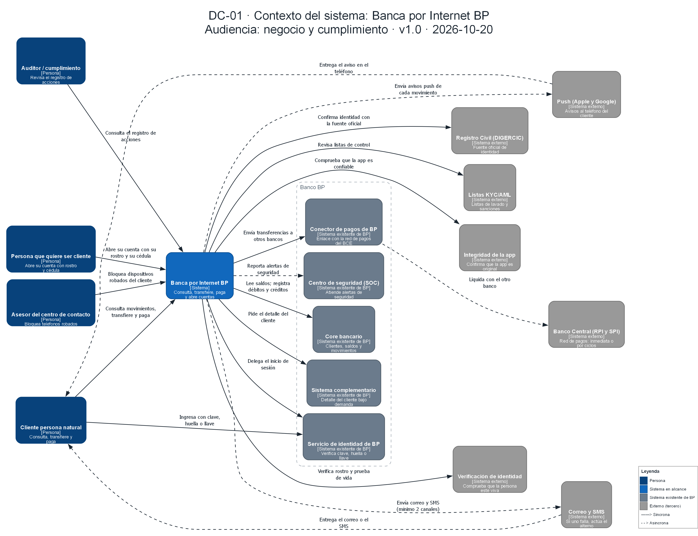

::: {.figcap}
**Figura 1.** Diagrama de contexto. Muestra cuatro personas, el sistema en alcance y doce sistemas externos o existentes de BP.

Versión en alta resolución: `diagrams/png/01-contexto.png`
:::
:::

El diagrama muestra cuatro personas. El **cliente** consulta, transfiere y paga desde la web o la app. Una **persona que quiere ser cliente** abre su cuenta con su rostro y su cédula. El **asesor** del centro de contacto bloquea dispositivos robados. El **auditor** consulta el registro de acciones.

El sistema se relaciona con el **Core bancario**, fuente oficial de clientes, saldos y movimientos; con el **sistema complementario**, que entrega detalle del cliente; con el **servicio de identidad** que ya usa BP; y con el **conector de pagos** del banco, que envía las transferencias interbancarias a la red de pagos del Banco Central del Ecuador: el Sistema de Pagos Interbancarios (SPI) y la Red de Pagos Instantáneos (RPI). Además, usa un proveedor de verificación biométrica, el Registro Civil, las listas KYC/AML, los servicios de notificación push, correo y SMS, las verificaciones de integridad de la app de Apple y Google, y el centro de operaciones de seguridad del banco.

---

# 4. Contenedores (C4 nivel 2)

El nivel de contenedores descompone el sistema en aplicaciones y servicios desplegables, cada uno con su tecnología. Se presenta en cuatro láminas, una por frontera funcional, con una caja por contenedor. Cada flecha indica qué hace, el protocolo y la seguridad; el código entre paréntesis remite a la tabla completa de relaciones del repositorio (`diagrams/README.md`).

::: {.figura}
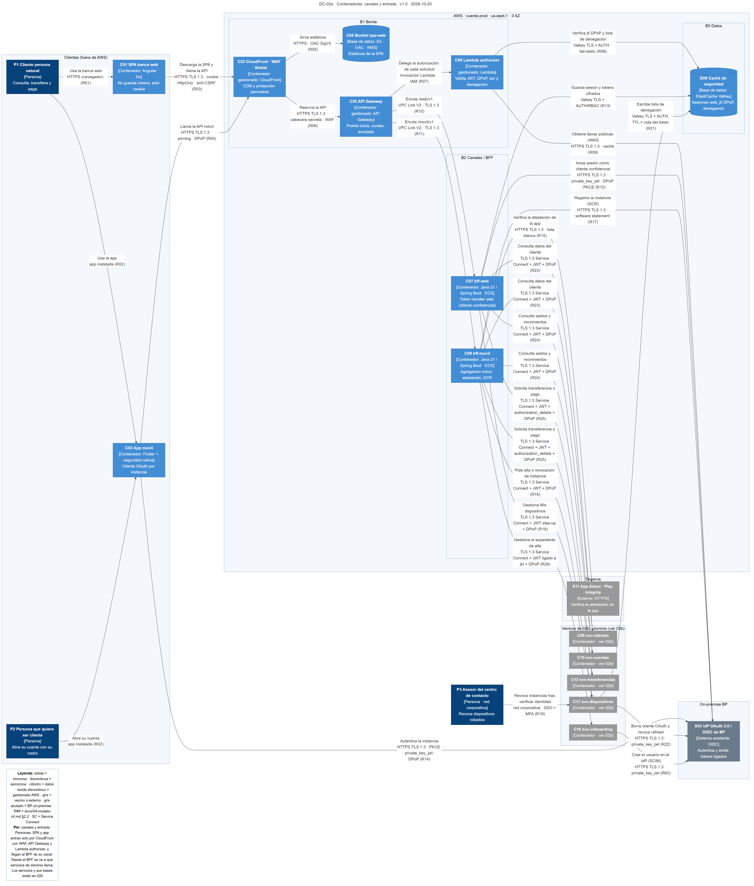

::: {.figcap}
**Figura 2.** Contenedores: canales y entrada. SPA Angular y app Flutter, borde (CloudFront, WAF, Shield), API Gateway con authorizer, los BFF por canal y a qué servicios llama cada uno.

Versión en alta resolución: `diagrams/png/02a-contenedores-canales-y-entrada.png`
:::
:::

::: {.figura .figura-alto}
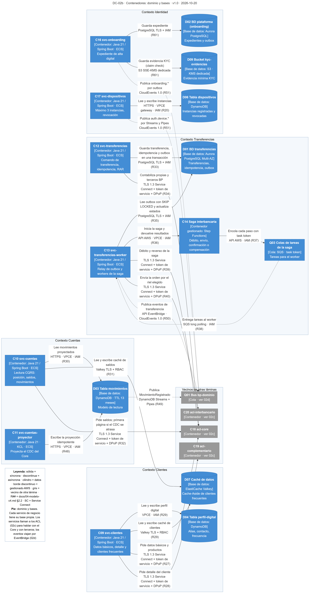

::: {.figcap}
**Figura 3a.** Contenedores: dominio y datos. Servicios de negocio sobre ECS Fargate, una base de datos por servicio, la saga de transferencias en Step Functions y la caché de clientes frecuentes.

Versión en alta resolución: `diagrams/png/02b-contenedores-dominio-y-bases.png`
:::
:::

::: {.figura}
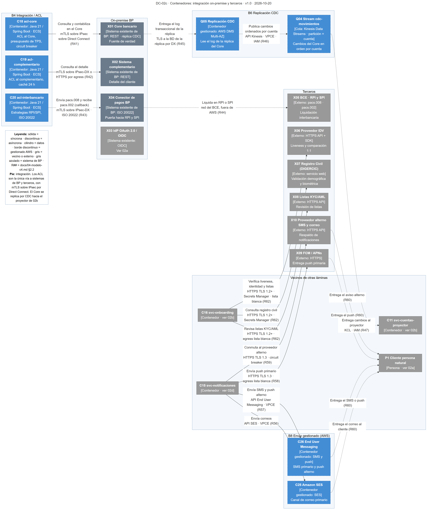

::: {.figcap}
**Figura 3b.** Contenedores: integración. Los tres ACL son la única vía al Core, al sistema complementario y al conector de pagos (mTLS sobre IPsec por Direct Connect); replicación CDC del Core; proveedores de biometría, Registro Civil, KYC/AML y notificaciones con proveedor alterno.

Versión en alta resolución: `diagrams/png/02c-contenedores-integracion-on-prem-y-terceros.png`
:::
:::

::: {.figura}
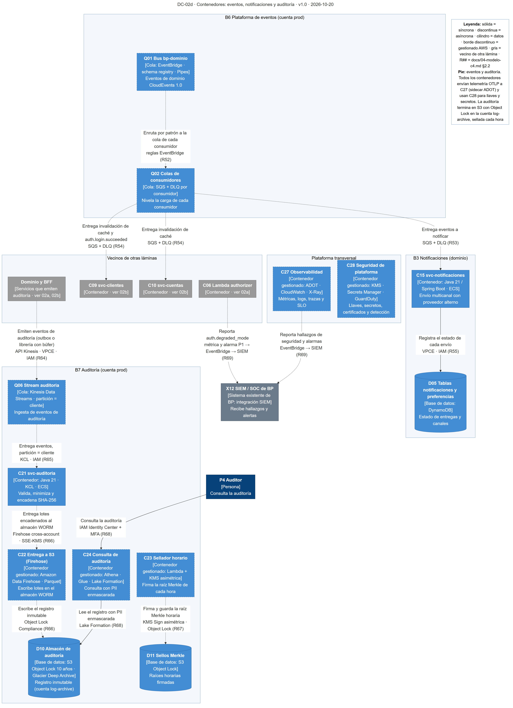

::: {.figcap}
**Figura 3c.** Contenedores: eventos, notificaciones y auditoría. Bus de eventos con una cola por consumidor, envío multicanal y la cadena de auditoría inmutable hasta la cuenta log-archive, consultable por el auditor.

Versión en alta resolución: `diagrams/png/02d-contenedores-eventos-notificaciones-auditoria.png`
:::
:::

**Canales.** La **SPA** es una aplicación Angular servida desde S3 y CloudFront con OAC; no guarda tokens. La **app móvil** es Flutter con un módulo nativo de seguridad que custodia las llaves en el hardware del teléfono.

**Entrada.** **CloudFront** con **AWS WAF** (reglas gestionadas, Bot Control, ATP en login y ACFP en onboarding) y **Shield Advanced** protege el borde. **API Gateway REST regional** valida, en móvil, el JWT, la prueba DPoP y el `acr` mínimo por operación, y responde con el reto de step-up (RFC 9470); en web exige la cookie de sesión y la cabecera anti-CSRF, y son los servicios los que verifican el token y la prueba DPoP que envía `bff-web`. Un **ALB interno** conecta mediante VPC Link V2 con los contenedores privados.

**Backends por canal.** `bff-web` gestiona la sesión mediante cookie y guarda los tokens en el servidor. `bff-movil` gestiona la atestación del dispositivo y el registro de instancias. Ninguno contiene reglas de negocio.

**Servicios de dominio.** `svc-clientes`, `svc-cuentas` (lectura de movimientos, alimentada por CDC), `svc-transferencias` (comando, idempotencia y saga), `svc-notificaciones`, `svc-auditoria`, `svc-onboarding` y `svc-dispositivos`. Cada uno tiene su propia base de datos (Aurora PostgreSQL o DynamoDB), según ADR-011.

**Integración.** Tres ACL dedicados: `acl-core`, `acl-complementario` y `acl-interbancario`. Traducen los modelos y protocolos externos al contrato canónico interno y protegen su capacidad con *bulkheads* y presupuestos de tasa.

**Mensajería y datos.** EventBridge con SQS por consumidor y DLQ para eventos de dominio; Step Functions para la saga interbancaria; Kinesis para el CDC de movimientos y la auditoría; DynamoDB para las lecturas de alto volumen; ElastiCache Valkey para sesiones, clientes frecuentes y la lista de denegación.

## 4.1 Catálogo de servicios

La plataforma despliega **14 servicios** en ECS Fargate. Los tres servicios base del enunciado se marcan en negrita; el resto se añadió por una razón concreta, indicada en la última columna. El *tier* define la estrategia de recuperación (sección 13): Tier 1 RTO ≤ 30 min, Tier 2 RTO ≤ 1 h.

| Servicio | Bounded context | Almacén propio | Comunicación | Tier | Por qué existe |
|---|---|---|---|---|---|
| `bff-web` | Canal web | Caché de seguridad Valkey (sesiones cifradas) | Síncrona (REST) | 1 | *Token handler*: el navegador no recibe tokens; contrato adaptado a la SPA |
| `bff-movil` | Canal móvil | Sin estado persistente | Síncrona (REST) | 1 | Atestación, registro de instancias (DCR) y contrato adaptado a la app |
| **`svc-clientes`** | Clientes | DynamoDB `perfil-digital` + caché Valkey | Síncrona; consume eventos de login | 2 | Servicio base: datos básicos (Core) y detalle (complementario) |
| **`svc-cuentas`** | Cuentas y consultas | DynamoDB `movimientos` + caché Valkey | Síncrona (lectura) | 2 | Servicio base: posición y movimientos desde el modelo de lectura |
| `svc-cuentas-proyector` | Cuentas y consultas | Escribe en DynamoDB `movimientos` | Asíncrona (Kinesis CDC) | 2 | Separa la escritura del modelo de lectura de la API de consulta (CQRS) |
| **`svc-transferencias`** | Pagos y transferencias | Aurora `transferencias` (idempotencia, outbox, beneficiarios) | Síncrona (comando, 201/202) | 1 | Servicio base: transferencias y pagos con idempotencia |
| `svc-transferencias-worker` | Pagos y transferencias | Aurora `transferencias` (compartida dentro del mismo contexto) | Asíncrona (outbox, colas de la saga) | 1 | Relé de outbox y tareas de la saga, escalado por profundidad de cola sin afectar a la API |
| `svc-notificaciones` | Notificaciones | DynamoDB `notificaciones` y `preferencias` | Asíncrona (eventos) | 2 | Norma de notificar por al menos dos canales, con proveedor alterno |
| `svc-auditoria` | Auditoría | Kinesis → S3 Object Lock (cuenta *log-archive*) | Asíncrona (Kinesis) | 1 | Registro inmutable de todas las acciones |
| `svc-onboarding` | Identidad (alta) | Aurora `plataforma`, base `onboarding` + S3 `kyc-evidencias` | Síncrona con la app; asíncrona hacia auditoría | 2 | Alta digital con reconocimiento facial (sección 5.1) |
| `svc-dispositivos` | Identidad (dispositivos) | DynamoDB `dispositivos` + lista de denegación en Valkey | Síncrona; publica `auth.device.*` | 1 | Política de máximo tres dispositivos y revocación; regla de negocio que no puede vivir en un BFF |
| `acl-core` | Integración | Sin almacén (presupuesto de TPS en memoria) | Síncrona hacia el Core | 1 | Traduce el modelo del Core y protege su capacidad |
| `acl-complementario` | Integración | Caché de 24 h | Síncrona | 2 | Aísla al sistema complementario y tolera su caída |
| `acl-interbancario` | Integración | Sin almacén (estado en la saga) | Asíncrona (tareas de la saga) | 1 | Traducción ISO 20022 y estrategia de riel RPI/SPI |

Fuera del clúster ECS se ejecutan el *Lambda authorizer* del API Gateway, la máquina de estados de la saga (Step Functions) y el sellado horario de auditoría (Lambda).

**Reutilización futura.** El diseño deja piezas listas para nuevos canales o productos sin rehacer la plataforma:

- **Contratos versionados**: cada API publica su OpenAPI con versión en la ruta (`/v1`) y política de compatibilidad hacia atrás; los eventos usan CloudEvents 1.0 registrados en el *schema registry* de EventBridge, con validación de compatibilidad en la integración continua. Un consumidor nuevo (por ejemplo, analítica o un canal de banca empresarial) se suscribe al bus sin tocar a los productores.
- **Plantilla de servicio**: un esqueleto común (Spring Boot hexagonal, librería de auditoría, OpenTelemetry, Resilience4j, filtro JWT, *health checks*, *pipeline* e IaC) para que un servicio nuevo nazca con los controles transversales.
- **ACL reutilizables**: `acl-core`, `acl-complementario` y `acl-interbancario` exponen contratos canónicos; cualquier servicio futuro (préstamos, inversiones) los consume sin conocer el modelo del Core.
- **Strategy extensible**: pagos de servicios básicos o nuevos rieles de pago se agregan como una Strategy en `svc-transferencias`, y un nuevo canal de notificación como un Adapter en `svc-notificaciones`.

---

::: {.apaisa .apaisa-compacto}

# 5. Componentes (C4 nivel 3)

Los diagramas de componentes muestran el interior de los servicios críticos, los patrones aplicados y los protocolos con su control de seguridad.

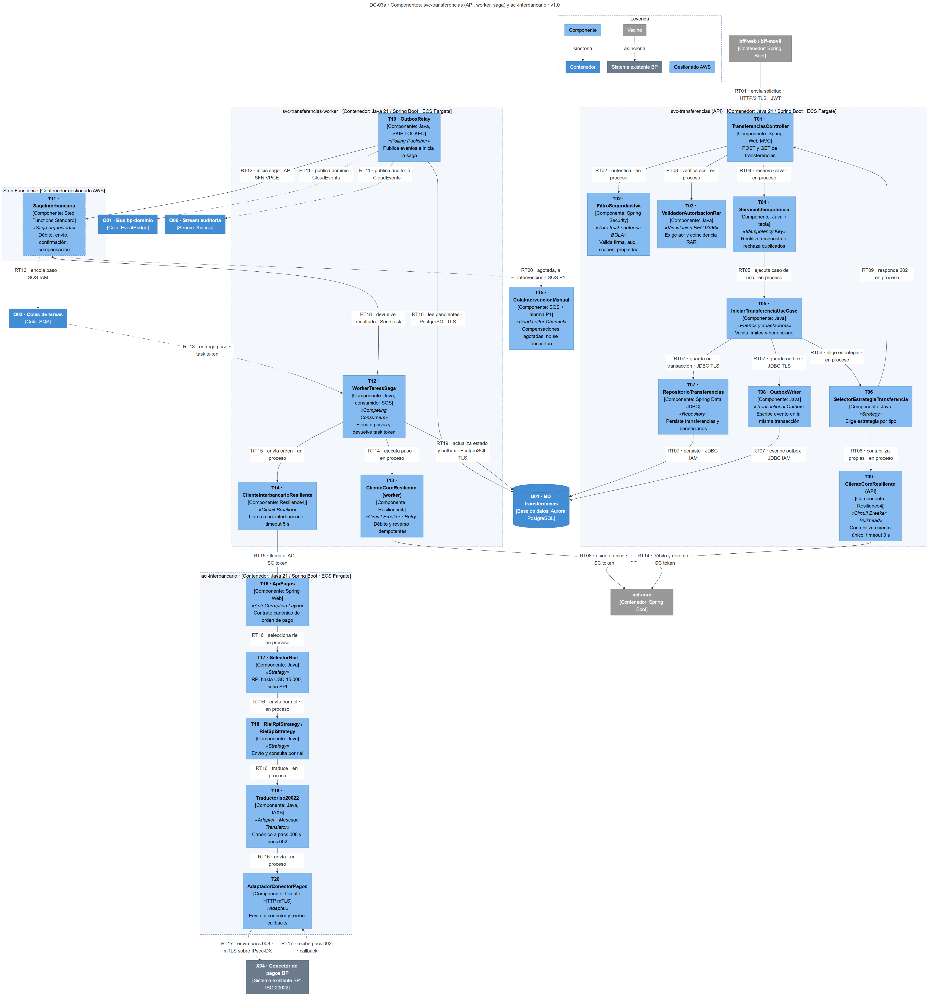

::: {.figcap}
**Figura 4.** Componentes de transferencias. API de comandos, *worker* de la saga, *outbox* e *idempotency store*, y el ACL interbancario con traductor ISO 20022.

Versión en alta resolución: `diagrams/png/03a-componentes-transferencias.png`
:::
:::

**Transferencias (figura 4).** La API recibe el comando con `Idempotency-Key` y valida que el cuerpo coincida exactamente con los `authorization_details` del token. Una transacción local de Aurora registra la transferencia, la clave de idempotencia y el evento en el *outbox*. Las estrategias por tipo (propia, tercero BP, pago a producto, interbancaria) se seleccionan con el patrón Strategy. Las interbancarias ejecutan una saga orquestada en Step Functions con compensación y consulta de estado antes de cualquier reintento.

::: {.apaisa}
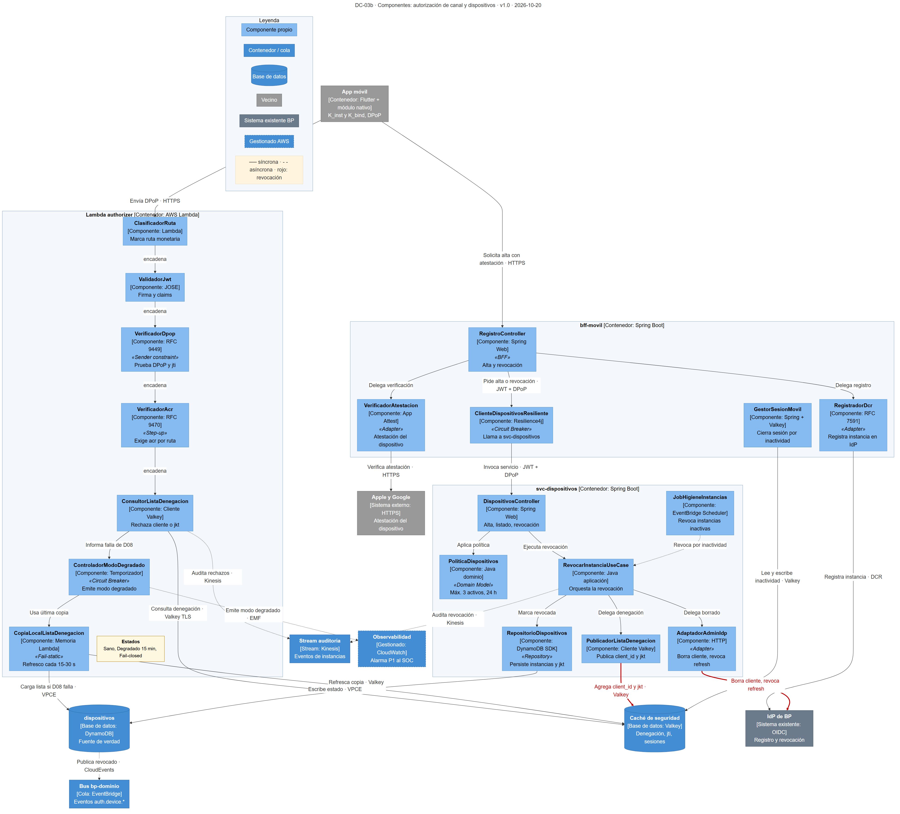

::: {.figcap}
**Figura 5.** Componentes de identidad. Authorizer con lista de denegación y modo *fail-static*, `bff-movil` con atestación y DCR, y `svc-dispositivos` con la política de instancias.

Versión en alta resolución: `diagrams/png/03b-componentes-autorizacion-dispositivos.png`
:::
:::

**Identidad de canal (figura 5).** El authorizer verifica la firma del JWT con JWKS en caché, la prueba DPoP con control de `jti` y la lista de denegación. `bff-movil` registra cada instancia tras una atestación válida. `svc-dispositivos` mantiene la política de máximo tres dispositivos y la revocación por instancia.

::: {.figura}
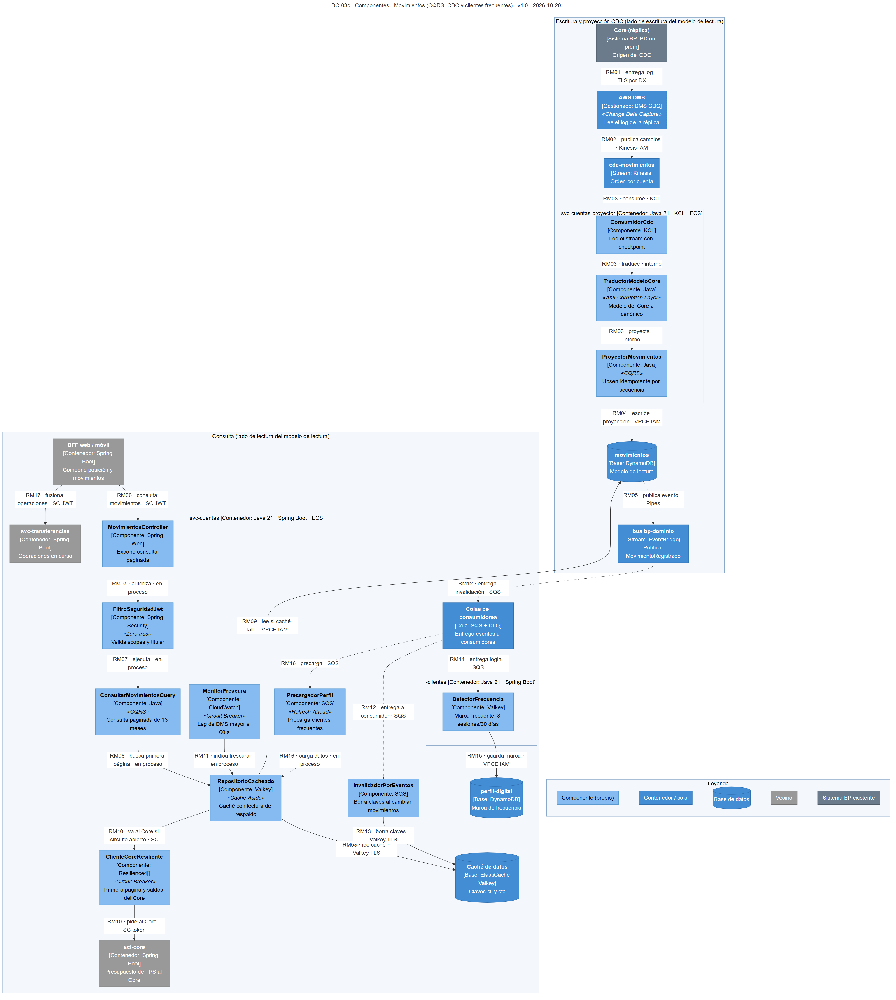

::: {.figcap}
**Figura 6.** Componentes de consultas. Proyector desde CDC, lectura en DynamoDB, caché de clientes frecuentes con Cache-Aside y Refresh-Ahead, y degradación al Core.

Versión en alta resolución: `diagrams/png/03c-componentes-movimientos-cqrs.png`
:::
:::

**Consultas (figura 6).** El movimiento llega desde el Core por CDC, un proyector lo transforma y lo escribe en DynamoDB. La caché de clientes frecuentes (Cache-Aside con Refresh-Ahead selectivo) reduce la latencia de perfil, productos y movimientos recientes. Si el CDC se atrasa más de 60 s, la lectura pasa al Core con prioridad inferior a la de transferencias.

**Auditoría (figura 7).** Cada servicio envía sus eventos mediante una librería común. `svc-auditoria` valida el esquema, enmascara datos personales, encadena el hash de cada registro y publica en Firehose hacia S3 con Object Lock en modo Compliance.

::: {.figura .figura-alto .figura-compacto}
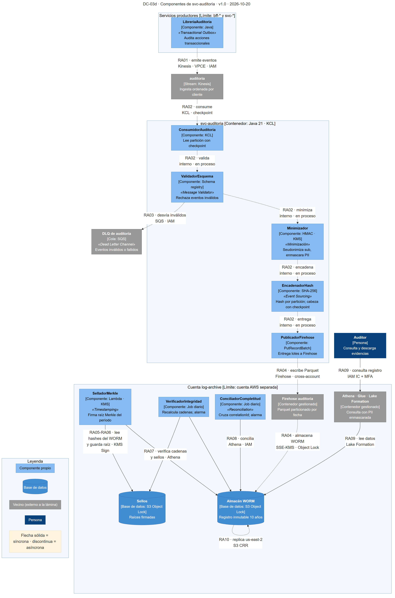

::: {.figcap}
**Figura 7.** Componentes de auditoría. Validación, minimización, encadenamiento de hashes, sellos firmados y almacenamiento WORM.

Versión en alta resolución: `diagrams/png/03d-componentes-auditoria.png`
:::
:::

::: {.apaisa}

## 5.1 Onboarding con reconocimiento facial

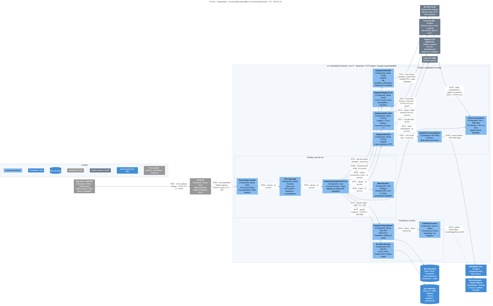

::: {.figcap}
**Figura 7a.** Componentes de onboarding. Caso de uso con máquina de estados, puertos y adaptadores hacia el proveedor IDV, el motor alterno, el Registro Civil, las listas KYC/AML y el IdP; emisor del comprobante firmado; expedientes, bóveda de evidencias y eventos de auditoría.

Versión en alta resolución: `diagrams/png/03e-componentes-onboarding.png`
:::
:::

**Onboarding (figura 7a).** `svc-onboarding` sigue una arquitectura hexagonal: el núcleo (caso de uso y motor de decisión) no conoce a ningún proveedor; cada dependencia externa entra por un puerto con su adaptador.

- **Entrada.** `bff-movil` valida la atestación de la app (App Attest / Play Integrity) y reenvía la solicitud por Service Connect con JWT. El `FiltroSeguridad` comprueba el token del BFF, la atestación y que exista un consentimiento biométrico explícito y separado (LOPDP) antes de aceptar cualquier imagen.
- **Caso de uso.** `GestionarExpedienteUseCase` es un *Process Manager*: lleva el expediente por sus estados, guarda cada transición en la misma transacción que el evento de outbox y, si el enrolamiento no termina, compensa borrando el usuario creado en el IdP.
- **Verificación.** El adaptador del proveedor IDV (**FacePhi**, prueba de vida evaluada según ISO/IEC 30107-3 con conformidad nivel 2 de iBeta, laboratorio NVLAP) valida el documento, la prueba de vida, la inyección y la comparación 1:1 selfie–documento, siempre servidor a servidor. Si su *circuit breaker* abre, el liveness pasa al **motor alterno (Amazon Rekognition Face Liveness)** y la validación documental queda para revisión diferida.
- **Fuente oficial.** El adaptador del Registro Civil actúa como anticorrupción frente al servicio demográfico y biométrico, consumido por **SOAP/HTTPS bajo convenio interinstitucional (protocolo a confirmar)**. Si no responde, el expediente queda pendiente: nunca se aprueba sin la fuente oficial.
- **Decisión.** El `MotorDecision` aplica umbrales (FAR objetivo ≤ 0,01 %) y señales de riesgo; ante anomalías escala a reto activo o a revisión humana.
- **Integración con la autenticación.** Con el expediente aprobado, el adaptador del IdP crea el usuario en estado `pendiente_credenciales` (SCIM/API de administración) y el `EmisorComprobante` emite un **comprobante firmado con KMS**: JWT de 5 minutos, de un solo uso y ligado al `jkt` de la llave no exportable del dispositivo. Ese comprobante autoriza el **registro de la instancia de la app en el IdP (DCR)**; el IdP lo valida contra `svc-onboarding` (firma, `jti` no usado, `jkt` coincidente). Después la app sigue el flujo estándar Authorization Code + PKCE + PAR, el cliente define su clave en la página del IdP y registra su passkey desbloqueada con biometría local. El primer token sale del IdP con `acr` de onboarding verificado, sin canales paralelos.
- **Datos.** El expediente y el outbox viven en Aurora (`plataforma`, base `onboarding`). La evidencia KYC mínima (imágenes y puntuaciones, nunca plantillas biométricas) se guarda en S3 `kyc-evidencias` con una llave KMS dedicada, Macie y acceso con separación de funciones (patrón *Claim Check*: el expediente solo guarda la referencia).
- **Auditoría.** Cada transición publica un evento `onboarding.*` con puntuaciones y versión del modelo, sin imágenes, hacia la auditoría inmutable.

**Estados del expediente**

| Estado | Significado | Transición siguiente | Evento de auditoría |
|---|---|---|---|
| `CREADO` | Consentimiento otorgado, llave del dispositivo registrada en el expediente | `CAPTURAS_RECIBIDAS` | `onboarding.consent.granted` |
| `CAPTURAS_RECIBIDAS` | Cédula y selfie recibidas cifradas | `VERIFICANDO` | `onboarding.capture.received` |
| `VERIFICANDO` | IDV, Registro Civil y KYC/AML en curso | `APROBADO`, `EN_REVISION`, `PENDIENTE_FUENTE`, `RECHAZADO` | `.document.verified`, `.liveness.passed/failed`, `.match.scored`, `.registry.validated`, `.aml.screened` |
| `PENDIENTE_FUENTE` | Registro Civil o proveedor no disponible; se reintenta con *backoff* | `VERIFICANDO` o `EXPIRADO` | `onboarding.pending` |
| `EN_REVISION` | Señales de riesgo o puntuación en zona gris; revisión humana o videollamada | `APROBADO` o `RECHAZADO` | `onboarding.review.assigned` |
| `APROBADO` | Usuario creado en el IdP (`pendiente_credenciales`) y comprobante emitido | `ENROLADO` o `EXPIRADO` | `onboarding.identity.created` |
| `ENROLADO` | Instancia registrada, clave y passkey creadas, primer token emitido | `COMPLETADO` | `onboarding.device.enrolled` |
| `COMPLETADO` | Cuenta abierta y bienvenida notificada por dos canales | Final | `onboarding.completed` |
| `RECHAZADO` | Verificación fallida o lista restrictiva | Final | `onboarding.rejected` |
| `EXPIRADO` | Comprobante vencido sin enrolamiento o expediente sin avance en 72 h; se borra el usuario del IdP (compensación) | Final (el cliente puede reiniciar) | `onboarding.expired` |

## 5.2 Patrones aplicados y dónde se ven

| Patrón | Problema que resuelve | Dónde se ve |
|---|---|---|
| Backend for Frontend | Cada canal necesita su contrato y su modelo de sesión; el navegador no debe tener tokens | Figuras 2 y 7b; ADR-003 |
| API Gateway | Punto único de entrada con autenticación, cuotas y validación de esquema | Figura 2 |
| Database per Service | Evitar acoplamiento por base de datos compartida entre equipos | Sección 4.1; figura 3a |
| Anti-Corruption Layer | El modelo y los protocolos del Core, del complementario, del Registro Civil y de la red de pagos no deben filtrarse al dominio | Figuras 3b, 4, 6 y 7a |
| CQRS + Materialized View | El histórico de movimientos no puede depender de la capacidad del Core | Figura 6; ADR-004 |
| Change Data Capture | Alimentar el modelo de lectura sin modificar el Core | Figura 6 |
| Cache-Aside + Refresh-Ahead | Latencia baja para clientes frecuentes y menos carga al Core | Figura 6; sección 9.2 |
| Transactional Outbox | Publicar el evento si y solo si se confirma la transacción | Figuras 4, 7 y 7a |
| Idempotency Key + consumidor idempotente | Un reintento no debe duplicar un débito | Figura 4; SQ-05a |
| Saga orquestada (compensación) | Transferencia interbancaria sin transacción distribuida | Figura 4; SQ-05a y SQ-05b; ADR-009 |
| Process Manager | Expediente de onboarding con varios pasos externos y compensación | Figura 7a |
| Strategy | Tipo de transferencia o pago; canal de notificación; regla de decisión de onboarding | Figuras 4 y 7a; ADR-010 |
| Adapter (puertos y adaptadores) | Proveedores intercambiables (IDV, notificaciones, listas) | Figuras 4 y 7a |
| Circuit Breaker, Timeout, Retry con *backoff* y *jitter* | Una dependencia lenta no debe tumbar al servicio | Figuras 6 y 7a; sección 13 |
| Bulkhead | Separar *pools* para que el histórico no consuma la capacidad de las transferencias | Figura 6; `acl-core` |
| Fallback / degradación elegante | Seguir operando con funcionalidad reducida | Figuras 5 (*fail-static*), 6 (Core directo) y 7a (motor alterno) |
| Queue-Based Load Leveling + DLQ | Absorber picos de notificaciones, auditoría y saga | Figura 3c |
| Event Sourcing (registro *append-only*) + cadena de *hashes* | Auditoría inmutable y verificable | Figura 7; ADR-012 |
| Claim Check | No mover imágenes biométricas por el bus ni guardarlas en el expediente | Figura 7a |

---

# 6. Decisiones de arquitectura

Cada decisión se documentó como ADR con contexto, al menos dos alternativas puntuadas con una tabla ponderada, la decisión, al menos dos justificaciones teóricas y consecuencias. El índice completo está en `docs/adr/README.md`.

## 6.1 Tabla resumen de los 14 ADR

| ADR | Decisión | Alternativas descartadas (puntaje) | Justificaciones teóricas (resumen) |
|---|---|---|---|
| **001** Estilo y eventos | Microservicios por *bounded context*; REST solo donde el cliente espera la respuesta; eventos en EventBridge con SQS y DLQ por consumidor; Transactional Outbox | Monolito modular (3,10); SOA con ESB (2,20). Mensajería: SNS+SQS y MSK como alternativas | Bounded contexts (Evans, DDD); Transactional Outbox e Idempotent Consumer (Richardson) |
| **002** Región y cómputo | `us-east-1` con DR en `us-east-2`; ECS Fargate ARM64; Lambda solo para tareas de apoyo | `sa-east-1` (2,95) y `mx-central-1` (3,65) como región; EKS y Lambda para el cómputo principal | Well-Architected (rendimiento y costo); 12-Factor (procesos sin estado) |
| **003** API Gateway y BFF | API Gateway REST regional con BFF por canal y token handler web | API única genérica (3,00); GraphQL federado (3,40) | Backends for Frontend (Newman); API Gateway (Richardson); RFC 10017 |
| **004** Core y lectura | ACL dedicado por sistema externo; 2 Direct Connect + VPN; movimientos en CQRS alimentado por CDC | ACL como librería en cada servicio (3,25); reutilizar el ESB (3,05). Conectividad solo por VPN (descartada) | Anti-Corruption Layer (Evans); CQRS (Young, Fowler) |
| **005** SPA | Angular modular en monorepo Nx; S3 y CloudFront con OAC; sin tokens en el navegador | React (3,40), con Next.js y Vite | OWASP ASVS (sesiones, XSS); ISO/IEC 25010 (mantenibilidad) |
| **006** App móvil | Flutter con módulo nativo de seguridad | React Native (4,00); Kotlin Multiplatform (3,70); .NET MAUI (2,80) | OWASP MASVS; RFC 8252 (apps nativas) |
| **007** Autenticación | Authorization Code + PKCE + PAR (FAPI 2.0); BFF en web con DPoP de punta a punta; cliente confidencial por instancia en móvil | Implicit, ROPC y Client Credentials para usuarios (prohibidos o inadecuados); Authorization Code sin PKCE; SPA con tokens en el navegador (1 de 5) | RFC 9700; RFC 7636; RFC 10017; RFC 8252; FAPI 2.0; RFC 9449 (DPoP); RFC 7591 (DCR) |
| **008** Onboarding facial | Servicio propio con puertos y adaptadores; proveedor IDV recomendado FacePhi; liveness pasivo con escalamiento adaptativo | Liveness activo (2,85); pasivo sin escalamiento (4,20). Proveedores: Veridas, Jumio, Onfido, iProov, FaceTec, Rekognition | ISO/IEC 30107-3 (PAD); CEN/TS 18099 (inyección); NIST SP 800-63A-4 (IAL2) |
| **009** Transferencias y pagos | Idempotency-Key; camino síncrono para propias; saga orquestada con Step Functions para interbancarias | Saga coreografiada (3,10); orquestador embebido o Temporal (3,85) | Saga (Garcia-Molina); Idempotency-Key; Kleppmann (sin 2PC) |
| **010** Notificaciones | `svc-notificaciones` con Strategy y Adapter; mínimo dos canales; proveedor alterno | SNS directo (3,00); CPaaS único (3,35). Pinpoint descartado por fin de soporte | Strategy y Adapter (GoF); Guaranteed Delivery (Hohpe & Woolf) |
| **011** Persistencia y clientes frecuentes | Aurora PostgreSQL, DynamoDB y ElastiCache Valkey por servicio; mecanismo elegido: Cache-Aside + Refresh-Ahead selectivo + invalidación por evento | Cache-Aside con TTL (B1); Write-Through (B2); vista materializada persistente (B3) | Database per Service (Richardson); localidad de acceso (Kleppmann) |
| **012** Auditoría inmutable | Kinesis, `svc-auditoria` con cadena de hashes y sellos KMS, S3 Object Lock Compliance y Athena | Tabla *append-only* en Aurora (3,35); OpenSearch como almacén principal (2,95). QLDB y CloudTrail Lake descartados por estado de servicio | Event Sourcing (Fowler); Merkle y sellado temporal (Haber & Stornetta); NIST SP 800-92 |
| **013** HA, DR y resiliencia | Warm standby en `us-east-2` para Tier 1-2; backup & restore para Tier 3; Resilience4j con ECS Service Connect; degradación *fail-static* del authorizer | Backup & restore (2,80); pilot light (3,25); activo-activo (3,00); service mesh con Istio (control semántico insuficiente) | Well-Architected (REL10, REL13); Release It! (Nygard); SRE (Beyer) |
| **014** Observabilidad y SLO | AWS nativo con OpenTelemetry; SLO por journey; alertas por *burn rate* | APM comercial (3,95); stack OSS autogestionado (3,05) | SRE Book (SLO y golden signals); OpenTelemetry (CNCF); Observability Engineering |

## 6.2 Resumen por ADR prioritario

### ADR-001 · Estilo arquitectónico y comunicación

**Decisión.** Microservicios organizados por *bounded context* (catálogo de la sección 4). La comunicación es síncrona por REST/JSON solo cuando el cliente espera la respuesta, y asíncrona por eventos de dominio en EventBridge. Cada productor publica mediante un *outbox* transaccional y cada consumidor es idempotente.

**Por qué.** El monolito modular no escala por separado las consultas y las transferencias, y el ESB concentra la lógica en la tubería. Los microservicios por dominio obtienen el mejor puntaje (4,15 frente a 3,10 y 2,20) porque aíslan fallas y permiten que cada equipo evolucione su servicio. El *outbox* evita el *dual write* entre la base de datos y el bus.

**Trade-off.** Mayor complejidad operativa (puntaje 2 de 5), compensada con plataforma gestionada, observabilidad transversal y plantillas de servicio.

### ADR-003 · API Gateway y BFF por canal

**Decisión.** CloudFront y WAF protegen el borde. API Gateway REST regional valida el token, la prueba de posesión DPoP y el nivel de autenticación, y luego entrega cada solicitud al intermediario (BFF) del canal. El authorizer no cachea resultados por token porque la prueba DPoP cambia en cada solicitud; solo cachea las llaves públicas (JWKS).

**Por qué.** La seguridad es distinta por canal: el navegador no debe custodiar tokens, mientras que el móvil sí puede custodiar llaves en hardware. El patrón BFF obtiene 4,20 puntos frente a 3,00 de la API genérica.

**Degradación.** Si cae todo el clúster de seguridad, el authorizer mantiene en memoria la lista de denegación (refresco cada 15-30 s) y opera en modo *fail-static*: las operaciones monetarias se rechazan y las lecturas siguen con tokens de vida corta. Ese modo expira a los 15 min y pasa a *fail-closed* total. Un entorno nuevo carga la lista desde DynamoDB y, si no puede hacerlo, queda en *fail-closed*.

### ADR-007 · Autenticación OAuth 2.0 / OIDC, métodos y step-up

**Decisión.** Un único flujo de autorización: Authorization Code con PKCE (S256) y PAR, perfilado con FAPI 2.0. **Web:** la SPA usa el patrón BFF (RFC 10017). `bff-web` es un cliente confidencial, guarda los tokens en el servidor y los liga a su llave con DPoP; el navegador solo recibe la cookie `__Host-sid` con `HttpOnly`, `Secure` y `SameSite=Strict`. Cada microservicio verifica el JWT y la prueba DPoP (enlace `cnf.jkt`), así que el perfil se cumple de punta a punta sin desviación. **Móvil:** la app es un cliente confidencial por instancia; en el enrolamiento genera en el Secure Enclave o StrongBox dos llaves no exportables, una para autenticar el cliente y otra para el *device binding* del usuario. Las autorizaciones se hacen en el navegador del sistema, nunca en un WebView embebido. **Step-up web:** redirección a la autorización con PAR y `authorization_details`; la evolución futura es CIBA (aprobación desde la app).

**Por qué.** RFC 9700 prohíbe Implicit y ROPC y exige PKCE. La tabla de decisión de la SPA otorga 5 puntos al BFF frente a 3 del *token-mediating backend* y 1 de la SPA con tokens en el navegador. FAPI 2.0 exige clientes confidenciales y tokens ligados al remitente.

**Métodos después del onboarding (RF-13).** Clave de banca y biometría del dispositivo (*device binding*) como factor de posesión; passkeys cuando el IdP las soporte; *step-up* para transferencias a terceros e interbancarias, con firma de la transacción con la llave del dispositivo. Un SMS no se usa como factor único (NIST SP 800-63B-4).

**Sesiones.** Web: 5 min de inactividad y 30 min absolutos. Móvil: 2 min de inactividad y reautenticación biométrica al volver del segundo plano, con vida máxima de 30 min.

**Respaldo.** Si el IdP de BP no soporta registro dinámico de clientes (DCR), `bff-movil` actúa como cliente confidencial para la app. Amazon Cognito no cumple este perfil (sin PAR ni DCR) y, de ser el producto de BP, la brecha se declara.

### ADR-008 · Onboarding con reconocimiento facial

**Decisión.** `svc-onboarding` orquesta por puertos y adaptadores al proveedor IDV (documento, selfie y prueba de vida), al Registro Civil y a las listas KYC/AML. El proveedor recomendado es FacePhi, con Veridas como alternativa equivalente y Jumio si BP prioriza la cobertura documental global. Amazon Rekognition Face Liveness queda como segundo motor de respaldo.

**Por qué.** La prueba pasiva con escalamiento adaptativo obtiene 4,30 puntos frente a 2,85 de la prueba activa, porque reduce el abandono y mantiene la resistencia a la presentación. La decisión de aprobar la verificación siempre es del servidor, nunca de la app, y el expediente nunca se aprueba automáticamente si el Registro Civil no responde.

**Integración con el IdP.** Al aprobarse, el servicio crea al usuario en el IdP en estado `pendiente_credenciales` y emite un comprobante firmado de un solo uso, de 5 min, ligado a la llave del dispositivo. El primer token se obtiene con el flujo estándar de ADR-007; no existe un canal paralelo de emisión de tokens.

**Privacidad.** Los datos biométricos son sensibles según la LOPDP. BP no conserva plantillas biométricas; conserva solo la evidencia mínima de KYC, cifrada con una llave KMS dedicada.

### ADR-009 · Orquestación de transferencias y pagos

**Decisión.** Las transferencias propias y a terceros de BP se resuelven en un camino síncrono, porque el Core las contabiliza atómicamente en un solo asiento. Las interbancarias usan una saga orquestada en Step Functions Standard, con respuesta `202 Accepted`, compensación por reverso idempotente y consulta de estado antes de cualquier reintento.

**Por qué.** La saga orquestada obtiene 4,35 puntos frente a 3,10 de la coreografiada, por visibilidad, compensación con esperas largas y garantías de idempotencia. Un débito nunca se reintenta a ciegas: ante un *timeout* el estado pasa a `EN_VERIFICACION` y se consulta la referencia.

**Idempotencia.** `Idempotency-Key` generada por el cliente. Misma clave y mismo hash devuelven la respuesta guardada; misma clave con otro hash responde `422`; una clave en curso responde `409`. Retención de 7 días.

### ADR-012 · Auditoría inmutable

**Decisión.** Log inmutable en Kinesis, `svc-auditoria` con cadena de hashes SHA-256 por partición, raíz de Merkle horaria firmada con una llave asimétrica de KMS, almacenamiento en S3 Object Lock Compliance y consulta con Athena. Retención de 12 meses en línea y 10 años en Deep Archive.

**Por qué.** La opción log inmutable obtiene 4,40 puntos frente a 3,35 de la tabla *append-only*, porque la inmutabilidad es verificable y no depende de permisos. QLDB está fuera de soporte desde el 31-jul-2025 y CloudTrail Lake está cerrado a nuevos clientes desde el 31-may-2026, por lo que ambos quedan descartados.

### ADR-013 · Alta disponibilidad, DR y resiliencia

**Decisión.** Tres zonas de disponibilidad con auto-healing en todas las capas. DR en `us-east-2` con modo *warm standby* para Tier 1 y Tier 2 (Aurora Global, DynamoDB Global Tables, S3 CRR y Global Datastore para el clúster de seguridad). Tier 3 con backup & restore. La conmutación regional es controlada: una decisión humana con runbook, Route 53 ARC y `failover` gestionado de Aurora.

**Por qué.** Warm standby obtiene 3,90 puntos. Cumple el RTO de 30 min y el RPO de 1 min sin el costo del activo-activo (3,00, con un costo de 1 de 5). La conmutación automática se descarta para evitar *flapping* y *split-brain*.

**Resiliencia en llamadas.** Resilience4j en el código (timeouts, reintentos con *backoff* y *jitter* solo en operaciones idempotentes, Circuit Breaker, Bulkhead) con ECS Service Connect para el tráfico interno. AWS App Mesh está en fin de soporte desde el 30-sep-2026, por lo que no se usa.

### ADR-014 · Observabilidad y SLO

**Decisión.** Servicios nativos de AWS (CloudWatch, Application Signals, X-Ray, Synthetics, RUM, Managed Grafana) con instrumentación OpenTelemetry (ADOT). SLO por journey, alertas por *burn rate* multiventana y pruebas de caos trimestrales con AWS FIS.

**Por qué.** La opción nativa con OpenTelemetry obtiene 4,15 puntos, por encima del APM comercial (3,95) y el stack OSS (3,05). La instrumentación estándar evita el *lock-in* del backend de observabilidad.

## 6.3 Resumen de los ADR restantes

- **ADR-002.** La región `us-east-1` obtiene 4,30 frente a 2,95 de `sa-east-1` y 3,65 de `mx-central-1`; tiene el par de DR más cercano (`us-east-2`, a unos 10-15 ms) y el catálogo de servicios más maduro. La latencia desde Ecuador se medirá en el piloto.
- **ADR-005.** Angular obtiene 4,25 puntos frente a 3,40 de React. Su estructura opinada, la seguridad por defecto (sanitización, Trusted Types, XSRF) y el ciclo de soporte predecible compensan el menor talento disponible. Se descarta la arquitectura de micro-frontends con uno o dos equipos de front, por costo de coordinación.
- **ADR-006.** Flutter obtiene 4,30 frente a 4,00 de React Native, con una capa nativa de seguridad (llaves en hardware, atestación, RASP y *pinning*). Kotlin Multiplatform (3,70) y .NET MAUI (2,80) quedan como alternativas evaluadas.
- **ADR-010.** Un servicio propio con Strategy y Adapter obtiene 4,45 frente a 3,00 de SNS directo. Permite cumplir "mínimo dos canales" con redundancia de canal y de proveedor, y deja trazabilidad de entrega para auditoría.
- **ADR-011.** Cada servicio tiene su propia base de datos (*Database per Service*). La caché de clientes frecuentes combina *Cache-Aside*, *Refresh-Ahead* selectivo e invalidación por evento: protege al Core y mantiene una latencia baja en las consultas frecuentes.

---

# 7. Seguridad e identidad

## 7.1 Arquitectura de seguridad por capas

La seguridad sigue defensa en profundidad y *zero trust* (NIST SP 800-207). Ninguna capa depende de la siguiente: si una falla, la siguiente sigue protegiendo.

| Capa | Qué protege | Controles principales |
|---|---|---|
| 1. Borde | Disponibilidad y superficie expuesta | CloudFront (TLS 1.2 o superior), WAF (reglas gestionadas, Bot Control, ATP en login, ACFP en onboarding), Shield Advanced, Route 53 |
| 2. Identidad | Quién es el cliente y desde qué dispositivo | OIDC con PKCE y PAR, BFF token handler en web, cliente confidencial por instancia en móvil, DPoP, *device binding*, step-up con firma de transacción |
| 3. Aplicación y API | Que cada solicitud esté autorizada | Validación de JWT, prueba DPoP y `acr` en el gateway y en cada servicio, control de acceso por objeto (BOLA), validación de esquema, idempotencia, límites transaccionales |
| 4. Datos | Confidencialidad e integridad de datos personales, biométricos y transacciones | Llaves KMS por dominio, TLS en todos los saltos, tokenización y seudonimización, minimización, auditoría WORM |
| 5. Red | Movimiento lateral y exfiltración | Cuentas separadas con Organizations y SCP, subredes privadas, *security groups* por servicio, VPC endpoints, *egress* por lista blanca, cifrado sobre Direct Connect |
| 6. Operación | Detección, respuesta y cadena de suministro | CloudTrail organizacional, GuardDuty, Security Hub, Config, Inspector, Macie, SIEM y SOC del banco, SDLC seguro (sección 7.8), *break-glass* con doble control |

**Principios transversales.** Mínimo privilegio. Ningún token ni secreto utilizable en el navegador. La biometría del cliente no sale de su teléfono en el uso diario. Todo evento de seguridad llega a la auditoría inmutable.

## 7.2 Flujos de autenticación

- **Login web.** El navegador inicia el flujo en `bff-web`, que lo lleva al IdP con PAR y PKCE, recibe el código y lo canjea. `bff-web` guarda los tokens en su almacén de sesiones (ElastiCache Valkey, cifrado) y entrega solo la cookie de sesión. Las llamadas posteriores llegan por CloudFront y API Gateway, que valida la cookie y la protección anti-CSRF. `bff-web` llama a los servicios internos con el token vigente y la prueba DPoP, y cada servicio verifica JWT, `acr` y la propiedad del recurso. Ver SQ-01.
- **Enrolamiento y login móvil.** Tras el onboarding, la app genera las llaves en el hardware del teléfono, se registra como cliente confidencial con registro dinámico de clientes (RFC 7591) y atestación del dispositivo, y obtiene tokens ligados por DPoP. API Gateway verifica el token y la prueba antes de entregar cada solicitud a `bff-movil`. Ver SQ-02.
- **Reanudación.** Al volver del segundo plano, la app reautentica con biometría local, sin volver a pedir la clave, y reutiliza su llave de instancia. Ver SQ-03.
- **Step-up.** Las transferencias a terceros e interbancarias exigen un nivel de autenticación 2 (`acr` `aal2-tx`) y la firma de la transacción. En móvil, el authorizer del gateway responde con el reto de RFC 9470; la app repite la autorización (PAR y `/authorize` en el navegador del sistema), el cliente ve el monto y el destino y firma con la llave de su dispositivo, y la app canjea el código con PKCE y DPoP. En web, el servicio responde con el reto y `bff-web` redirige al navegador a la autorización, con PAR y `authorization_details` que describen monto y destino. Al volver, el código se canjea con PKCE y la sesión queda con el nivel exigido. CIBA ("aprobar desde la app") queda como evolución futura. Ver SQ-01 y SQ-05a.

## 7.3 Estrategia del IdP (matriz de brechas)

El producto de identidad existente de BP determina el camino. Si cumple las capacidades mínimas (DCR con protección de *initial access token* sin cuota que impida unos 2,4 M registros; `private_key_jwt` con JWKS por cliente; PAR; DPoP; `acr_values` y `max_age`), se usa la opción c (cliente confidencial por instancia). Si le faltan capacidades, se usa el respaldo b (`bff-movil` como cliente confidencial para toda la app). Cognito no cumple el perfil FAPI 2.0 de este diseño.

**Herramientas de industria.** Donde el IdP lo permita, se priorizan *passkeys* (FIDO2 / WebAuthn) como factor sin contraseña. Son productos de referencia con PAR, DPoP y registro dinámico de clientes: Keycloak, Curity y Ping Identity. La elección final depende del producto de BP y se evalúa contra esta matriz de brechas.

## 7.4 Política de dispositivos

| Regla | Valor propuesto (parametrizable) |
|---|---|
| Dispositivos activos por cliente | 3 |
| Alta de un dispositivo nuevo | Step-up con un dispositivo ya enrolado, o re-verificación facial si no hay ninguno |
| Notificación de alta | Al menos dos canales, con enlace "no fui yo" que revoca en un toque |
| Enfriamiento del dispositivo nuevo | 24 h con límites reducidos (sin alta de beneficiarios, tope interbancario bajo) |
| Revocación automática | 180 días sin uso, cambio de biometría, atestación fallida, señal de root o reempaquetado |
| Registro DCR | Máximo 3 altas por cliente cada 24 h; alarma por desviación global |

**API de backoffice.** Las operaciones del personal (bloqueo de dispositivos, consulta de auditoría, revocaciones) solo se exponen en la red corporativa o por la conexión directa (DX). Exigen SSO con MFA, cada operador queda identificado y auditado, y la separación de funciones impide que una misma persona cree un cliente y apruebe su operación.

## 7.5 Escenario: robo de uno de tres dispositivos

El cliente tiene la app en tres dispositivos y le roban uno. Desde el teléfono robado, el ladrón no puede usar la clave de banca sin el segundo factor del dispositivo, no puede firmar transacciones (la llave `K_bind` está en el hardware) y no puede renovar sesiones.

El cliente reporta desde otro dispositivo, desde la web con step-up o al centro de contacto, que verifica su identidad. El sistema revoca **solo la instancia robada**: se borra su registro en el IdP, se revocan sus sesiones y refresh tokens, sus access tokens entran a la lista de denegación con rechazo inmediato, se elimina su llave pública del perfil y se borra el token de push. Los otros dos dispositivos siguen operando. El objetivo de servicio es que la revocación sea efectiva en 60 s o menos. La clave de banca no se cambia por defecto, pero el sistema recomienda cambiarla si el cliente la guardó en el teléfono robado. Todo queda auditado y se notifica por al menos dos canales (SQ-06).

## 7.6 Modelo de amenazas STRIDE

El modelo cubre seis flujos críticos: login web, login móvil, onboarding facial, transferencia interbancaria, registro y revocación de instancia, y reanudación de sesión. Las amenazas dominantes son el robo de tokens por XSS (mitigado por el BFF y la ausencia de tokens en el navegador), la suplantación del cliente en el *redirect* (PKCE y redirecciones HTTPS verificadas), la inyección de datos biométricos (atestación, detección de cámara virtual y decisión en el servidor) y la repetición de transacciones (idempotencia y `authorization_details`).

## 7.7 Cifrado, llaves y secretos

- **AWS KMS** con llaves gestionadas por el cliente para todos los dominios (puntaje 4,60). **CloudHSM** solo si BP o el supervisor exige custodia mono-inquilino, mediante un *custom key store* de KMS. Para llaves separadas se usa una llave KMS dedicada por dominio: biometría, auditoría, datos personales y transacciones.
- **Secretos** en Secrets Manager (unos 60 secretos con réplica entre regiones); ninguno en código ni en el repositorio.
- **Residencia de llaves (KMS XKS).** Si la verificación de residencia de datos (riesgo 4) exige que las llaves estén custodiadas en Ecuador, se usa *KMS External Key Store* (XKS) contra un HSM de BP on-premise; los datos cifrados siguen en AWS.
- **TLS 1.3** en todos los saltos internos; mTLS en los ACL hacia on-premise; MACsec o IPsec sobre Direct Connect.
- **Tokenización y seudonimización** para la auditoría de largo plazo y los datos que no requieren identificar a la persona.

## 7.8 Ciclo de desarrollo seguro (SDLC)

Los controles se aplican en el pipeline de cada servicio, antes de cada despliegue:

- **Análisis estático (SAST) y de dependencias (SCA)**, con SBOM por imagen.
- **Secretos:** bloqueo de *push* con secret scanning y gitleaks en *pre-commit*. Ningún secreto en código; la CI se autentica con OIDC, sin llaves estáticas.
- **Infraestructura como código:** Checkov o tfsec sobre Terraform; se bloquean las desviaciones críticas (bucket público, KMS sin rotación).
- **Imágenes:** firma y procedencia con SLSA nivel 2 o superior (AWS Signer o cosign). El pipeline solo despliega imágenes firmadas.
- **Aplicaciones móviles:** análisis según OWASP MASVS y MASTG.
- **Pruebas dinámicas (DAST) y pentest externo** antes de producción y, después, una vez al año.

Estos controles se alinean con OWASP ASVS 5.0 y con el marco de desarrollo seguro NIST SP 800-218 (SSDF).

## 7.9 Antifraude

El motor de riesgo evalúa cada inicio de sesión y cada operación monetaria con señales de huella del dispositivo, geovelocidad (cambios de ubicación imposibles), beneficiario nuevo, monto frente al historial y patrón horario. Según el riesgo, la operación se permite, exige step-up o se enfría (por ejemplo, 24 h para un beneficiario nuevo). Tras un robo reportado, el riesgo de la cuenta se eleva durante 72 horas, y esa decisión queda auditada. El perfilamiento se somete a evaluación de impacto en protección de datos (LOPDP, art. 42) antes de producción.

---

# 8. Regulación y estándares

La matriz completa está en `docs/02-seguridad-y-normativa.md` §8. Las normas se citan con su estado de verificación; las que no se pudieron confirmar en fuente primaria se marcan como pendientes de validación legal.

| Norma o estándar | Requisito concreto | Control en la arquitectura |
|---|---|---|
| Código Orgánico Monetario y Financiero (COMF) | La Superintendencia de Bancos dispone controles estrictos sobre banca electrónica | Controles de canal (ADR-007), información de medidas de seguridad al cliente |
| Codificación SB, Libro I, Título IX, Cap. V, Sección VIII (riesgo operativo y canales electrónicos) | Cierre de sesión por inactividad; notificación de accesos; 2 de 3 factores para transacciones monetarias; banca móvil solo desde dispositivos autorizados | Sesiones web de 5 min de inactividad y 30 min absolutos; móvil de 2 min de inactividad; registro de dispositivos; step-up (ADR-007) |
| Codificación SB, Cap. V, arts. 23-26 (ciberseguridad) | Capacidades de identificar, proteger, detectar, responder y recuperar; referencia a NIST CSF 2.0 | Secciones 7 y 13, SOC, GuardDuty y Security Hub |
| Circular SB-INRE-2022-0021-C | Presentar a la SB el proceso, los proveedores externos y la evidencia de cumplimiento antes de ofrecer el canal | Paquete documental: este documento, el C4 y la lista de proveedores |
| Codificación JPRF, Libro I, Tít. II, Cap. XXV y Cap. VII | Servicios ofertados solo por canales registrados | Trámite de registro del canal (pendiente de validación legal) |
| LOPDP (Ecuador, 2021), arts. 4 y 25-26 | Datos biométricos son sensibles; tratamiento solo con causal, como el consentimiento explícito | Consentimiento explícito antes de abrir la cámara; sin plantillas biométricas; llave KMS dedicada |
| LOPDP, arts. 37, 39 y 40 | Seguridad según el estado de la técnica; protección de datos desde el diseño y por defecto | Cifrado, tokenización, minimización; STRIDE documentado |
| LOPDP, art. 42 | Evaluación de impacto para tratamientos de alto riesgo | EIPD obligatoria del onboarding biométrico y del perfilamiento antifraude antes de producción |
| LOPDP, art. 43 | Notificar la vulneración a la Autoridad de Protección de Datos y a ARCOTEL en 5 días | Runbook de incidentes de datos con reloj de 5 días |
| LOPDP, art. 46 | Notificar al titular en 3 días cuando hay riesgo para sus derechos | Notificación por al menos dos canales (ADR-010) |
| LOPDP, art. 48 | Delegado de protección de datos para tratamientos a gran escala de datos sensibles | BP designa DPO, que aprueba la EIPD |
| LOPDP, arts. 55-60 | Transferencia internacional con garantías | Acuerdo de tratamiento con el proveedor de nube; pendiente de validación legal |
| LOPDP, derecho de supresión frente a la retención WORM | Los registros de auditoría son inmutables, pero los datos personales deben poder suprimirse al vencer su plazo | Datos seudonimizados; la tabla de correspondencia vive fuera del WORM y se elimina al vencer el plazo; base legal: obligación legal de conservación |
| Ley Orgánica de Prevención, Detección y Combate del Delito de Lavado de Activos y de la Financiación de Otros Delitos (RO 4.º Supl. 610, 29-jul-2024), pendiente de validación legal | Debida diligencia del cliente, reporte de operaciones sospechosas a la UAFE y conservación de registros; evidencia KYC con 10 años desde el fin de la relación (supuesto a confirmar) | Servicio de KYC/AML en `svc-onboarding`; evidencia en auditoría con retención de 10 años |
| Ley de Comercio Electrónico, Firmas Electrónicas y Mensajes de Datos (2002) | Validez de los mensajes de datos y aceptación electrónica de términos | Aceptación de términos y consentimiento con evidencia (hash del texto, hora, dispositivo) en la auditoría |
| Banco Central del Ecuador: Sistema de Pagos Interbancarios (SPI) y Red de Pagos Instantáneos (RPI), Res. BCE-GG-008-2025 y BCE-GG-007-2026 | Pagos en tiempo real con ISO 20022 (`pacs.008` y `pacs.002`), con plazo de implementación hasta el 30-nov-2026; formato del SPI a confirmar | `acl-interbancario` con estrategia por riel (ADR-009) |
| PCI DSS v4.0.1 | Aplica solo si el canal almacena, procesa o transmite un PAN | Fuera de alcance por diseño: el canal usa alias de producto |
| ISO/IEC 27001:2022 (Anexo A) | Controles de acceso, nube, incidentes, continuidad, privacidad, autenticación, registro y cifrado | Controles repartidos en las secciones 7, 13 y 14 |
| NIST CSF 2.0 | Gobierno, identificación, protección, detección, respuesta y recuperación | Mapa de funciones en la sección 7 y el ADR-013 |
| OWASP ASVS 5.0, API Security Top 10 y MASVS v2 | Autenticación, sesiones, OAuth, cifrado y almacenamiento de la app | Criterio de aceptación de las pruebas de seguridad (ADR-005, ADR-006, ADR-007) |
| OpenID FAPI 2.0 Security Profile | Clientes confidenciales, PAR, PKCE S256, tokens ligados, sin rotación de refresh | ADR-007 |
| NIST SP 800-63B-4 y 800-63A-4 | Niveles AAL2 y AAL3; IAL2 remoto con fuente autoritativa | ADR-007 y ADR-008 |
| ISO/IEC 30107-3 y CEN/TS 18099 | Detección de presentación con conformidad de nivel 2 de iBeta (laboratorio NVLAP) y detección de inyección | Condición de adjudicación del proveedor IDV (ADR-008) |
| ISO 22301 | Continuidad del negocio | Warm standby y ensayos semestrales (ADR-013) |

**Nota.** Las reformas posteriores a 2022 de la Codificación SB se verifican en la revisión legal previa a producción. La norma técnica de notificación de vulneraciones de la Superintendencia de Protección de Datos Personales, SPDP-SPD-2026-0040-R (Registro Oficial del 24-sep-2026), se verificó de forma parcial: las fuentes secundarias indican 2 días para el encargado y 5 días para el responsable; el texto oficial se confirma en la revisión legal. Este documento no cita números de resolución que no se hayan verificado en la fuente primaria.

---

# 9. Auditoría y clientes frecuentes

## 9.1 Auditoría de todas las acciones

Cada acción del cliente y del personal genera un evento de auditoría: login, consulta, transferencia, cambio de datos, alta de dispositivo, revocación, consentimiento y acceso del auditor. Los servicios transaccionales publican desde su *outbox*; las consultas se envían de forma asíncrona con un búfer local para no añadir latencia.

El registro es **append-only**, con cadena de hashes por partición (cliente) y raíz de Merkle firmada con KMS cada hora.

- **Qué es la "base de datos de auditoría".** No es una base transaccional: es **S3 con Object Lock en modo Compliance (WORM) + Athena**, en una cuenta *log-archive* separada. Firehose escribe Parquet particionado por **fecha** y por **prefijo de cliente seudonimizado**; además se mantiene un **índice por cliente** (tabla Iceberg ordenada por cliente y fecha) para que la consulta "todas las acciones del cliente X en el mes Y" lea pocas particiones y responda en segundos.
- **Separación de funciones.** Lake Formation define permisos por columna y por fila: el auditor ve los eventos con datos personales enmascarados; la reidentificación del `sub` solo la hace el oficial de protección de datos con un rol aparte y queda, a su vez, auditada. Nadie, ni la cuenta administradora, puede desactivar Object Lock (SCP de la organización).
- **WORM frente al derecho de supresión (LOPDP).** El registro guarda solo el `sub` **seudonimizado**. La tabla de correspondencia seudónimo → cliente vive **fuera del WORM** y se elimina al vencer el plazo legal: los eventos quedan anonimizados sin romper la cadena de *hashes*. La base legal de la conservación es el cumplimiento de una obligación legal.
- **Retención.** **10 años en total: 12 meses en línea (S3) y el resto en Glacier Deep Archive.** La evidencia KYC del onboarding se conserva **10 años desde el fin de la relación con el cliente (supuesto a confirmar con el oficial de cumplimiento de BP)**.

**Almacenes por servicio**

| Servicio | Almacén | Patrón de acceso | Consistencia |
|---|---|---|---|
| `svc-transferencias` / `-worker` | Aurora PostgreSQL `transferencias` (Multi-AZ, Global Database) | Escritura transaccional por clave de idempotencia; outbox en la misma transacción | Fuerte (ACID) en la región activa; réplica DR ≈ 1 s |
| `svc-cuentas` / `-proyector` | DynamoDB `movimientos` (TTL 13 meses) + Valkey | Lectura por cuenta y rango de fechas, paginada; *upsert* idempotente por secuencia | Eventual (desfase del CDC, objetivo < 60 s; si se supera se lee del Core) |
| `svc-clientes` | DynamoDB `perfil-digital` + Valkey | Lectura por cliente; Cache-Aside | Eventual; datos del Core con TTL corto e invalidación por evento |
| `svc-onboarding` | Aurora `plataforma` (base `onboarding`) + S3 `kyc-evidencias` | Expediente por id; evidencia por referencia (*Claim Check*) | Fuerte en el expediente; S3 fuerte de lectura tras escritura |
| `svc-dispositivos` | DynamoDB `dispositivos` + lista de denegación en Valkey de seguridad | Lectura por cliente/instancia; escritura de revocación | Fuerte en la tabla (lectura consistente); denegación replicada en segundos |
| `svc-notificaciones` | DynamoDB `notificaciones` y `preferencias` | Escritura por evento; lectura por cliente | Eventual |
| `bff-web` | Valkey de seguridad (sesiones cifradas) | Clave de sesión con TTL | Fuerte en la región; Global Datastore en DR |
| `svc-auditoria` | Kinesis → S3 Object Lock + Athena | Solo anexar; consulta analítica por fecha y cliente | Eventual (minutos hasta Parquet); inmutable |

## 9.2 Clientes frecuentes

Los clientes frecuentes son quienes generan la mayor parte de las consultas. El mecanismo elegido (ADR-011, opción B4) combina:

- **Cache-Aside** para perfil, productos y movimientos recientes, con TTL corto en saldos.
- **Refresh-Ahead selectivo**: se precargan antes de la expiración los datos de clientes con alta probabilidad de consulta.
- **Invalidación por evento**: cada movimiento o transferencia publica un evento que invalida la caché del cliente afectado, en lugar de depender solo del TTL.
- **Beneficiarios frecuentes** como extensión de `svc-transferencias`.

**Por qué.** Protege al Core (puntaje 5 de 5 frente a 3 de Cache-Aside con TTL) y obtiene 5 de 5 en latencia p95. La caché es una optimización: si cae, la latencia sube y el servicio sigue disponible (*fail-open* controlado). Los débitos siempre se validan en el Core.

---

# 10. Integración con externos

| Sistema externo | Protocolo y seguridad | Patrón de integración | Timeout y objetivo de servicio | Tolerancia a fallos |
|---|---|---|---|---|
| Core bancario | REST o SOAP por enlace privado; mTLS de aplicación sobre Direct Connect | Traductor dedicado (ACL), CDC para lectura, presupuesto de TPS | 3 s por llamada (propuesto); disponibilidad de al menos 99,95 % (supuesto) | Circuit Breaker, *fail fast*, prioridad de transferencias sobre histórico |
| Sistema complementario | Enlace privado cifrado | Traductor dedicado; caché de 24 h | 2 s por llamada (propuesto); disponibilidad de referencia ≈ 99,5 % | Respuesta parcial si cae; se consulta solo bajo demanda |
| Red de pagos del BCE (SPI y RPI) | ISO 20022 por el conector de pagos de BP | Saga orquestada con `acl-interbancario` | 5 s por llamada; `TimeoutSeconds` de la saga por riel | RPI; SPI solo antes de enviar; consulta de estado antes de compensar |
| Proveedor de verificación de identidad (IDV) | HTTPS con atestación; decisión en el servidor | Adapter y puertos | 10 s por verificación (propuesto); SLA a cotizar | Motor alterno de prueba de vida; expediente pendiente |
| Registro Civil | SOAP/HTTPS por convenio interinstitucional; a confirmar | Adapter con *timeout* y reintento | 10 s (propuesto); reintento solo en consultas | Expediente pendiente; nunca aprobado sin fuente |
| Listas KYC/AML | HTTPS | Adapter | 5 s (propuesto) | Expediente pendiente |
| Notificaciones push (APNs, FCM) | HTTPS | Adapter por canal | 2 s por envío (propuesto) | Proveedor alterno (ADR-010) |
| Correo y SMS | HTTPS | Adapter primario y alterno | 2 s por envío (propuesto) | Cambio de proveedor en el Adapter |
| App Attest y Play Integrity | Verificación de atestación | Validación en `bff-movil` | 1 s (propuesto) | Sin atestación válida no se registra la instancia |
| SOC del banco | Integración con el SIEM | Eventos asíncronos | Sin plazo en línea; entrega por lotes | Reintento desde la cola |

**Notificaciones (RF-08).** Cada movimiento se notifica por al menos dos canales en 60 s o menos, con un proveedor alterno por canal. Las notificaciones *push* no muestran montos completos ni códigos OTP con la pantalla bloqueada.

---

# 11. Front-end y móvil

## 11.1 SPA

| Criterio | Peso (%) | Angular (elegido) | React |
|---|---|---|---|
| Estructura y convenciones para equipos grandes | 25 | 5 | 3 |
| Seguridad incorporada (sanitización, Trusted Types, protección XSRF) | 20 | 5 | 3 |
| Mantenibilidad y ciclo de soporte | 20 | 4 | 3 |
| Ecosistema y talento disponible | 15 | 4 | 5 |
| Rendimiento | 10 | 4 | 4 |
| Sinergia con la app móvil | 10 | 2 | 3 |
| **Puntaje ponderado** | **100** | **4,25** | **3,40** |

Angular se elige por su estructura opinada, la seguridad por defecto y el ciclo de soporte predecible. Se organiza en un monorepo Nx con módulos cargados de forma diferida. Los tokens no llegan al navegador: el BFF gestiona la sesión.

## 11.2 App móvil

| Criterio | Peso (%) | Flutter (elegido) | React Native |
|---|---|---|---|
| Integración nativa de seguridad | 20 | 4 | 4 |
| Disponibilidad de SDK del proveedor IDV y de AppAuth | 20 | 4 | 4 |
| Rendimiento y UI consistente | 15 | 5 | 4 |
| Productividad (código compartido) | 15 | 5 | 4 |
| Madurez y talento | 15 | 4 | 5 |
| Control de dependencias | 15 | 4 | 3 |
| **Puntaje ponderado** | **100** | **4,30** | **4,00** |

Kotlin Multiplatform (3,70) y .NET MAUI (2,80) se evaluaron también y quedan descartados. Flutter delega toda la lógica sensible (llaves, biometría, atestación y RASP) a un módulo nativo, de modo que la parte multiplataforma no toca los secretos. Con dos opciones de framework y la misma capa nativa, el riesgo de la elección queda acotado.

**Paridad entre canales.** Ambos canales ofrecen las mismas capacidades de negocio, salvo el onboarding facial, que es exclusivo del móvil.

::: {.apaisa}

## 11.3 Arquitectura interna

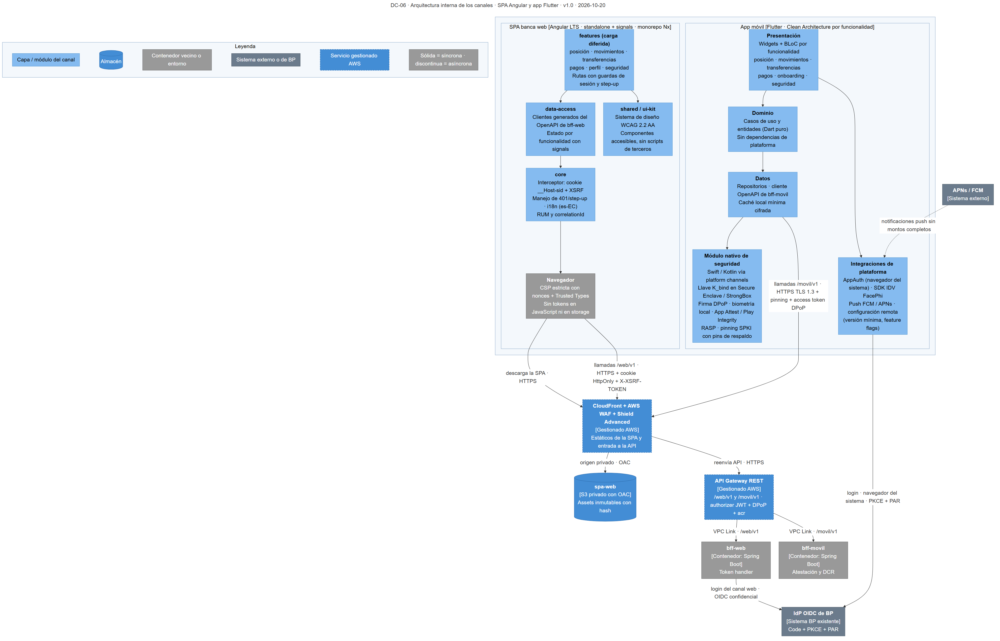

::: {.figcap}
**Figura 7b.** Arquitectura interna de los canales. Capas de la SPA Angular y de la app Flutter y su conexión con CloudFront, API Gateway, los BFF y el IdP.

Versión en alta resolución: `diagrams/png/06-arquitectura-front-movil.png`
:::
:::

**SPA Angular (monorepo Nx).**

| Capa | Contenido | Regla |
|---|---|---|
| `features` | Módulos con carga diferida: posición, movimientos, transferencias, pagos, perfil y seguridad. Rutas protegidas por **guardas** (sesión activa; `acr` suficiente para operaciones sensibles) | Un *feature* no importa a otro (reglas de dependencias de Nx verificadas en la integración continua) |
| `data-access` | Clientes HTTP generados desde el OpenAPI de `bff-web`; estado por funcionalidad con *signals* | Único punto que habla con la API |
| `core` | **Interceptor** que envía la cookie `__Host-sid` (`HttpOnly`, `Secure`, `SameSite=Strict`) y la cabecera **XSRF**; manejo central de 401 y del reto de *step-up*; propagación de `correlationId`; RUM; **i18n** (es-EC, preparado para otros idiomas) | Se carga una sola vez |
| `shared` / `ui-kit` | Sistema de diseño accesible **WCAG 2.2 AA** (contraste, foco visible, navegación por teclado, lectores de pantalla, objetivos táctiles ≥ 24 px) | Sin lógica de negocio |

Controles del navegador: **CSP estricta con *nonces*** y **Trusted Types** (Angular sanitiza por defecto y bloquea asignaciones peligrosas al DOM), HSTS, `frame-ancestors 'none'`, sin *scripts* de terceros en páginas transaccionales y **ningún token en JavaScript, `localStorage` ni `sessionStorage`**. La SPA se publica en S3 privado con *assets* inmutables con *hash*; un despliegue es atómico (se cambia `index.html` al final) y CloudFront invalida solo ese archivo.

**App Flutter (Clean Architecture por funcionalidad).**

| Capa | Contenido |
|---|---|
| Presentación | *Widgets* y gestión de estado con **BLoC** por funcionalidad (posición, movimientos, transferencias, pagos, onboarding, seguridad); accesibilidad con `Semantics`, tamaño de fuente del sistema y contraste AA |
| Dominio | Casos de uso y entidades en Dart puro, sin dependencias de plataforma (comprobables con pruebas unitarias) |
| Datos | Repositorios, cliente HTTP generado desde el OpenAPI de `bff-movil`, caché local mínima cifrada (nunca movimientos completos ni tokens de refresco en claro) |
| **Módulo nativo de seguridad** (Swift / Kotlin) | Llave `K_bind` no exportable en Secure Enclave / StrongBox; firma de las pruebas **DPoP**; biometría local (Face ID / BiometricPrompt); App Attest / Play Integrity; **RASP** (root/jailbreak, *hooking*, emulador, depuración); **pinning** por SPKI con *pins* de respaldo. La parte Flutter nunca toca secretos |
| Integraciones | AppAuth (login en el navegador del sistema, PKCE + PAR), SDK IDV de FacePhi para el onboarding, **push** por FCM/APNs sin montos completos ni OTP en pantalla bloqueada, configuración remota |

**Almacenamiento seguro.** Keychain (iOS) y Keystore (Android) solo para datos mínimos (identificador de instancia, referencia a la llave). El *access token* vive en memoria y se descarta al bloquear la app (2 min de inactividad o al pasar a segundo plano).

**Estrategia de releases.**

| Canal | Cómo se publica | Control de riesgo |
|---|---|---|
| SPA | *Pipeline* con pruebas unitarias, E2E, SAST/SCA y escaneo de cabeceras; despliegue a *staging* y luego a producción | *Feature flags* por funcionalidad; activación gradual (*canary* por porcentaje de clientes) y vuelta atrás desactivando el *flag* o restaurando la versión anterior de `index.html` |
| App móvil | App Store y Google Play con lanzamiento escalonado (*phased release* / *staged rollout*: 1 % → 10 % → 50 % → 100 %) | *Feature flags* por configuración remota; **versión mínima soportada** que el BFF exige por cabecera: por debajo de ella, **actualización forzada**; entre la mínima y la recomendada, aviso de actualización. Sin descarga de código ejecutable fuera de las tiendas |
| Ambos | Contrato del BFF versionado (`/v1`) y compatible hacia atrás durante al menos dos versiones de la app | Métricas de errores por versión de app; si sube la tasa de error se detiene el escalonamiento |

---

::: {.apaisa .apaisa-compacto}

# 12. Infraestructura AWS

## 12.1 Vista general

La solución se organiza en varias cuentas de AWS Organizations: producción, red, seguridad y herramientas, archivo de logs y backup. Producción corre en `us-east-1` con tres zonas de disponibilidad. La recuperación regional está en `us-east-2`, dentro de la misma organización.

::: {.figcap}
**Figura 8.** Infraestructura AWS (vista general). Cuentas, regiones, borde, cómputo, datos, mensajería y conectividad híbrida con el Core.

Versión en alta resolución: `diagrams/png/04-infra-vista-general.png`
:::
:::

::: {.apaisa}
## 12.2 Borde y entrada

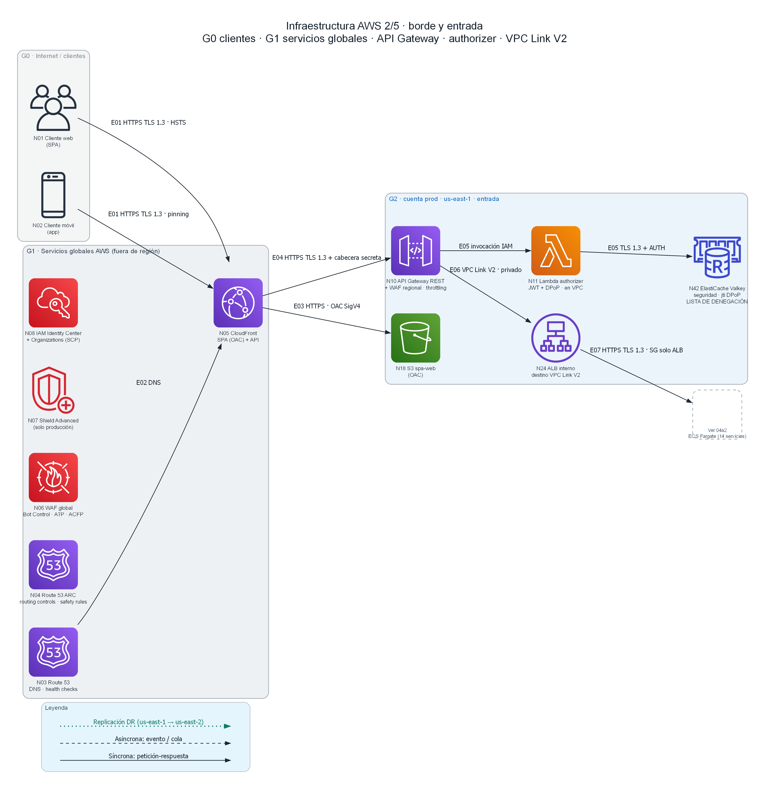

::: {.figcap}
**Figura 9.** Borde y entrada (lámina 04a). CloudFront, WAF global y regional, Shield, API Gateway con authorizer, ALB interno y el bucket de la SPA.

Versión en alta resolución: `diagrams/png/04a-borde-y-entrada.png`
:::
:::

::: {.apaisa}
## 12.3 Cómputo y datos

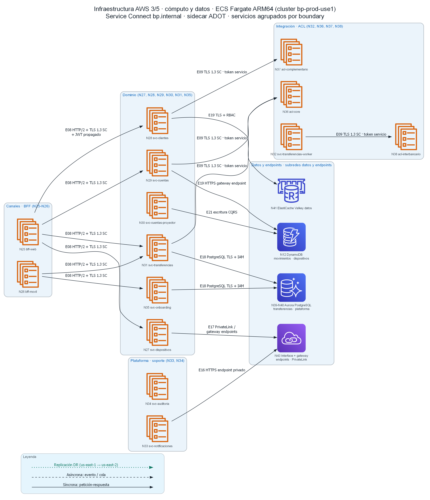

::: {.figcap}
**Figura 10.** Cómputo y datos (lámina 04a2). Servicios en ECS Fargate ARM64 por frontera, bases de datos, caché, CDC, auditoría y endpoints.

Versión en alta resolución: `diagrams/png/04a2-computo-y-datos.png`
:::
:::

::: {.apaisa}
## 12.4 Red híbrida y cuentas

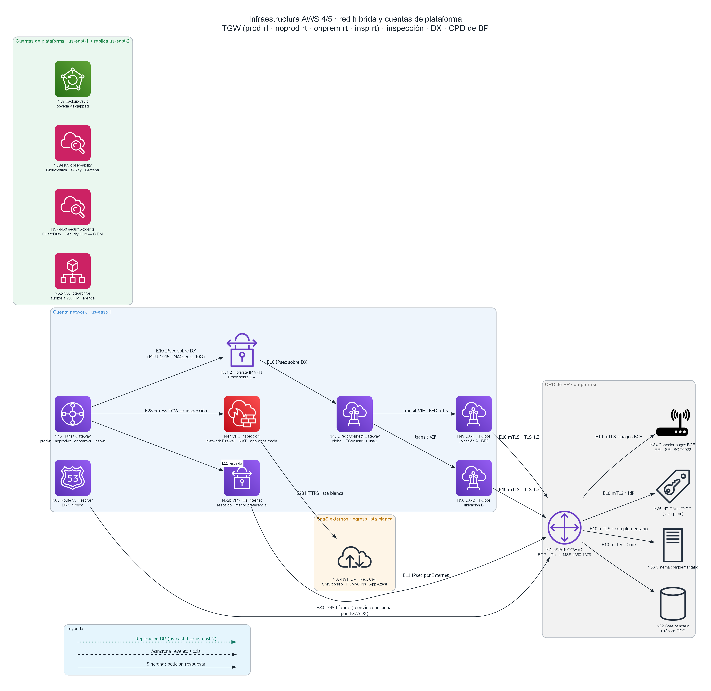

::: {.figcap}
**Figura 11.** Red híbrida y cuentas (lámina 04c). Transit Gateway, inspección centralizada, Direct Connect doble, VPN de respaldo, centro de datos de BP y cuentas de plataforma.

Versión en alta resolución: `diagrams/png/04c-red-hibrida-y-cuentas.png`
:::
:::

**Recursos principales.**

| Capa | Recursos | Notas |
|---|---|---|
| Borde | CloudFront, WAF (global y regional), Shield Advanced, Route 53, ARC | Shield Advanced solo en producción |
| API | API Gateway REST regional, authorizer Lambda ARM64, ALB interno con VPC Link V2 | Sin caché de resultados del authorizer por token |
| Cómputo | ECS Fargate ARM64 para los 14 servicios desplegables del catálogo (incluye el worker de la saga y el proyector de CQRS); Lambda para el authorizer, el sellado de auditoría y trabajos | Tamaños válidos de Fargate; Service Connect con proxy |
| Datos | Aurora PostgreSQL (transferencias y plataforma), DynamoDB, ElastiCache Valkey, S3 | Aurora Global Database; clúster de seguridad con tres nodos en tres zonas |
| Mensajería | EventBridge con Pipes, SQS con DLQ, Step Functions Standard, Kinesis Data Streams | Pipes en reposo en DR para no duplicar eventos |
| Seguridad | KMS (multi-región), Secrets Manager, GuardDuty, Security Hub, Config, Inspector, Macie, Private CA | Ver sección 7 |
| Red | Transit Gateway, Network Firewall (3 zonas), Direct Connect, VPN, endpoints de interfaz | Egreso centralizado por lista blanca |

**Equivalencia con Azure.** El Anexo C detalla los servicios equivalentes en Azure, por si BP prefiere esa nube.

## 12.5 Decisiones de infraestructura

Cuatro decisiones de infraestructura explican la forma de la red y del despliegue (las justificaciones completas están en los ADR-002, ADR-004 y ADR-013):

1. **Cuentas separadas por función.** Producción, red, seguridad y herramientas, archivo de registros y bóveda de respaldo viven en cuentas distintas de AWS Organizations, con políticas de control (SCP). Un error o un acceso indebido en una cuenta no alcanza a las demás, y el respaldo queda aislado incluso frente a un borrado malicioso. La región de DR vive en la cuenta de producción porque Aurora Global Database no admite secundarias en otra cuenta; el aislamiento lo da la bóveda de respaldo.
2. **Red privada por zonas, con salida controlada.** Cada región usa tres zonas de disponibilidad, subredes privadas y grupos de seguridad por servicio. El tráfico hacia Internet pasa por un firewall centralizado con lista blanca, de modo que un servicio comprometido no puede enviar datos a destinos no autorizados.
3. **Conectividad híbrida redundante con el Core.** Dos conexiones dedicadas (Direct Connect) en ubicaciones distintas, con dos proveedores de transporte, y una VPN IPsec por Internet como respaldo. Si caen ambos enlaces, el canal mantiene las lecturas con caché y rechaza las operaciones monetarias.
4. **Cifrado de enlace con IPsec sobre 1 Gbps.** El consumo hacia el Core es bajo (unos 12 Mbps en pico, más el CDC), así que bastan puertos de 1 Gbps con IPsec. MACsec exige puertos de 10 Gbps, con un costo de unos USD 2.850 al mes más; se adoptará si BP ya cuenta con 10 Gbps (sección 15.4).

---

# 13. Alta disponibilidad, DR y auto-healing

## 13.1 Modos de falla

| # | Modo de falla | Reacción automática | Efecto al cliente | RTO / RPO |
|---|---|---|---|---|
| F1 | Tarea de Fargate cae | ECS reemplaza la tarea; el balanceador la retira; el autoescalado repone capacidad | Ninguno | — / 0 |
| F2 | Despliegue defectuoso | Circuit breaker de despliegue y rollback automático | Errores de menos de 1 % durante minutos | Menos de 10 min / 0 |
| F3 | Caída de una zona de disponibilidad | Redistribución en dos zonas; failover de Aurora al lector; ElastiCache promueve la réplica | Errores transitorios de menos de 1 min | Menos de 1 min / 0 |
| F4 | Caída grave de la región | Decisión humana con runbook (no automática) | Indisponibilidad hasta la conmutación | ≤ 30 min (Tier 1) y ≤ 1 h (Tier 2) / ≤ 1 min (Tier 1) y ≤ 5 min (Tier 2) |
| F5 | Core lento o caído | Circuit breaker, bulkhead y *load shedding* (prioridad: transferencias, luego posición, luego histórico) | Movimientos disponibles desde el modelo de lectura, con marca de frescura; saldo desde caché de hasta 30 s con aviso; transferencias rechazadas con mensaje claro, o en verificación si hubo *timeout* | — / 0 en el canal |
| F6 | IdP caído | JWKS en caché: las sesiones vigentes siguen funcionando | No se puede iniciar sesión | — |
| F7 | Sistema complementario caído | Caché de 24 h; respuesta parcial | Detalle no disponible | — / 0 |
| F8 | Red interbancaria caída | Circuit breaker, *timeouts* de la saga, RPI a SPI solo antes de enviar | Transferencias en `EN_PROCESO` | — / 0 |
| F9 | Proveedor de notificaciones o biometría caído | Proveedor alterno (Adapter); expediente pendiente | Notificación por el canal alterno | — / 0 |
| F10 | Un enlace Direct Connect cae | BGP converge al segundo enlace; si caen ambos, VPN por Internet | Lecturas reintentan; escrituras idempotentes | — / 0 |
| F11 | ElastiCache de datos caído | Lectura directa a la fuente con limitador de tasa | Latencia mayor | — / 0 (datos derivables) |
| F12 | ElastiCache de seguridad caído | Failover a la réplica; si cae todo, modo *fail-static* del authorizer (máximo 15 min, luego *fail-closed*) | Monetarias rechazadas; lecturas con tokens de vida corta | — / 0 |
| F13 | Lag de CDC mayor a 60 s | Lectura directa al Core | Ninguno | — |
| F14 | Mensajes envenenados | Aislamiento en DLQ y alarma | Ninguno, o notificación tardía | — / 0 |

**Objetivos de recuperación por nivel (Tier).**

| Nivel | Servicios | RTO | RPO | Estrategia en `us-east-2` |
|---|---|---|---|---|
| Tier 1 | Autenticación y sesiones, transferencias y pagos, auditoría | ≤ 30 min | ≤ 1 min (auditoría: prácticamente 0 dentro de la región) | Warm standby |
| Tier 2 | Consultas de movimientos y posición, notificaciones, onboarding | ≤ 1 h | ≤ 5 min | Warm standby con capacidad mínima |
| Tier 3 | Reportería y analítica | ≤ 24 h | ≤ 24 h | Backup y restauración |

## 13.2 Disponibilidad compuesta por journey

La disponibilidad de cada recorrido se calcula como el producto de las disponibilidades de sus dependencias en la ruta crítica. El login depende del gateway, del BFF, del clúster de seguridad y del IdP de BP. Supuesto actual: el IdP tiene 99,95 %; por eso el SLO de login se fija en 99,9 % y se solicita a BP un IdP con disponibilidad de al menos 99,99 %. La transferencia propia depende además del Core, cuyo límite de disponibilidad condiciona su SLO, que también es 99,9 %. La consulta de movimientos depende de DynamoDB y de la caché, no del Core en condiciones normales, y su SLO es 99,95 %.

## 13.3 Estrategia de DR

| Estado en `us-east-2` | Componentes |
|---|---|
| **Caliente** (replicando, listo para servir) | Aurora Global de transferencias (con instancia), DynamoDB Global Tables, Global Datastore del clúster de seguridad, S3 CRR (auditoría WORM, KYC y SPA), KMS multi-región |
| **Tibio** (desplegado a capacidad mínima) | ECS con 22 tareas (Tier 1: 8 servicios por 2; Tier 2: 6 por 1), API Gateway, ALB, WAF regional, authorizer, EventBridge, SQS y Step Functions |
| **Frío** (se crea o se carga al conmutar) | Caché de datos (se calienta con Refresh-Ahead), CDC de DMS, *workgroups* de Athena, reportería Tier 3 (restauración de AWS Backup, RTO de 24 h) |

**Runbook de conmutación regional (RTO objetivo: 30 min).**

| Paso | Acción | Tiempo objetivo |
|---|---|---|
| 0 | Declarar incidente P1, congelar despliegues | T+0 a T+5 min |
| 1 | Verificar salud de `us-east-2` y el lag de réplicas | T+5 a T+8 min |
| 2 | Detener escrituras en la región origen con modo de mantenimiento | T+8 a T+10 min |
| 3 | Promover Aurora Global y el Global Datastore de seguridad | T+10 a T+12 min |
| 4 | Escalar ECS a la capacidad mínima de producción y arrancar CDC | T+12 a T+18 min |
| 5 | Verificar conectividad con el Core por Direct Connect Gateway | T+15 a T+20 min |
| 6 | Rehidratar las sagas en curso desde Aurora, de forma idempotente | T+18 a T+22 min |
| 7 | Conmutar el tráfico con una sola llamada a ARC (routing controls) | T+22 a T+24 min |
| 8 | Validar los journeys con canaries y comunicar a clientes | T+25 a T+30 min |
| 9 | Retorno (*failback*) planificado cuando la región origen se estabilice | Días |

Durante la conmutación no se usan planos de control alojados en la región caída (IAM, Route 53, CloudFront). Las sesiones web sobreviven gracias al Global Datastore; las instancias móviles no se ven afectadas, porque sus llaves están en el dispositivo y los tokens se validan con las JWKS del IdP.

::: {.figura}
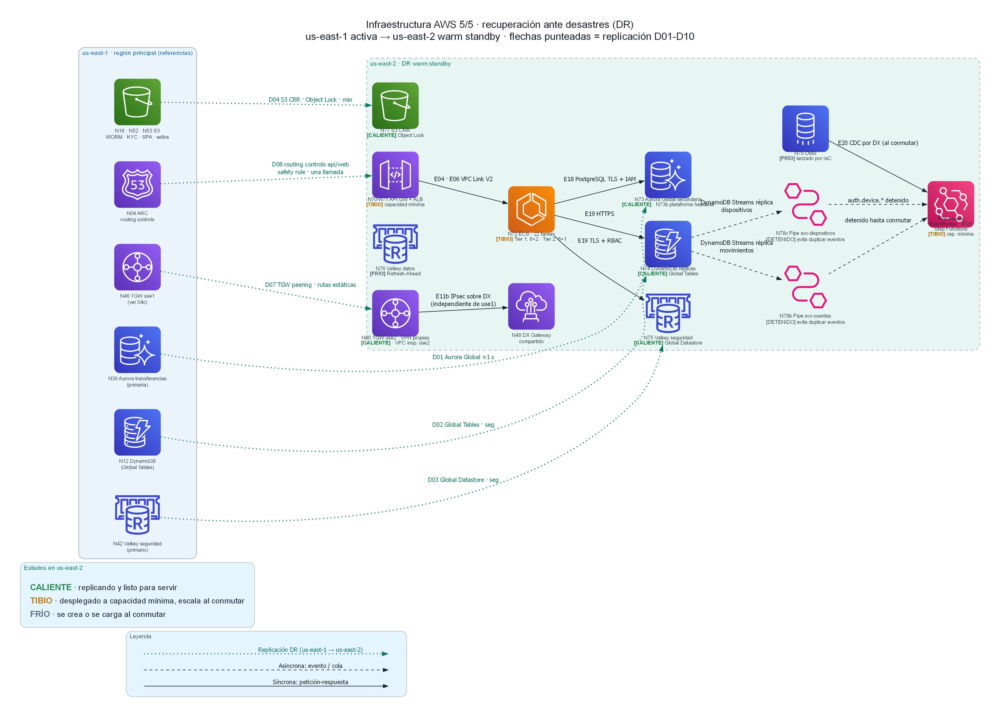

::: {.figcap}
**Figura 12.** Recuperación ante desastres (lámina 04b). Estados caliente, tibio y frío de los componentes en `us-east-2`, con replicación de datos y ruta de conmutación.

Versión en alta resolución: `diagrams/png/04b-dr-multi-region.png`
:::
:::

**Pruebas.** Ensayos de conmutación semestrales y pruebas de caos trimestrales con AWS FIS. Un plan de DR no ensayado no es un plan.

---

# 14. Monitoreo y excelencia operativa

## 14.1 SLI y SLO por journey

| Journey | SLI de disponibilidad | Latencia (p95) | SLO | Presupuesto de error mensual |
|---|---|---|---|---|
| Login | Logins exitosos / intentos válidos | ≤ 1,5 s | 99,9 % | ≈ 43 min |
| Consulta de movimientos | Respuestas válidas / total | Primera página ≤ 800 ms | 99,95 % | ≈ 21,6 min |
| Posición consolidada | Ídem | ≤ 500 ms con caché | 99,95 % | ≈ 21,6 min |
| Transferencia propia | Completadas sin error técnico / solicitadas | ≤ 2 s | 99,9 % | ≈ 43 min |
| Transferencia interbancaria | Aceptación 202 sin error técnico; estado final en plazo por riel | Aceptación ≤ 2 s | 99,95 % aceptación; 99 % en plazo | — |
| Onboarding | Expedientes aceptados sin error técnico | Pasos ≤ 3 s | 99,9 % | ≈ 43 min |
| Notificación de movimiento | Entregada por al menos dos canales en 60 s | ≤ 60 s | 99,9 % | — |

**Por qué la interbancaria tiene un SLO de aceptación de 99,95 % y la transferencia propia de 99,9 %.** La aceptación (`202`) se registra en la base de la saga y el débito se ejecuta después, de forma asíncrona, así que la aceptación no depende del Core en línea. La transferencia propia, en cambio, se contabiliza de forma síncrona en el Core, cuyo límite de disponibilidad fija su SLO.

## 14.2 Alertas

Las alertas se configuran por *burn rate* multiventana, según el SRE Workbook: una alerta de página cuando el presupuesto de error se consume a 14,4 veces su ritmo normal durante 15 min, y una alerta de ticket a un ritmo menor en una ventana más larga. Cada alarma accionable tiene un dueño y un *runbook*. Las alertas de síntomas (recorridos) prevalecen sobre las de causa (CPU).

**Ejemplo de alarma accionable (login).**

| Campo | Contenido |
|---|---|
| Condición | Consumo del presupuesto de error del login a 14,4 veces su ritmo durante 15 min |
| Dueño | Equipo de identidad, con guardia de operación |
| Primer diagnóstico | Separar errores 401 (credenciales o dispositivo) de errores 5xx (plataforma); revisar el IdP y el clúster de seguridad |
| Acción 1 | Si el clúster de seguridad falla, failover a la réplica de ElastiCache (F12); si persiste, modo *fail-static* del authorizer |
| Acción 2 | Si el IdP no responde, activar el aviso a clientes y abrir caso con BP |
| Escalamiento | Comité de crisis si el consumo se mantiene más de 30 min o hay impacto regional |
| Cierre | Revisión posterior al incidente, sin culpables, con acciones registradas |

## 14.3 Telemetría y operación

- **Golden signals** por servicio: latencia, tráfico, errores y saturación.
- **Trazas distribuidas** con OpenTelemetry y muestreo del 10 % más el 100 % de errores y de solicitudes lentas.
- **Logs** estructurados con retención de 30 a 90 días en CloudWatch y archivo en S3.
- **RUM** de la SPA con muestreo del 25 %, y **Synthetics** con siete journeys en dos regiones.
**Excelencia operativa.** La operación se apoya en cuatro prácticas:

- **CI/CD** con revisión obligatoria de cada cambio (*merge request*), pruebas automatizadas y escaneo de seguridad (sección 7.8).
- **Infraestructura como código** con Terraform: sin cambios manuales en producción; la infraestructura se revisa y se despliega desde el mismo pipeline.
- **Despliegues progresivos** *blue/green* o *canary*, con métricas de los recorridos como criterio de avance y reversión automática si el consumo del presupuesto de error se acelera.
- **Revisión posterior a incidentes**, tablero de DR en Grafana y ensayos de recuperación semestrales.

---

# 15. Costos

## 15.1 Resumen por capa

| Capa | Producción (us-east-1) | DR (us-east-2) | Total mensual (USD) | Partidas principales |
|---|---:|---:|---:|---|
| Borde (CloudFront, WAF, Shield Advanced, Route 53, ARC) | 8.071 | — | 8.071 | Shield Advanced 3.000; WAF ATP 2.283; ARC 1.825 |
| API (API Gateway, authorizer, ALB) | 515 | 40 | 555 | API Gateway 420 |
| Cómputo (Fargate ARM64, Lambda) | 1.970 | 922 | 2.892 | 68 vCPU y 136 GB en promedio |
| Datos (Aurora, DynamoDB, ElastiCache, Kinesis, DMS, S3, Athena, Backup) | 2.485 | 962 | 3.447 | Aurora 926; ElastiCache 789; DMS 270 |
| Mensajería (EventBridge, SQS, Step Functions) | 596 | — | 596 | Step Functions 288 |
| Red (Direct Connect, VPN, TGW, Network Firewall, endpoints) | 2.620 | 1.272 | 3.892 | Network Firewall 898; Direct Connect 478 |
| Seguridad (KMS, Secrets, GuardDuty, Security Hub, Config, Inspector, Macie) | 2.253 | 175 | 2.428 | GuardDuty 700; Security Hub y Config 650 |
| Observabilidad (logs, métricas, X-Ray, Synthetics, RUM, Grafana) | 2.125 | 175 | 2.300 | Métricas 650; logs 675 |
| **Total** | **20.635** | **3.546** | **24.181** | |
| Contingencia del 15 % | | | 3.627 | |
| **Total con contingencia** | | | **≈ 27.800** | Supuesto de presupuesto: 25.000 a 45.000 USD al mes (el enunciado no fija una cifra) |
| Condicional: CA privada para mTLS hacia on-premise (2 regiones), solo si BP no usa su propia PKI | | | +800 (+920 con contingencia) | ≈ 28.700 |

El detalle fila a fila (supuesto, precio unitario, fuente y elasticidad) está en `docs/costos/estimacion-costos.csv`. El costo de DR representa cerca del 15 % del total porque el borde, Shield, ARC y la seguridad organizacional son globales o se cobran una vez.

## 15.2 Sensibilidad al volumen

| Escenario | Volumen | Total mensual (sin contingencia) |
|---|---|---:|
| ×0,5 | Mitad del volumen de diseño (1 M de clientes, sobre la base de 2 M; 60 M de llamadas al mes) | ≈ 19.100 |
| Base | Volumen de diseño de la sección 2 (2 M de clientes) | ≈ 24.200 |
| ×2 | 4 M de clientes; 240 M de llamadas al mes | ≈ 34.300 |

El costo escala de forma sub-lineal: duplicar el volumen multiplica el costo por 1,42, porque los controles de seguridad y de resiliencia son mayormente fijos. El costo variable dominante es el WAF ATP, seguido de los logs y de API Gateway.

## 15.3 Costos no incluidos

| Concepto | Orden de magnitud mensual | Estado |
|---|---|---|
| Licencia o suscripción del IdP (producto de BP) | USD 5.000 a 30.000 | A cotizar |
| Proveedor biométrico IDV (unas 25.000 verificaciones al mes) | USD 12.000 a 38.000 | A cotizar |
| SMS (unos 300.000 al mes) | USD 9.000 a 24.000 | Estimación |
| Correo y push | USD 500 a 1.000 | Estimación |
| Circuitos del proveedor local hasta Direct Connect | USD 4.000 a 15.000 | A cotizar |
| Soporte AWS Enterprise (recomendado para banca) | USD 1.800 a 15.000 | Estimación |
| Entornos no productivos (staging, QA, dev) | USD 3.500 a 6.000 | Estimación |
| CloudHSM (solo si se exige custodia mono-inquilino) | USD 4.400 a 9.000 | Estimación |

Con los entornos no productivos, el total estimado queda entre USD 31.300 y 33.800 al mes.

## 15.4 Palancas de optimización

La tabla separa tres grupos: palancas ya incluidas en la base de 24.181 USD (no suman), la palanca descartada y las palancas aplicables que sí se suman al ahorro.

| Palanca | Ahorro mensual (USD) | Estado | Trade-off |
|---|---:|---|---|
| Analizar con ATP solo los inicios de sesión sin señal de dispositivo conocido | ≈ 1.300 | Aplicable | Menor cobertura en dispositivos conocidos, mitigada con reglas por tasa |
| Tareas de DR con una sola tarea por servicio de Tier 1 (escala al conmutar) | ≈ 460 | Aplicable | Menos capacidad inicial tras la conmutación; depende de cuotas elevadas |
| Compute Savings Plans de 1 año sobre Fargate y Lambda | 400 a 500 (estimado) | Aplicable | Compromiso de un año |
| Nodos reservados de ElastiCache e instancias reservadas de Aurora | ≈ 400 (estimado) | Aplicable | Compromiso; menos flexibilidad de tipo |
| DynamoDB en clase Standard-IA para movimientos | ≈ 150 | Aplicable | Mayor costo por escritura; conviene por el peso del almacenamiento |
| Logs en clase Infrequent Access (workers y depuración) | 100 a 200 | Aplicable | Sin algunas funciones, como los filtros de métricas |
| Retención por niveles de logs (CloudWatch, luego S3 y Glacier) | ≈ 50 | Aplicable | Consulta más lenta del histórico |
| Muestreo de trazas al 5 % fuera de picos | ≈ 50 | Aplicable | Menos detalle en casos poco frecuentes |
| **Total de palancas aplicables** | **≈ 2.900 a 3.100** | | Total sin contingencia: **≈ 21.100 a 21.300** |
| Red de 1 Gbps con IPsec en lugar de 10 Gbps con MACsec | ≈ 2.850 evitados | Ya incluida en la base | MACsec solo si BP ya tiene 10 Gbps |
| Graviton (ARM64) en todos los servicios | ≈ 20 % frente a x86 | Ya incluida en la base | Imágenes multi-arquitectura en CI |
| Trazas al 10 % más errores, y RUM al 25 % | — | Ya incluida en la base | Menos visibilidad de casos raros |
| Cambio a ARC Region switch en lugar del clúster de *routing control* | ≈ 1.755 | Descartada | Se mantiene el clúster por ser el plano de conmutación más robusto |
| Apagado de no productivos fuera de horario | 30 a 50 % del costo no productivo | Fuera de la base | Ninguno relevante |

Con las palancas aplicables (≈ 2.900 a 3.100 USD al mes), el total sin contingencia queda entre ≈ 21.100 y 21.300 USD al mes. El ahorro de no productivos se calcula sobre un costo que no está en la base de 24.181 USD. Algunas cifras son estimaciones que se validarán en la calculadora de precios de AWS.

**Riesgo de estimación.** Los precios estimados y los servicios menores pueden variar entre ±10 y 15 %. Se mitigan con la calculadora de precios de AWS, la contingencia y el monitoreo de anomalías de costo.

---

# 16. Riesgos y supuestos a validar con BP

| # | Riesgo o supuesto | Impacto | Mitigación o acción |
|---|---|---|---|
| 1 | El IdP de BP no soporta PAR, DPoP o DCR | Alto: cambia el registro del móvil | Matriz de brechas (sección 7.3) y respaldo `bff-movil` como cliente confidencial |
| 2 | El Core no permite leer sus cambios desde una réplica (CDC) ni deduplicar débitos por referencia | Alto: afecta el modelo de lectura y las transferencias | Validar con el proveedor del Core en la primera fase; lectura directa al Core como respaldo |
| 3 | Latencia desde Ecuador a `us-east-1` mayor a la estimada | Medio: experiencia del cliente | La latencia se medirá en el piloto. Alternativa: `sa-east-1`, con mayor costo |
| 4 | Residencia de datos fuera de Ecuador | Alto: restricción normativa | Revisión legal; garantías contractuales de transferencia internacional; llaves en KMS XKS (HSM de BP) si la residencia de llaves lo exige |
| 5 | Cálculo de volumen (2 M de clientes; 8 M de sesiones al mes) | Medio: costo y capacidad | Sensibilidad de 0,5× a 2× (sección 15.2) |
| 6 | Proveedor biométrico y su nivel de prueba de vida | Alto: fraude en el onboarding | Adjudicar con evidencia de conformidad de nivel 2 de iBeta (ISO/IEC 30107-3) |
| 7 | Interoperabilidad con SPI y RPI (ISO 20022) | Medio: rechazos de la red | Pruebas con el BCE; traductor en el ACL interbancario |
| 8 | Cumplimiento regulatorio de la SB y de la JPRF | Alto: autorización del canal | Revisión legal y paquete documental antes de producción |
| 9 | Evaluación de impacto (EIPD) del onboarding biométrico | Alto: requisito de la LOPDP | Realizar la EIPD antes de producción, con el DPO |
| 10 | Disponibilidad del IdP por debajo de 99,99 % (supuesto actual 99,95 %) | Medio: SLO de login | Solicitar ≥ 99,99 % a BP o aceptar 99,9 % |
| 11 | Estimaciones de precio no cotizadas | Bajo a medio: presupuesto | Contingencia del 15 % y calculadora de precios de AWS |
| 12 | Modelo de amenazas y runbook de DR sin ensayo | Medio: RTO no cumplido | Ensayos semestrales de DR y pruebas de caos trimestrales |

---

# 17. Diagramas de secuencia

Los ocho diagramas de secuencia describen los flujos más críticos. Cada uno tiene su fuente en `docs/04-modelo-c4.md` §5 o en el ADR correspondiente.

| ID | Flujo | Relación con la arquitectura |
|---|---|---|
| SQ-01 | Login web por BFF (Authorization Code, PKCE y PAR) y step-up de transferencia | ADR-007, ADR-003 |
| SQ-02 | Enrolamiento de instancia (DCR) y login móvil con biometría y DPoP | ADR-007, ADR-006 |
| SQ-03 | Reanudación de sesión móvil tras segundo plano o inactividad | ADR-007 |
| SQ-04 | Onboarding con reconocimiento facial | ADR-008 |
| SQ-05a | Transferencia interbancaria: autorización con step-up y scoring antifraude (hasta el 202) | ADR-007, ADR-009 |
| SQ-05b | Transferencia interbancaria: saga, rieles RPI/SPI, compensación y notificaciones | ADR-009, ADR-004 |
| SQ-06 | Robo de dispositivo: reporte y revocación | Sección 7.5 |
| SQ-07 | Consulta de movimientos con caché y degradación al Core | ADR-011, ADR-004 |

::: {.apaisa}
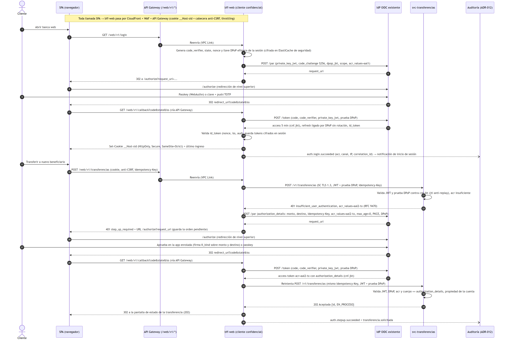

::: {.figcap}
**Figura 13.** Secuencia SQ-01. Login web con Authorization Code, PKCE y PAR; DPoP de punta a punta (bff-web firma una prueba en cada llamada interna) y step-up por redirección a la autorización para una transferencia.

Versión en alta resolución: `diagrams/png/05-sq01-login-web-bff.png`
:::
:::

::: {.apaisa}
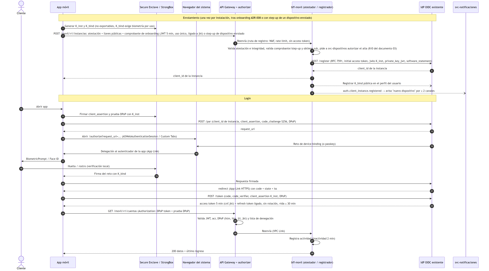

::: {.figcap}
**Figura 14.** Secuencia SQ-02. Enrolamiento de la instancia móvil (DCR con atestación) y login con biometría y DPoP.

Versión en alta resolución: `diagrams/png/05-sq02-enrolamiento-login-movil.png`
:::
:::

::: {.apaisa}
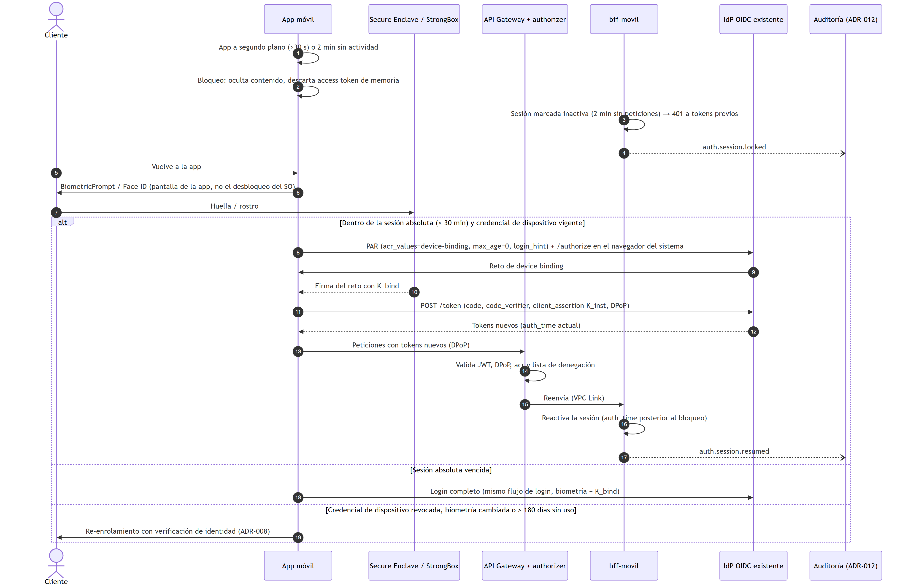

::: {.figcap}
**Figura 15.** Secuencia SQ-03. Reanudación de la sesión tras segundo plano o inactividad, con reautenticación biométrica local.

Versión en alta resolución: `diagrams/png/05-sq03-reanudar-sesion-movil.png`
:::
:::

::: {.apaisa}
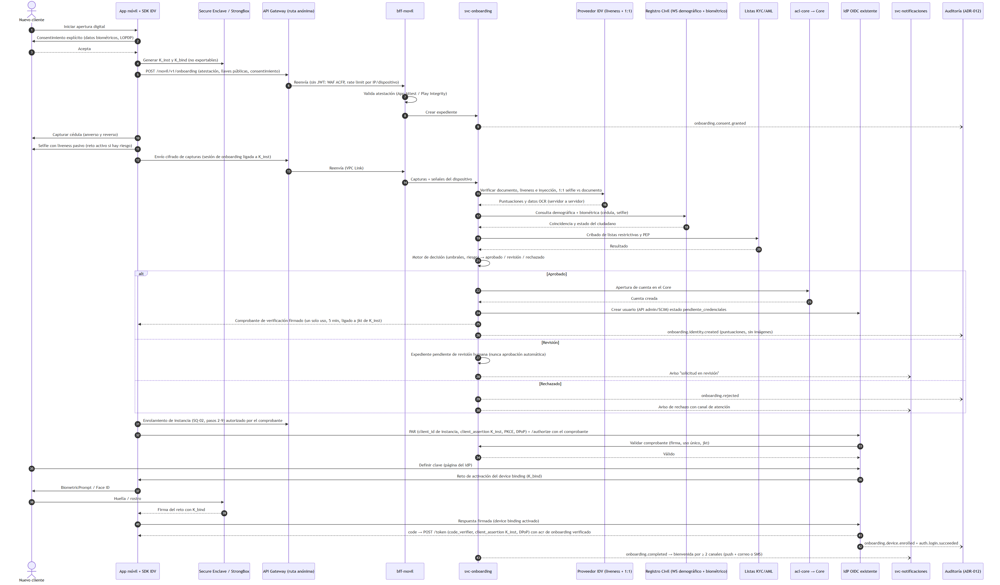

::: {.figcap}
**Figura 16.** Secuencia SQ-04. Onboarding: captura en el dispositivo, verificación en el servidor y alta en el IdP con comprobante firmado.

Versión en alta resolución: `diagrams/png/05-sq04-onboarding-facial.png`
:::
:::

::: {.apaisa}
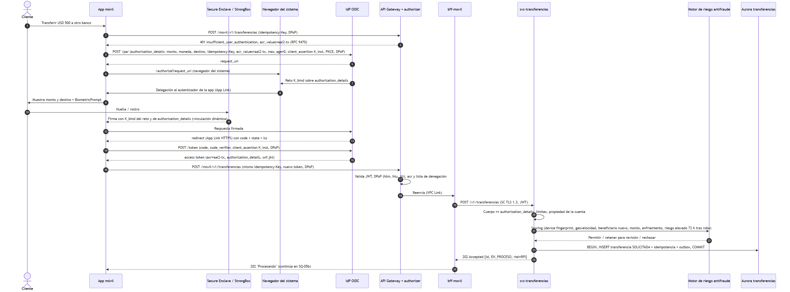

::: {.figcap}
**Figura 17.** Secuencia SQ-05a. Transferencia interbancaria: reto de step-up (RFC 9470), autorización con PAR y `authorization_details` en el navegador del sistema, firma con la llave del dispositivo, scoring antifraude y aceptación (202).

Versión en alta resolución: `diagrams/png/05-sq05a-transferencia-autorizacion-stepup.png`
:::
:::

::: {.apaisa}
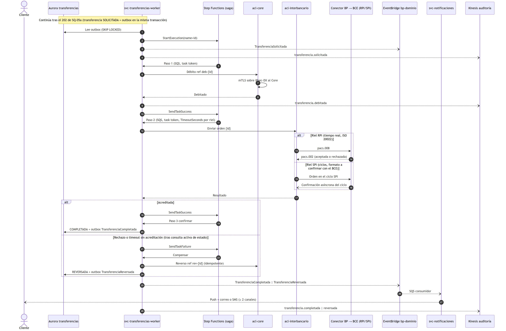

::: {.figcap}
**Figura 18.** Secuencia SQ-05b. Saga en Step Functions: débito, envío por la RPI o el SPI, compensación ante rechazo y notificación por al menos dos canales.

Versión en alta resolución: `diagrams/png/05-sq05b-transferencia-saga.png`
:::
:::

::: {.apaisa}
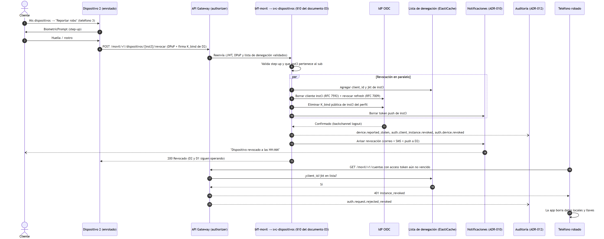

::: {.figcap}
**Figura 19.** Secuencia SQ-06. Reporte del robo y revocación de la instancia robada, con auditoría y notificación por dos canales.

Versión en alta resolución: `diagrams/png/05-sq06-robo-dispositivo.png`
:::
:::

::: {.apaisa}
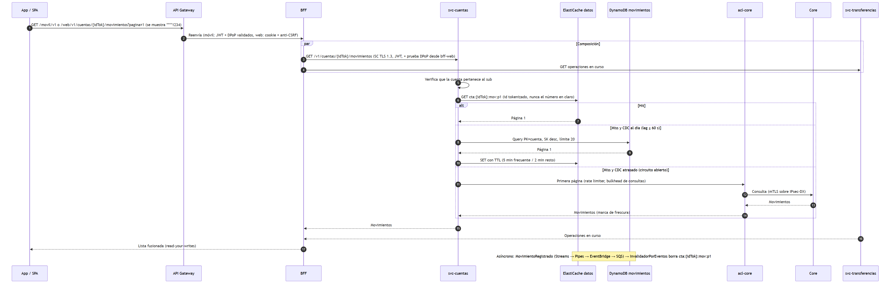

::: {.figcap}
**Figura 20.** Secuencia SQ-07. Consulta de movimientos: caché de clientes frecuentes, lectura de DynamoDB y degradación al Core si el CDC se atrasa.

Versión en alta resolución: `diagrams/png/05-sq07-consulta-movimientos.png`
:::
:::

---

# Anexo A. Matriz de la rúbrica

Autoevaluación honesta: el "nivel de cumplimiento" refleja el estado del documento al cierre de esta versión; la brecha indica lo que queda pendiente antes de producción.

| # | Criterio | Dónde se cubre | ADR relacionados | Nivel de cumplimiento | Brecha o pendiente |
|---|---|---|---|---|---|
| 1 | Solución que satisface los requerimientos, con justificación | Secciones 2, 4, 6 y 17 | Todos | Cumple | Supuestos de volumen y costo pendientes de validación con BP |
| 2 | Calidad y profundidad de los diagramas C4 | Secciones 3, 4 y 5; convención única en `docs/04-modelo-c4.md` | ADR-001, ADR-004 | Cumple | Ninguna relevante; las láminas en alta resolución están en `diagrams/png/` |
| 3 | Segmentación de responsabilidades y desacoplamiento | Secciones 4 y 5; catálogo de servicios | ADR-001, ADR-003, ADR-004, ADR-011 | Cumple | Ninguna relevante |
| 4 | Patrones de arquitectura | Secciones 5 y 9; patrones en cada ADR | ADR-001, 003, 004, 009 a 013 | Cumple | Ninguna relevante |
| 5 | Integración con servicios externos | Sección 10; traductores en la sección 4 | ADR-001, 003, 004, 009, 010 | Cumple | Tiempos de espera propuestos; SLA de proveedores por cotizar |
| 6 | Arquitectura de front-end y móvil | Sección 11; ADR-005 y ADR-006 | ADR-003, 005, 006, 007 | Cumple | Ninguna relevante |
| 7 | Acceso a datos | Sección 9; figura 6; sección 12.3 | ADR-004, 009, 011, 012 | Cumple | Ninguna relevante |
| 8 | Nube (AWS) | Sección 12; anexo C para Azure | ADR-002, 013, 014 | Cumple | Cuentas y redes sujetas a la revisión de BP |
| 9 | Manejo de costos | Sección 15 | ADR-002, 013, 014 | Cumple | Estimación con error de ±10 a 15 %; el presupuesto es un supuesto |
| 10 | Autenticación | Sección 7.2; ADR-007 | ADR-003, 005, 006, 007 | Cumple | Proveedor de identidad de BP por confirmar; CIBA como evolución |
| 11 | Integración con el onboarding | Sección 7; SQ-04; ADR-006 y ADR-008 | ADR-006, 008 | Cumple | Protocolo del Registro Civil a confirmar con la entidad |
| 12 | Auditoría | Sección 9.1; figura 7 | ADR-012 | Cumple | Validación legal del plazo de supresión frente al registro inmutable |
| 13 | Regulaciones bancarias y estándares de seguridad | Secciones 7 y 8 | ADR-005 a 008, 010, 012 | Cumple | Normas pendientes de validación legal antes de producción (SB, JPRF, SPDP) |
| 14 | HA y tolerancia a fallos | Sección 13; figura 12 | ADR-002, 004, 009, 010, 011, 013 | Cumple | Ensayo de DR pendiente en la fase de piloto |
| 15 | Monitoreo | Sección 14 | ADR-014 | Cumple | Tableros y alarmas se implementan en la fase de piloto |

---

# Anexo B. Glosario

Términos y siglas que aparecen en el documento, en orden alfabético.

| Sigla o término | Significado |
|---|---|
| **AAL2 / AAL3** | Niveles de seguridad de la autenticación según NIST SP 800-63B. |
| **ACFP** | Protección de WAF contra fraude en la apertura de cuentas. |
| **ACL** | Capa anticorrupción: traduce el modelo de un sistema externo al modelo interno. |
| **ADR** | Registro de decisión de arquitectura: decisión, alternativas y justificación. |
| **APNs** | Servicio de notificaciones push de Apple. |
| **ARC** | Application Recovery Controller: conmutación de tráfico entre regiones. |
| **ARCOTEL** | Agencia de Regulación y Control de las Telecomunicaciones (Ecuador). |
| **ATP** | Protección de WAF contra la toma de cuentas en el inicio de sesión. |
| **Atestación** | Verificación de que la app es original y que el dispositivo no está comprometido. |
| **Authorizer** | Función que valida el token antes de que la solicitud llegue al servicio. |
| **Auto-healing** | Recuperación automática de instancias fallidas, sin intervención humana. |
| **BCE** | Banco Central del Ecuador. |
| **BFF** | *Backend for Frontend*: backend por canal que adapta los datos a la experiencia. |
| **BOLA** | Autorización rota a nivel de objeto: un usuario accede al recurso de otro. |
| **BP** | Banco para el que se diseña la solución. |
| **Bulkhead** | Aislamiento de recursos para que la falla de uno no hunda a los demás. |
| **Burn rate** | Velocidad con que se consume el presupuesto de error de un SLO. |
| **Cache-Aside** | Patrón en que la aplicación lee de la caché y, si no está, de la fuente. |
| **CA privada** | Autoridad de certificación privada (AWS Private CA). |
| **CDC** | *Change Data Capture*: captura de los cambios de una base de datos a partir de su log. |
| **CIBA** | Autenticación iniciada por el cliente con aprobación desde la app del usuario. |
| **Circuit Breaker** | Patrón que corta las llamadas a una dependencia que falla. |
| **CloudFront** | Red de distribución de contenido de AWS. |
| **COMF** | Código Orgánico Monetario y Financiero. |
| **CQRS** | Separa el modelo de escritura del modelo de lectura. |
| **CSRF / XSRF** | Ataque en que el navegador envía una solicitud no deseada con la sesión del usuario. |
| **DCR** | Registro dinámico de clientes OAuth (RFC 7591). |
| **DLQ** | Cola para mensajes que no pudieron procesarse (*Dead Letter Queue*). |
| **DMS** | Servicio de replicación y CDC de AWS (*Database Migration Service*). |
| **DPO** | Delegado de protección de datos, exigido por la LOPDP. |
| **DPoP** | Prueba de posesión (RFC 9449): liga el token a una llave del cliente. |
| **DR** | Recuperación ante desastres. |
| **DX** | AWS Direct Connect: enlace privado y dedicado con AWS. |
| **EIPD** | Evaluación de impacto en la protección de datos personales. |
| **ECS / Fargate** | Servicio de contenedores de AWS / modo sin servidores de ECS. |
| **EventBridge** | Bus de eventos de AWS. |
| **Fail-static** | Modo degradado que conserva el último estado válido conocido. |
| **Fail-closed / fail-open** | Ante una falla, rechazar (*closed*) o permitir (*open*). |
| **FAPI 2.0** | Perfil de seguridad de la OpenID Foundation para APIs financieras. |
| **FIDO2 / WebAuthn** | Estándares de autenticación sin contraseña con llaves criptográficas. |
| **FIS** | AWS Fault Injection Service: experimentos de caos. |
| **HA** | Alta disponibilidad. |
| **IAL2** | Nivel de verificación de identidad según NIST SP 800-63A. |
| **iBeta (NVLAP)** | Laboratorio acreditado que certifica la detección de presentaciones falsas. |
| **IaC** | Infraestructura como código. |
| **IdP** | Proveedor de identidad que autentica al usuario. |
| **IDV** | Verificación de identidad: documento, biometría y prueba de vida. |
| **Idempotencia** | Propiedad por la que repetir una operación produce el mismo efecto que ejecutarla una vez. |
| **Idempotency-Key** | Cabecera que permite reintentar una solicitud sin duplicarla. |
| **IPsec / MACsec** | Cifrado de red en capa 3 (IPsec) y en capa 2 (MACsec). |
| **ISO 20022** | Estándar internacional de mensajería financiera (`pacs.008`, `pacs.002`). |
| **JPRF** | Junta de Política y Regulación Financiera (Ecuador). |
| **JWKS / JWT** | Conjunto de llaves públicas / token de identidad firmado. |
| **KMS** | Servicio de gestión de llaves de cifrado de AWS. |
| **KYC / AML** | Conozca a su cliente / antilavado de activos. |
| **Liveness** | Prueba de vida: verifica que la persona frente a la cámara está viva. |
| **LOPDP** | Ley Orgánica de Protección de Datos Personales (Ecuador, 2021). |
| **mTLS** | TLS mutuo: cliente y servidor se autentican con certificados. |
| **OAuth 2.0 / OIDC** | Autorización delegada / capa de identidad sobre OAuth 2.0 (OpenID Connect). |
| **OpenTelemetry** | Estándar abierto para instrumentar trazas, métricas y logs. |
| **Outbox transaccional** | Escribe el evento en la misma transacción que el dato y lo publica después. |
| **PAR** | *Pushed Authorization Requests* (RFC 9126): envía los parámetros de autorización por un canal directo. |
| **Passkey** | Credencial de inicio de sesión sin contraseña, basada en FIDO2. |
| **PCI DSS** | Estándar de seguridad para datos de tarjetas de pago. |
| **PKCE** | *Proof Key for Code Exchange* (RFC 7636): protege el código de autorización. |
| **PoC** | Prueba de concepto. |
| **RASP** | Protección de la app en ejecución contra manipulación. |
| **Refresh-Ahead** | Patrón que recarga un dato en caché antes de que expire. |
| **Resilience4j** | Biblioteca de tolerancia a fallos para Java. |
| **RF / RNF** | Requisito funcional / requisito no funcional. |
| **RFC** | Documento de estándar de la IETF. |
| **RO** | Registro Oficial del Ecuador. |
| **RPI** | Red de Pagos Instantáneos del BCE: transferencias en tiempo real. |
| **RPO** | Máxima cantidad de datos que se puede perder, medida en tiempo. |
| **RTO** | Tiempo máximo para restaurar el servicio. |
| **RUM** | Monitoreo de la experiencia real de los usuarios en el navegador. |
| **Saga** | Secuencia de transacciones locales con acciones compensatorias. |
| **SAST / DAST / SCA** | Análisis estático de código / dinámico / de dependencias. |
| **SB** | Superintendencia de Bancos del Ecuador. |
| **SBOM** | Inventario de los componentes de software de una aplicación. |
| **SCP** | Política de AWS Organizations que limita las acciones de las cuentas. |
| **SDLC** | Ciclo de vida del desarrollo de software. |
| **Service Connect** | Descubrimiento y balanceo entre servicios de ECS. |
| **Shield Advanced** | Protección avanzada de AWS contra denegación de servicio distribuida. |
| **SIEM / SOC** | Gestión de eventos de seguridad / centro de operaciones de seguridad. |
| **SLI / SLO** | Indicador de nivel de servicio / objetivo de nivel de servicio. |
| **SLSA** | Marco de niveles de procedencia e integridad del software. |
| **SMS OTP** | Código de un solo uso enviado por mensaje de texto. |
| **SPA** | Aplicación web de una sola página. |
| **SPDP** | Superintendencia de Protección de Datos Personales (Ecuador). |
| **SPI** | Sistema de Pagos Interbancarios del BCE. |
| **SSDF** | Marco de desarrollo seguro del NIST (SP 800-218). |
| **Step-up** | Solicitar un nivel de autenticación mayor para una operación sensible. |
| **STRIDE** | Modelo de amenazas: suplantación, manipulación, repudio, divulgación, denegación de servicio y elevación de privilegios. |
| **TGW** | AWS Transit Gateway: concentrador de red entre VPC, Direct Connect y VPN. |
| **Tier** | Nivel de criticidad de un servicio que define su RTO y su RPO. |
| **TLS** | Cifrado del transporte. |
| **TPS** | Transacciones por segundo. |
| **Token handler** | Patrón en que el backend guarda los tokens y el navegador solo recibe una cookie. |
| **Trusted Types** | Función del navegador que reduce la inyección XSS. |
| **UAFE** | Unidad de Análisis Financiero y Económico (Ecuador). |
| **VPC Link** | Enlace privado que conecta API Gateway con una VPC. |
| **WAF** | Firewall de aplicaciones web. |
| **Warm standby** | Copia del entorno encendida a capacidad mínima, lista para servir. |
| **WORM** | *Write Once Read Many*: impide modificar o borrar registros durante su retención. |
| **XSS** | Inyección de scripts maliciosos en el navegador. |
| **Zero trust** | Modelo que verifica cada solicitud y no confía en la red interna. |

---

# Anexo C. Equivalencias en Azure

Si BP prefiere Azure, la arquitectura se puede trasladar con los siguientes equivalentes. La tabla completa está en `docs/03-nube-ha-dr-monitoreo-costos.md` §6.

| Servicio AWS | Equivalente Azure | Nota |
|---|---|---|
| AWS Organizations y SCP | Management Groups y Azure Policy | |
| IAM Identity Center | Microsoft Entra ID (PIM) | |
| Route 53 y Route 53 ARC | Azure DNS y Traffic Manager, o Azure Front Door | Sin equivalente exacto de ARC |
| CloudFront | Azure Front Door | |
| AWS WAF (Bot Control, ATP, ACFP) | Azure WAF en Front Door (Bot Manager) | ATP y ACFP sin equivalente nativo directo |
| Shield Advanced | Azure DDoS Protection | |
| API Gateway REST con Lambda authorizer | Azure API Management (políticas `validate-jwt`) | |
| ALB con VPC Link V2 | Application Gateway con Private Link | |
| ECS Fargate con Service Connect | Azure Container Apps o AKS | |
| Lambda | Azure Functions | |
| Aurora PostgreSQL Global Database | Azure Database for PostgreSQL Flexible Server | RPO mayor que Aurora Global |
| DynamoDB Global Tables | Azure Cosmos DB (multi-región) | |

---

# Anexo D. Nota de elaboración

Para la elaboración de este ejercicio se utilizó inteligencia artificial con un patrón orquestador.

---

# Anexo E. Prueba de concepto

La carpeta `poc/` del repositorio contiene una prueba de concepto ejecutable (Java 21, Spring Boot 3, arquitectura hexagonal) que demuestra cuatro decisiones del diseño con infraestructura real en contenedores: PostgreSQL, Valkey, un Core simulado con WireMock y un gateway nginx.

| Decisión demostrada | ADR | Evidencia obtenida |
|---|---|---|
| Transferencia idempotente con `Idempotency-Key` | ADR-009 | Primera llamada 201; reintento idéntico 200 con el mismo id; misma clave con otro cuerpo o en otro recurso 422; clave en curso 409 (según ADR-009; cubierto por pruebas unitarias, no por la demo) |
| Transactional Outbox con relay | ADR-001, ADR-009 | La transferencia, el evento y la auditoría se guardan en una sola transacción; el relay publica el evento (`FOR UPDATE SKIP LOCKED`) |
| Cache-Aside para clientes frecuentes y *circuit breaker* hacia el Core | ADR-004, ADR-011, ADR-013 | Primera consulta desde el Core, la siguiente desde caché; con el Core caído responde desde la copia de respaldo marcada como degradada; sin copia, 503 y el circuito pasa a abierto |
| Auditoría con cadena de hashes SHA-256 | ADR-012 | El endpoint de verificación confirma la integridad; una alteración directa en la base se detecta (409, registro alterado identificado) |

Resultados: 22 pruebas unitarias y 3 de integración con Testcontainers en verde; `docker compose up --build` y un guion de 10 escenarios (`poc/demo.sh`) reproducen la evidencia de la tabla. El repositorio incluye además un pipeline de GitHub Actions (build y pruebas con JDK 21) y un módulo Terraform de referencia (VPC en 3 zonas y clúster ECS) validado con `terraform validate`, sin despliegue.

Fuera del alcance de la PoC: OAuth/OIDC y DPoP (se simula el usuario con una cabecera), la saga hacia el Core y la red interbancaria, EventBridge (se usa Valkey Streams), multi-región y pruebas de carga. El detalle y los comandos están en `poc/README.md`.

---

# Referencias

**Estándares y RFC de seguridad.**

- RFC 6749 (OAuth 2.0), RFC 7636 (PKCE), RFC 7591 (Dynamic Client Registration), RFC 7592, RFC 8252 (OAuth para apps nativas), RFC 9126 (PAR), RFC 9449 (DPoP), RFC 9470 (Step-up), RFC 9700 (OAuth 2.0 Security Best Current Practice), RFC 10017 (OAuth 2.0 para aplicaciones de navegador).
- OpenID Foundation: FAPI 2.0 Security Profile (final, 2025); OpenID Connect Core; OpenID Connect Client-Initiated Backchannel Authentication (CIBA).
- NIST SP 800-207 (Zero Trust), SP 800-63B-4 y 800-63A-4 (identidad digital), SP 800-53 y 800-92 (controles y logs), CSF 2.0, SP 800-218 (SSDF).
- ISO/IEC 27001:2022, ISO/IEC 25010, ISO/IEC 27701, ISO 22301, ISO/IEC 30107-3 (detección de presentación), CEN/TS 18099 (inyección biométrica).
- OWASP ASVS 5.0, OWASP API Security Top 10 2023, OWASP MASVS v2 y MASTG.

**Arquitectura y patrones.**

- Evans, E. *Domain-Driven Design* (2003).
- Richardson, C. *Microservices Patterns* (2018).
- Newman, S. *Building Microservices*, 2.ª ed. (2021); *Monolith to Microservices* (2019).
- Nygard, M. *Release It!*, 2.ª ed. (2018).
- Hohpe, G. y Woolf, B. *Enterprise Integration Patterns* (2003).
- Gamma, E. et al. *Design Patterns* (1994).
- Kleppmann, M. *Designing Data-Intensive Applications* (2017).
- Skelton, M. y Pais, M. *Team Topologies* (2019).
- Garcia-Molina, H. y Salem, K. "Sagas" (1987).
- Fowler, M. "Event Sourcing" y "CQRS" (2005 y 2011).

**Operación y nube.**

- Beyer, B. et al. *Site Reliability Engineering* (2016) y *The Site Reliability Workbook* (2018).
- Majors, C., Fong-Jones, L. y Miranda, G. *Observability Engineering* (2022).
- AWS Well-Architected Framework (pilares de Fiabilidad, Seguridad, Rendimiento, Costos y Excelencia Operativa) y el whitepaper *Disaster Recovery of Workloads on AWS*.
- OpenTelemetry (CNCF) y W3C Trace Context.

**Regulación ecuatoriana.**

- Código Orgánico Monetario y Financiero (COMF).
- Codificación de Normas de la Superintendencia de Bancos, Libro I, Título IX, Capítulo V (riesgo operativo y canales electrónicos), y circulares citadas en `docs/02-seguridad-y-normativa.md` §8.
- Ley Orgánica de Protección de Datos Personales (2021) y su reglamento.
- Ley Orgánica de Prevención, Detección y Combate del Delito de Lavado de Activos y de la Financiación de Otros Delitos (RO 4.º Supl. 610, 2024).
- Ley de Comercio Electrónico, Firmas Electrónicas y Mensajes de Datos (2002).
- Norma técnica SPDP-SPD-2026-0040-R, Superintendencia de Protección de Datos Personales (verificación parcial).
- Normas del Banco Central del Ecuador sobre el Sistema Central de Pagos y la Red de Pagos Instantáneos (RPI).

**Fuentes del proyecto.** `docs/00-enunciado.md`, `docs/01-requisitos.md`, `docs/02-seguridad-y-normativa.md`, `docs/03-nube-ha-dr-monitoreo-costos.md`, `docs/04-modelo-c4.md`, `docs/adr/` (ADR-001 a ADR-014) y `docs/costos/estimacion-costos.csv`.
