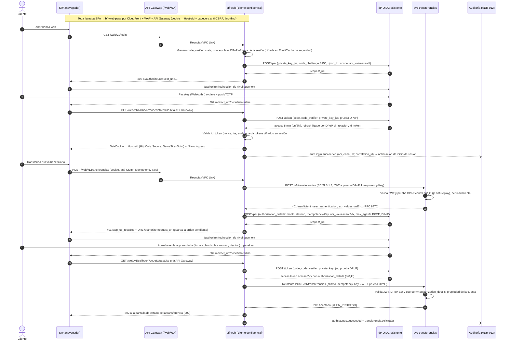
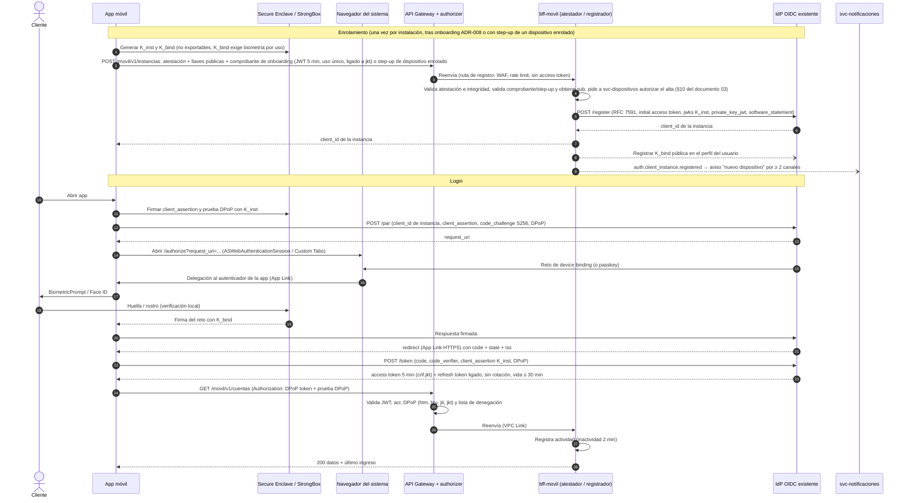
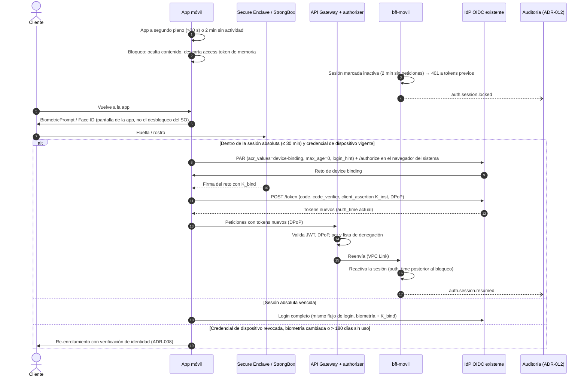

# ADR-007 — Autenticación OAuth 2.0 / OIDC por canal, métodos de ingreso y step-up

| Estado | Fecha | Requisitos | Criterios de rúbrica | Elementos C4 afectados |
|---|---|---|---|---|
| Aceptado (2026-10-19) | 2026-10-18 | RF-11, RF-13, RF-15, RNF-05, RNF-14, RNF-16, S-13, S-20 | #10 Arquitectura de autenticación · #13 Regulaciones y estándares de seguridad · #6 Front-end y móvil | Contexto: IdP existente · Contenedores: SPA, App móvil, BFF Web, BFF Móvil, API Gateway, IdP · Componentes: Identidad (sesión BFF, validador JWT/DPoP, step-up, registro de instancias), Auditoría |

## 1. Contexto

BP exige que **la SPA y la app móvil** autentiquen a los usuarios con un **producto OAuth 2.0 existente y configurable** (RF-11, S-20), que tras el onboarding el cliente ingrese con **clave, huella u otro método** (RF-13) y que la seguridad sea de extremo a extremo (RNF-05). El IdP se trata como **caja negra OpenID Connect** (decisión A-4): se asume que soporta Authorization Code + PKCE, PAR, MFA, pasos de autenticación personalizables, JWT firmados, JWKS y **registro dinámico de clientes (RFC 7591)**; lo que no soporte se cubre con los respaldos de §5. Productos de mercado que cumplen ese perfil: Keycloak, Amazon Cognito, ForgeRock/Ping, Auth0/Okta, Microsoft Entra; ninguno se presupone.

**Fuerzas y restricciones**
- **Dos tipos de cliente con modelos de amenaza distintos**: la SPA corre en un navegador (XSS, extensiones maliciosas, robo de tokens del almacenamiento web); la app corre en un dispositivo que puede estar rooteado, y además tiene un *secure element* (Secure Enclave / StrongBox) que la SPA no tiene.
- **Un secreto embebido en una app distribuida no es secreto** (RFC 8252 §8.5): sin una credencial **por instalación**, cualquiera puede presentarse con el `client_id` de la app. FAPI 2.0 (§5.3.2.1) solo admite clientes confidenciales autenticados con `private_key_jwt` o mTLS.
- **Operaciones de alto riesgo** (transferencia a terceros/interbancaria, nuevo beneficiario, cambio de datos de contacto) requieren un nivel de aseguramiento mayor que la consulta de saldos (*step-up*).
- **Norma local de canales**: la Superintendencia de Bancos exige un tiempo máximo de inactividad tras el cual se cancela la sesión, notificar cada acceso, informar el último ingreso, doble factor para transacciones monetarias y, en banca móvil, operar solo desde dispositivos autorizados (Codificación SB, Lib. I, Tít. IX, Cap. V, Secc. VIII; origen: Res. SB-2018-771 arts. 20–21).
- **Latencia**: login p95 ≤ 1,5 s sin biometría (S-13); la validación de tokens no puede depender de una llamada síncrona al IdP en cada petición.
- **Auditoría**: todo evento de autenticación (éxito, fallo, step-up, registro y revocación de instancia, reanudación, enrolamiento) debe llegar al registro inmutable (RF-15, RNF-14, ADR-012).
- **Arquitectura de canal**: existe un **BFF por canal** detrás de API Gateway (ADR-003); la app móvil es multiplataforma (ADR-006), por lo que el diseño debe ser neutral al framework.
- **Datos personales**: el identificador del cliente y la telemetría del dispositivo son datos personales bajo la LOPDP (RNF-16); la biometría del dispositivo **nunca** sale del teléfono.

## 2. Opciones evaluadas

### 2.1 Flujo de autorización (ambos canales)

| Flujo | Estado según el estándar | Veredicto |
|---|---|---|
| **Implicit** (`response_type=token`) | RFC 9700 §2.1.2: los clientes **no deberían** usarlo; el token viaja en la URL (historial, *referrer*, logs) y no puede ligarse al remitente. Eliminado en OAuth 2.1. | Descartado |
| **Resource Owner Password Credentials (ROPC)** | RFC 9700 §2.4: **no debe** usarse; la app ve la clave del usuario, impide MFA/biometría/passkeys en el IdP y entrena al usuario a teclear su clave en cualquier pantalla (phishing). | Descartado |
| **Client Credentials para usuarios** | RFC 6749 §4.4: autentica **al cliente, no al usuario**; no hay sujeto humano ni consentimiento. Se reserva para servicio-a-servicio (p. ej. BFF → microservicio interno, conector Core). | Descartado para usuarios |
| **Authorization Code sin PKCE** | Vulnerable a interceptación del código (esquemas de URL personalizados en móvil, *code injection*); RFC 9700 §2.1.1 exige PKCE a clientes públicos y lo recomienda a confidenciales. | Descartado |
| **Authorization Code + PKCE (S256)** | RFC 6749 §4.1 + RFC 7636; flujo exigido por RFC 9700, RFC 8252 (nativas), RFC 10017 (navegador) y FAPI 2.0. | **Elegido** |

### 2.2 Patrón de la SPA (dónde viven los tokens)

Criterios ponderados (1–5; mayor es mejor):

| Criterio (peso) | A. SPA cliente público, tokens en el navegador | B. Backend *token-mediating* (refresh en backend, access token en navegador) | **C. BFF / token handler (cookies de sesión, tokens solo en servidor)** |
|---|---|---|---|
| Resistencia a robo de tokens por XSS (30 %) | 1 | 3 | **5** |
| Alineación con RFC 10017 y FAPI 2.0 (cliente confidencial) (25 %) | 1 | 3 | **5** |
| Encaje con la arquitectura (BFF por canal ya existe, ADR-003) (15 %) | 3 | 4 | **5** |
| Latencia / simplicidad de la SPA (15 %) | 4 | 3 | **4** |
| Costo operativo (estado de sesión en servidor) (15 %) | 5 | 4 | **3** |
| **Puntaje ponderado** | **2,35** | **3,30** | **4,55** |

- **A** — Pro: sin estado en servidor. Contra: un XSS exfiltra o usa los tokens; incompatible con FAPI 2.0 (exige cliente confidencial); RFC 10017 lo ubica como la opción **menos** segura.
- **B** — Pro: el refresh token no llega al navegador. Contra: el *access token* sigue expuesto a XSS; RFC 10017 lo admite solo si el BFF de *proxy* no es viable.
- **C** — Pro: el navegador solo tiene una cookie `__Host-` HttpOnly; el BFF es cliente **confidencial** (autenticación `private_key_jwt`), lo que permite cumplir FAPI 2.0 completo. Contra: estado de sesión en servidor (ElastiCache cifrado) y un salto adicional, que ya existe por ADR-003.

### 2.3 Ligado del token al remitente (*sender-constrained tokens*)

| Criterio (peso) | DPoP (RFC 9449) | mTLS con certificado de cliente (RFC 8705) | *Bearer* sin ligar |
|---|---|---|---|
| Viable en móvil sin PKI de certificados por dispositivo (35 %) | **5** (llave en Secure Enclave/StrongBox) | 2 | 5 |
| Mitiga reuso de tokens robados (35 %) | **5** | 5 | 1 |
| Compatibilidad con CDN/WAF que termina TLS en el borde (30 %) | **5** (va en cabecera HTTP) | 2 (se rompe al terminar TLS antes del gateway) | 5 |
| **Puntaje** | **5,00** | **3,05** | **3,60** |

Decisión: **DPoP de punta a punta en ambos canales**. En móvil, la llave DPoP es `K_inst` (hardware) y la prueba la verifica el *authorizer* del gateway. En web, `bff-web` liga su *access* y *refresh token* con DPoP frente al IdP usando una **llave efímera por sesión** (generada al iniciar sesión, cifrada con KMS en el ElastiCache de seguridad y destruida al cerrar la sesión) y **genera una prueba DPoP en cada llamada interna** (`htm`, `htu` del servicio, `iat`, `jti`, `ath`); cada microservicio verifica el JWT y la prueba contra `cnf.jkt` con la **librería común de validación** y controla el `jti` anti-*replay* en la misma caché de seguridad. Así, el *access token* web nunca circula como *bearer* en ningún tramo. **mTLS** se reserva para los ACL que cruzan hacia on-premise; el transporte interno es TLS 1.3 de Service Connect (`02-seguridad-y-normativa.md` §2.5). El *bearer* sin ligar puntúa más que mTLS solo por viabilidad, pero queda **descartado**: FAPI 2.0 §5.3.2.1 exige *sender-constrained tokens* y su puntaje en el criterio de seguridad (1) es inaceptable.

### 2.4 Métodos de autenticación posteriores al onboarding (RF-13)

| Método | Aseguramiento (NIST SP 800-63B) | Resistencia a phishing | Usabilidad | Uso decidido |
|---|---|---|---|---|
| Usuario + clave | AAL1 (un factor) | Baja | Media | Solo como **primer factor** o recuperación; nunca suficiente para transaccionar |
| OTP por SMS | Autenticador "restringido" en 800-63B | Baja (SIM swap, interceptación) | Alta | **Solo respaldo** controlado, con límites y alerta al cliente |
| OTP TOTP / push en app con aprobación | AAL2 | Media (push con número de coincidencia) | Alta | Segundo factor de la **web** cuando no hay passkey |
| **Biometría del dispositivo + llave ligada (device binding)** | AAL2 (posesión de la llave + desbloqueo local biométrico) | Alta (firma de reto, la biometría no viaja) | Muy alta | **Método principal en móvil** |
| **Passkeys / FIDO2 / WebAuthn** | AAL2 (sincronizadas) · AAL3 (ligadas a hardware, no exportables) | **Muy alta** (ligadas al origen) | Muy alta | **Método preferente en web** y alternativa en móvil |

### 2.5 Tipo de cliente OAuth de la app móvil

Criterios ponderados (1–5; mayor es mejor):

| Criterio (peso) | a. Cliente público + PKCE + DPoP + atestación | b. BFF Móvil como cliente confidencial | **c. Cliente confidencial por instancia (DCR RFC 7591 + `private_key_jwt` con llave en hardware, registro condicionado a atestación)** | c'. *Attestation-Based Client Authentication* (borrador IETF) | d. *OAuth 2.0 for First-Party Applications* (borrador IETF) |
|---|---|---|---|---|---|
| Autenticación criptográfica del cliente / de la instancia (30 %) | 2 | 3 | **5** | 5 | 2 |
| Cumplimiento FAPI 2.0 sin desviación (25 %) | 1 | 5 | **5** | 4 | 1 |
| Protección de tokens en el dispositivo (15 %) | 4 | 5 | **4** | 4 | 3 |
| Complejidad de implementación y operación (15 %) | 4 | 2 | **3** | 3 | 2 |
| Madurez del estándar y soporte del IdP (15 %) | 4 | 5 | **3** | 1 | 1 |
| **Puntaje ponderado** | **2,65** | **3,95** | **4,25** | **3,70** | **1,75** |

- **a** — Lo que pide el BCP de apps nativas (RFC 8252) y RFC 9700. DPoP neutraliza el robo de tokens. Contra: el `client_id` es público, así que un clon o un *script* puede iniciar flujos; la atestación solo compensa si el IdP la verifica en `/par` y `/token`, y eso no está estandarizado. **Queda fuera de alcance de FAPI 2.0** (§5.1.1) y está prohibido por §5.3.2.1.
- **b** — El BFF Móvil hace PAR y canje con `private_key_jwt`; la app solo mantiene una sesión con el BFF. Los tokens del IdP no llegan al dispositivo. Contra: el riesgo se traslada al canal app↔BFF (hay que ligar esa sesión a una llave del dispositivo y exigir atestación en el BFF) y se mantiene estado de sesión adicional.
- **c** — Cada instalación tiene su propia credencial no exportable: el cliente queda autenticado en cada `/par` y `/token`, se puede revocar un dispositivo concreto y se cumple FAPI 2.0 sin desviación. Contra: hay que gestionar el ciclo de vida de los registros y depende de que el IdP soporte DCR. Es el patrón documentado por proveedores como Curity para apps móviles.
- **c'** — Igual de fuerte que c y sin registro previo, con modo combinado con DPoP. Contra: sigue siendo **Internet-Draft** (draft-ietf-oauth-attestation-based-client-auth-10, julio 2026) y casi ningún producto lo soporta.
- **d** — Login nativo sin navegador (Authorization Challenge Endpoint). No resuelve la autenticación del cliente y vuelve a poner credenciales en la UI de la app, justo lo que RFC 8252 evita. **Internet-Draft** (draft-ietf-oauth-first-party-apps-04, julio 2026).

Orden de preferencia: **c → b (respaldo si el IdP no soporta DCR) → a (solo modo degradado)**; evolución a c' cuando sea RFC y el IdP lo soporte.

## 3. Decisión

1. **Flujo único: OAuth 2.0 Authorization Code + PKCE (S256) con OpenID Connect**, perfilado según **FAPI 2.0 Security Profile**: PAR obligatorio (RFC 9126), `state`/`nonce`, redirect URI exactas pre-registradas, *issuer identification* (`iss` en la respuesta, RFC 9207), código de autorización ≤ 60 s, clientes **confidenciales** (`private_key_jwt`) y tokens de acceso cortos y ligados al remitente. Se prohíben Implicit, ROPC, Hybrid y Authorization Code sin PKCE; Client Credentials solo servicio-a-servicio.
2. **SPA → patrón BFF / token handler (RFC 10017)**. El BFF Web es un **cliente confidencial** (`private_key_jwt`, llave en KMS); el navegador solo recibe una cookie `__Host-sid` (`HttpOnly; Secure; SameSite=Strict; Path=/`) con protección CSRF adicional (cabecera personalizada + verificación de `Origin`). Tokens, refresh token y la llave DPoP efímera de la sesión se guardan cifrados en la sesión del BFF (ElastiCache de seguridad con cifrado en reposo y tránsito). `bff-web` presenta el token a los servicios internos siempre con prueba DPoP (§2.3). CSP estricta en la SPA.
3. **App móvil → cliente confidencial por instancia** (tabla 2.5, opción c):
   - **Enrolamiento** (tras el onboarding de ADR-008 o al instalar en un dispositivo nuevo): la app genera en **Secure Enclave / StrongBox** dos pares de llaves **no exportables**: `K_inst`, credencial de la instancia de cliente que firma `client_assertion` y pruebas DPoP; y `K_bind`, *device binding* del usuario, que exige **biometría fuerte en cada uso** y se invalida si cambia la biometría enrolada. El **BFF Móvil** valida la **atestación** (App Attest / Play Integrity y la atestación de llave de Android) y, solo si es válida, **registra la instancia en el IdP por DCR (RFC 7591)** con un *initial access token* propio: `token_endpoint_auth_method=private_key_jwt`, `jwks` con la llave pública de `K_inst`, redirect URI de App Link/Universal Link y `software_statement` firmado por BP. La llave pública de `K_bind` se registra en el perfil del usuario en el IdP. Cada alta se notifica al cliente por **≥ 2 canales** y respeta la política de dispositivos (máximo 3 activos, *step-up*, enfriamiento 24 h: `02-seguridad-y-normativa.md` §5).
   - **Autorización**: navegador del sistema (`ASWebAuthenticationSession` en iOS, *Custom Tabs* en Android), **nunca WebView embebido** (RFC 8252 §8.12); redirect por **App Links / Universal Links** HTTPS verificados; **PAR + PKCE**, con `client_assertion` firmado por `K_inst` en `/par` y `/token`; tokens ligados por **DPoP** (`cnf.jkt`).
   - **Respaldo** si el IdP no soporta DCR: el **BFF Móvil actúa como cliente confidencial** (opción b). La app mantiene con el BFF una sesión ligada a `K_inst` (prueba de posesión por petición) y el BFF exige atestación.
   - **Modo degradado** (solo si tampoco es viable b): cliente público + PKCE + DPoP + atestación, con **rotación de refresh token y detección de reuso** (RFC 9700 §2.2.2). Se documenta como desviación FAPI temporal.
   - **Evolución**: migrar a *OAuth 2.0 Attestation-Based Client Authentication* cuando sea RFC y el IdP lo soporte (elimina el registro por instancia).
   - Solo los **dispositivos enrolados** pueden operar (Codificación SB, Lib. I, Tít. IX, Cap. V, Secc. VIII; origen: Res. SB-2018-771 art. 21). Revocación inmediata de la instancia y de `K_bind` al reportar pérdida del dispositivo, desde la banca web o el centro de contacto.
4. **Vida de tokens y sesión**:
   - *Access token* JWT **5 min**, firmado, con `aud` por API y `cnf.jkt` (DPoP) en ambos canales (llave `K_inst` en móvil, llave efímera de sesión de `bff-web` en web). *ID token* solo para el BFF o la app; no se envía a las APIs.
   - **Refresh token sender-constrained** (DPoP) **sin rotación** en los clientes FAPI (BFF Web, instancia móvil confidencial y BFF Móvil de respaldo), porque FAPI 2.0 §5.3.2.1 prohíbe la rotación salvo circunstancias extraordinarias. La rotación con detección de reuso (reuso ⇒ revocar toda la familia y la sesión + evento de seguridad) aplica **solo** al modo degradado de cliente público. La vida del refresh token nunca supera la sesión absoluta del canal.
   - **Web**: inactividad **5 min** y sesión absoluta **30 min**. Son configurables (2–5 min / ≤ 30 min) y quedan documentados según OWASP ASVS 5.0 7.1.1, que pide justificar la desviación frente a los máximos de NIST (aquí más estrictos). Al vencer la sesión, login completo.
   - **Móvil**:
     - Inactividad **2 min** en primer plano, impuesta en la UI y en el **servidor**: el BFF Móvil marca la sesión como inactiva y responde `401` hasta que se presenten tokens emitidos tras una nueva autenticación.
     - **Bloqueo al pasar a segundo plano**, con gracia ≤ 30 s (permite copiar un OTP o cambiar de app), y contenido oculto en el selector de apps.
     - Sesión absoluta **30 min**.
     - **Reanudar** = biometría local que desbloquea `K_bind` y firma un reto del IdP (posesión + inherencia = AAL2). No es una nueva captura de credenciales, y la biometría no sale del dispositivo.
     - La **credencial de dispositivo** (`K_bind` + registro de instancia) vive hasta **180 días de inactividad**; después se re-enrola con verificación de identidad (ADR-008). **No existe ningún token *bearer* de larga vida.**
5. **Métodos de ingreso** (RF-13):
   - **Móvil**: biometría del dispositivo (huella/Face ID vía `BiometricPrompt` con `CryptoObject` / `LocalAuthentication` con `SecAccessControl .biometryCurrentSet`) que **desbloquea la llave privada ligada** y firma un reto del IdP (o una **passkey** de plataforma). Respaldo: clave + OTP.
   - **Web**: **passkey (WebAuthn)** como método preferente; alternativa: usuario + clave + **aprobación push en la app enrolada** (con número de coincidencia) o TOTP. SMS OTP solo como respaldo con límites.
   - **Ambos canales**: **notificación de cada inicio de sesión** al cliente (push y correo o SMS) y **fecha y hora del último ingreso** al iniciar cada sesión (Codificación SB, Lib. I, Tít. IX, Cap. V, Secc. VIII; origen: Res. SB-2018-771 art. 20 c y e). Usuario distinto a la cédula, como exige la misma norma (art. 20 g).
6. **Step-up / MFA dinámico**: el gateway y los servicios exigen `acr` mínimo por operación; si el token no lo cumple, responden `401` con `WWW-Authenticate: ... error="insufficient_user_authentication", acr_values=...` (**RFC 9470**) y el canal relanza la autorización con `acr_values` y `max_age=0`. En móvil el reto lo emite el *authorizer* y la app hace PAR + `/authorize` en el navegador del sistema + canje con `code_verifier` (SQ-05a). En web el reto lo emite el servicio de dominio; `bff-web` hace PAR con `authorization_details`, responde a la SPA `401 step_up_required` con la URL de `/authorize` (redirección de nivel superior, Code + PKCE + PAR), recibe el *callback*, canjea el código y reintenta la orden con la misma `Idempotency-Key` (SQ-01). **Evolución futura**: *OpenID Connect CIBA* con el perfil **FAPI-CIBA** para "aprobar desde la app" sin sacar al cliente de la SPA, si el IdP lo soporta (matriz de brechas, `02` §4). Para transferencias se usa **firma de transacción con vinculación dinámica**: la autorización (vía `authorization_details`, **RFC 9396 RAR**) incluye monto, moneda, cuenta destino e idempotency-key, y el dispositivo firma ese contenido con `K_bind`. Siempre se exige **segundo factor a cuentas no registradas** y en las primeras transacciones a cuentas registradas según la norma (Codificación SB, Lib. I, Tít. IX, Cap. V, Secc. VIII; origen: Res. SB-2018-771 art. 20 h). Operaciones con step-up obligatorio: transferencia a terceros o interbancaria, nuevo beneficiario, cambio de datos de contacto, cambio de límites o de clave, y alta de dispositivo. El motor de riesgo (device fingerprint, geovelocidad, beneficiario nuevo, monto) puede elevar o relajar el step-up dentro de límites fijados por BP, sin bajar nunca del mínimo normativo.
7. **Validación en dos capas**: en móvil, el *authorizer* de API Gateway valida firma (JWKS cacheado), `iss`, `aud`, `exp`, `nbf`, `acr`, prueba DPoP (`htm`, `htu`, `iat`, `jti` anti-replay en caché) y lista de denegación. En web, la ruta `/web/v1/*` exige cookie + anti-CSRF, y el *token* lo presenta `bff-web` directamente a los servicios, que hacen la verificación completa del JWT, del `acr` y de la prueba DPoP contra `cnf.jkt` con la librería común (misma política *fail-static* que el *authorizer*, ADR-003). En ambos canales cada microservicio vuelve a validar `aud`/*scopes* y autoriza a nivel de recurso (la cuenta pertenece al `sub`) — defensa en profundidad contra BOLA (OWASP API1).
8. **Auditoría**: el IdP y los BFF emiten eventos `auth.login.succeeded|failed`, `auth.stepup.*`, `auth.session.resumed|locked|terminated`, `auth.client_instance.registered|revoked`, `auth.device.enrolled|revoked`, y `auth.token.reuse_detected` (solo en el modo degradado), con `correlation_id`, `sub` seudonimizado, canal, IP, hash de *device id* / `client_id` de instancia, `acr` y resultado, hacia la auditoría inmutable (ADR-012). Nunca se registran tokens, claves, OTP ni plantillas biométricas.

### Diagrama de secuencia — login SPA (BFF), DPoP de punta a punta y step-up web por redirección

### Diagrama de secuencia — enrolamiento de instancia y login móvil con biometría y DPoP

### Diagrama de secuencia — reanudar tras segundo plano o inactividad (móvil)

## 4. Justificación teórica

1. **RFC 9700 — OAuth 2.0 Security Best Current Practice (BCP 240, enero 2025)**: §2.1.1 exige PKCE para clientes públicos y lo recomienda para todos; §2.1.2 desaconseja Implicit; §2.4 prohíbe ROPC; §2.2.2 exige que los refresh tokens de clientes públicos estén **ligados al remitente o roten**; §2.5 recomienda criptografía asimétrica para autenticar al cliente. Mitiga: interceptación/inyección del código, fuga de tokens en URL y robo de credenciales. Es la base del descarte de la tabla 2.1 y de la regla de rotación solo en el modo degradado.
2. **RFC 7636 — PKCE**: liga el código de autorización al cliente que inició el flujo mediante `code_verifier`/`code_challenge` (S256), de modo que un código interceptado por otra app (esquema de URL suplantado) es inútil. Riesgo mitigado: suplantación de la app en el *redirect*.
3. **RFC 10017 — OAuth 2.0 for Browser-Based Applications (BCP 212, agosto 2026)**: ordena los patrones de mayor a menor seguridad — BFF, *token-mediating backend*, cliente OAuth en el navegador — y **recomienda expresamente el BFF para aplicaciones sensibles o que tratan datos personales**. Riesgo mitigado: exfiltración de tokens por XSS y abuso de sesión desde el navegador.
4. **RFC 8252 — OAuth 2.0 for Native Apps**: exige navegador del sistema (§8.12: las apps "MUST NOT use embedded user-agents"), PKCE y redirecciones por URI HTTPS reclamadas. §8.5: un secreto embebido en una app distribuida no es confidencial y obliga a tratarla como cliente público. Por eso la credencial confidencial debe ser **por instancia** y generada en el dispositivo. Riesgo mitigado: captura de credenciales por la app, secuestro del redirect y suplantación del cliente.
5. **OpenID FAPI 2.0 Security Profile (Final, OpenID Foundation, febrero 2025)**: perfil para APIs financieras de alto valor contra un modelo de atacante formal. §5.3.2.1: solo clientes confidenciales, autenticación `private_key_jwt` o mTLS, solo tokens *sender-constrained* (DPoP o mTLS) y **sin rotación de refresh token salvo circunstancias extraordinarias**. §5.3.2.2: PAR obligatorio, PKCE S256, código ≤ 60 s. Con el cliente por instancia en móvil y DPoP de punta a punta en web (el *token* web nunca circula como *bearer*, ni siquiera dentro de la VPC), los dos canales cumplen el perfil **sin desviación**, y BP obtiene un estándar certificable (pruebas de conformidad de la OIDF) en lugar de una configuración ad hoc.
6. **RFC 7591 — OAuth 2.0 Dynamic Client Registration** (con *software statement* e *initial access token*): permite registrar cada instalación como cliente con su propio JWKS. Así la app pasa a ser un cliente confidencial con una llave **no exportable** por dispositivo, revocable individualmente. Es el patrón documentado por proveedores de IdP para apps móviles (Curity: DCR por instancia con atestación). Riesgo mitigado: clonación de la app y abuso del `client_id` público. El borrador IETF *Attestation-Based Client Authentication* (-10, julio 2026) es la evolución prevista.
7. **RFC 9449 — DPoP**: liga el token a una llave del cliente; un token robado (logs, proxy, malware) no puede usarse sin la llave privada, que en móvil vive en hardware. Se prefiere a RFC 8705 (mTLS) porque sobrevive a la terminación TLS en CDN/WAF del borde.
8. **NIST SP 800-63B-4 (julio 2025) y FIDO2/WebAuthn (W3C WebAuthn Level 3 + FIDO CTAP)**: clasifican la clave sola como AAL1, restringen el SMS como autenticador y reconocen a los autenticadores criptográficos resistentes a phishing (passkeys, llaves ligadas al dispositivo desbloqueadas por biometría local) como AAL2/AAL3. Para AAL2 fijan una re-autenticación total ≤ 24 h e inactividad ≤ 1 h, y permiten re-autenticar tras la inactividad con un factor (p. ej. biometría) junto con el secreto de sesión. La biometría solo vale junto a un autenticador físico y su activación debe ser una operación separada del desbloqueo del dispositivo. Los valores de BP (2–5 min / 30 min) son más estrictos. Fundamenta la jerarquía de métodos, el step-up y la reanudación biométrica.
9. **Superintendencia de Bancos del Ecuador — Codificación SB, Lib. I, Tít. IX, Cap. V, Secc. VIII** ("Norma de control para la gestión del riesgo operativo", seguridad en canales electrónicos; vigencia confirmada por la Circular SB-INRE-2022-0021-C; origen: Res. SB-2018-771, 30-jul-2018). Se citan los literales de origen; su numeración dentro de la Codificación vigente se confirma con legal (`02` §11.2):
   - Art. 20 d): fijar un **tiempo máximo de inactividad** tras el cual se cancela la sesión y se exige nueva autenticación. La norma no da la cifra; la fija la entidad.
   - Art. 20 c) y e): notificar el acceso e informar el último ingreso.
   - Art. 20 g): usuario distinto a la cédula.
   - Art. 20 h): 2 de 3 factores para transacciones monetarias, con segundo factor siempre a cuentas no registradas.
   - Art. 21: banca móvil solo desde **dispositivos autorizados**.
10. **Referencia numérica nacional — SEPS, Res. SEPS-IGT-IGS-INSESF-INR-INGINT-INSEPS-009 (14-abr-2023), reformada por la -2023-0270**: el art. 30 cierra la sesión con **más de 2 min de inactividad** en canales electrónicos (5 min en banca de empresas) y ante sesiones simultáneas. Su ámbito son **cooperativas y mutualistas, no bancos**. Se usa como referencia de mercado para fijar el valor que la SB deja a la entidad.
11. **PSD2 RTS — Reglamento Delegado (UE) 2018/389**: art. 4(3)(d) fija en **5 minutos** el tiempo máximo sin actividad tras autenticarse; art. 5, vinculación dinámica de monto y beneficiario; art. 9(2), mitigar el riesgo de dispositivos multipropósito. Referencia internacional para los tiempos y para la firma de transacción.
12. **RFC 9470 (Step-Up Authentication Challenge) y RFC 9396 (Rich Authorization Requests)**: estandarizan cómo un recurso pide más aseguramiento (`acr_values`, `max_age`) y cómo expresar la autorización de una transacción concreta (monto, destino) para lograr **vinculación dinámica**, el control que neutraliza ataques *man-in-the-browser* sobre transferencias.
13. **OWASP ASVS 5.0 (V7 sesiones: 7.1.1 documentar timeouts y desviaciones frente a NIST, 7.3.1 inactividad según riesgo, 7.3.2 vida absoluta, 7.5.1/7.5.3 re-autenticación en operaciones sensibles) y OWASP MASVS 2.x / MASTG (MASVS-AUTH-1..3, MASVS-STORAGE, MASVS-RESILIENCE)**: MASTG-BEST-0036 pide **ligar criptográficamente la biometría** (`CryptoObject` / `SecAccessControl`, no un *callback* booleano); MASWE-0022 exige **invalidar las llaves al cambiar la biometría enrolada**; MASWE-0024 prohíbe dejar datos sensibles accesibles tras terminar la sesión (bloqueo en segundo plano). Sirven como criterio de pruebas de seguridad.

## 5. Consecuencias

**Positivas**
- Ningún token utilizable reside en el navegador; en móvil los tokens robados son inútiles sin la llave de hardware, y cada instalación se autentica criptográficamente ante el IdP.
- **Ambos canales cumplen FAPI 2.0 sin desviación**: móvil por cliente confidencial por instancia + DPoP con `K_inst`; web por `bff-web` confidencial + DPoP de punta a punta (IdP y servicios internos). Un solo flujo (Code + PKCE + PAR + `private_key_jwt`) simplifica la configuración del IdP y las pruebas de conformidad.
- Tiempos de sesión alineados con la norma local y con PSD2. Para el cliente, reanudar es un gesto biométrico, no teclear la clave.
- Se puede revocar un dispositivo concreto (instancia + `K_bind`) sin afectar a los demás.
- Todos los eventos de identidad quedan auditados con correlación extremo a extremo.

**Trade-offs**
- El BFF Web mantiene estado de sesión (ElastiCache Multi-AZ): costo y una dependencia más en la ruta crítica.
- **Ciclo de vida de los registros por instancia**: alta condicionada a atestación, revocación, limpieza de instancias huérfanas (reinstalación, 180 días sin uso) y cuotas de DCR en el IdP. El BFF Móvil asume el rol de atestador y registrador, y su llave de *software statement* pasa a ser un activo crítico (KMS/HSM).
- DPoP añade una firma por petición en el dispositivo y verificación + caché anti-replay de `jti` en el gateway (~1–3 ms). En web añade una firma por llamada interna en `bff-web` y una verificación + escritura de `jti` en cada servicio (~1–3 ms por salto), y hace que los servicios también dependan de la caché de seguridad (mitigado con el modo *fail-static* de ADR-003).
- El *step-up* web por redirección saca al cliente de la pantalla de la SPA durante la aprobación; CIBA queda como evolución.
- La inactividad de 2 min y el bloqueo en segundo plano generan más re-autenticaciones biométricas: es aceptable porque el gesto es de ~1 s, y se mitiga con un aviso previo a los 90 s.

**Riesgos y mitigación**

| Riesgo | Mitigación |
|---|---|
| El IdP existente no soporta **DCR (RFC 7591)**, PAR, DPoP, RFC 9470 o `private_key_jwt` | Matriz de brechas del IdP (`02-seguridad-y-normativa.md` §4). Sin DCR: **BFF Móvil como cliente confidencial** (opción b). Sin b: modo degradado de cliente público con rotación de refresh y detección de reuso. PAR → request firmado (JAR). DPoP → refresh token rotativo de vida corta + atestación. El gateway puede emitir el reto de step-up aunque el IdP no implemente RFC 9470. |
| Abuso del endpoint de registro (altas masivas de instancias falsas) | El registro solo lo hace el BFF Móvil con *initial access token*, tras validar la atestación. Límite de instancias activas por cliente, *rate limiting* y alerta por altas anómalas. Notificación al cliente en cada alta. |
| Caída del IdP = nadie inicia sesión | IdP en HA multi-AZ (S-20); las sesiones activas siguen operando hasta su expiración; JWKS cacheado en el gateway; alarma y runbook (ADR-014). |
| Dispositivo rooteado o app reempaquetada | Atestación (App Attest / Play Integrity) en el registro y periódicamente, RASP, detección de root/jailbreak y *certificate pinning* según OWASP MASVS-RESILIENCE; el motor de riesgo baja los límites transaccionales o revoca la instancia. |
| Cambio de biometría por un tercero con el dispositivo desbloqueado | `K_bind` se invalida al cambiar la biometría enrolada (MASWE-0022) ⇒ se exige re-enrolamiento con verificación de identidad (ADR-008). |
| Recuperación de cuenta como vía de toma de cuenta | La recuperación exige re-verificación de identidad (reutiliza el flujo biométrico de ADR-008) y genera notificación por ≥2 canales. |
| Fatiga de MFA push | Número de coincidencia, límite de intentos y bloqueo temporal. |
| La norma SB citada fue reformada o renumerada | Se cita la ubicación vigente (Codificación SB, Lib. I, Tít. IX, Cap. V, Secc. VIII, confirmada por la Circular SB-INRE-2022-0021-C); la numeración de los literales se confirma con legal (`02` §11.2). Los valores elegidos (2 min / 30 min) ya son más estrictos que las referencias revisadas. |

## 6. Patrones aplicados

- **Backend for Frontend / Token Handler** (RFC 10017) para la SPA.
- **Per-Instance Confidential Client** (DCR con llave de hardware y registro condicionado a atestación) para la app móvil.
- **Sender-Constrained Token** (DPoP de punta a punta, también en el tramo interno web) y **Device Binding** con llave no exportable ligada a biometría.
- **Step-Up Authentication** basada en riesgo y **Transaction Signing con vinculación dinámica** (RAR).
- **Gateway Offloading** de validación de tokens + **defensa en profundidad** (revalidación en el servicio).
- **Session Lock & Resume** (inactividad impuesta en servidor + reanudación biométrica local).
- **Refresh Token Rotation con detección de reuso** solo en el modo degradado de cliente público.
- **Externalized Identity / Federated Identity** (el IdP como caja negra OIDC).

## 7. Equivalente Azure

Microsoft Entra External ID (IdP OIDC) + Azure API Management (validate-jwt) + BFF en Azure Container Apps con sesión en Azure Cache for Redis y llaves en Azure Key Vault (Managed HSM). Si el IdP elegido no ofrece registro dinámico por instancia, aplica el respaldo de BFF Móvil como cliente confidencial.

## 8. Trazabilidad

| Requisito | Diagrama C4 / otro donde aparecerá | Sección del PDF |
|---|---|---|
| RF-11 (flujo OAuth recomendado) | Contenedores (SPA, App, BFF Web/Móvil, IdP, API Gateway); secuencias de login web, enrolamiento/login móvil y reanudación | §8 Seguridad e identidad |
| RF-13 (métodos de ingreso y step-up) | Componentes de Identidad (step-up, device binding, registro de instancias); secuencia de transferencia con step-up | §8 Seguridad e identidad |
| RNF-05 (seguridad extremo a extremo) | Componentes: rótulos de protocolo en flechas (HTTPS + cookie, DPoP, `private_key_jwt`, JWT, TLS 1.3 interno, mTLS hacia on-premise) | §8 · §14 Normativa |
| RF-15 / RNF-14 (auditoría de eventos de identidad) | Componentes de Auditoría; secuencias (eventos `auth.*`) | §9.x Auditoría |
| RNF-16 (datos personales) | Componentes (seudonimización en logs) | §14 Normativa |
