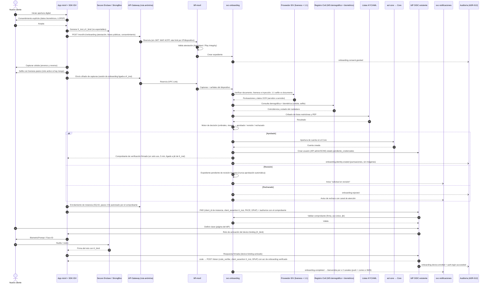

# ADR-008 — Onboarding móvil con reconocimiento facial integrado al flujo de autenticación

| Estado | Fecha | Requisitos | Criterios de rúbrica | Elementos C4 afectados |
|---|---|---|---|---|
| Aceptado (2026-10-19) | 2026-10-18 | RF-12, RF-13, RF-14, RF-15, RNF-01, RNF-03, RNF-05, RNF-16, S-14, S-20, S-25 | #11 Integración con onboarding · #10 Arquitectura de autenticación · #13 Regulaciones y estándares · #5 Integración con servicios externos | Contexto: Proveedor biométrico/IDV, Registro Civil (fuente oficial), listas de control · Contenedores: App móvil, BFF Móvil, Servicio de Onboarding, IdP, Auditoría · Componentes: Onboarding (orquestador, adaptador IDV, adaptador Registro Civil, motor de decisión, bóveda de evidencias) |

## 1. Contexto

El enunciado exige que el **onboarding de nuevos clientes en la app móvil use reconocimiento facial** y que esa arquitectura forme **parte del flujo de autorización y autenticación** (RF-12); después, el cliente debe poder ingresar con clave, huella u otro método (RF-13, resuelto en ADR-007), y se pide **recomendar herramientas de industria** (RF-14). Se asume un servicio de verificación facial con **prueba de vida** y comparación **1:1** contra la foto del documento y, si BP está habilitado, contra la fuente oficial de identidad (S-25). Construir un motor biométrico propio está fuera de alcance (FA-06).

**Fuerzas y restricciones**
- **Amenazas específicas del onboarding remoto**: ataques de presentación (foto, video, máscara 3D, *deepfake* mostrado a la cámara), **ataques de inyección** (cámara virtual, emulador, *hooking* del SDK para inyectar un video sintético saltándose la cámara), documentos falsificados o alterados, identidades sintéticas y suplantación con documento robado. El onboarding es la puerta de entrada al fraude de cuentas mula.
- **Fuente oficial en Ecuador**: la Dirección General de Registro Civil, Identificación y Cedulación (DIGERCIC) publica el trámite "Verificación mediante consulta de datos por web service demográfico o demográfico más biométrico", dirigido a personas jurídicas de derecho privado legalmente constituidas en Ecuador y sujeto a **autorización o habilitación de la DIGERCIC** (convenio de servicio; contacto: Dirección de Servicios Electrónicos). El acceso es por convenio: BP debe tenerlo o tramitarlo, o usar un proveedor que ya lo tenga. Los detalles del contrato de interfaz no son públicos y **no se suponen** aquí.
- **Datos biométricos = datos sensibles** según la LOPDP (Ecuador, 2021): requieren consentimiento explícito con una finalidad concreta, minimización, medidas de seguridad reforzadas, evaluación de impacto y, si el proveedor procesa fuera del país, garantías de transferencia internacional. El detalle normativo se desarrolla en el documento de seguridad.
- **Disponibilidad**: SLO de onboarding 99,9 % (S-14). El proveedor IDV y el Registro Civil son dependencias externas que pueden fallar (RNF-03).
- **Coherencia con ADR-007**: el resultado del onboarding debe convertirse en una **identidad en el IdP** con credenciales enroladas (clave + llave ligada al dispositivo / passkey) y en un **primer token** emitido por el flujo estándar Authorization Code + PKCE, no por un atajo propietario.

## 2. Opciones evaluadas

### 2.1 Tipo de prueba de vida

| Criterio (peso) | Activa (reto-respuesta: girar, parpadear, seguir un punto) | Pasiva (una captura o un video corto sin instrucciones) | **Pasiva + escalamiento adaptativo a activa/reto de luz** |
|---|---|---|---|
| Resistencia a presentación evaluada según ISO/IEC 30107-3, conformidad nivel 2 de iBeta alcanzable (30 %) | 4 | 4 | **5** |
| Fricción / tasa de abandono (25 %) | 2 | 5 | **4** |
| Resistencia a *deepfakes* e inyección (con señales de integridad) (25 %) | 3 | 3 | **4** |
| Accesibilidad (personas mayores, discapacidad motriz) (20 %) | 2 | 5 | **4** |
| **Puntaje** | **2,85** | **4,20** | **4,30** |

### 2.2 Proveedor de verificación de identidad (IDV) y liveness — RF-14

Puntajes **preliminares** (1–5) con información pública y declaraciones de los fabricantes a 2026-10; se confirman con RFP y PoC técnica. En la fila de PAD, **5** = carta de conformidad de iBeta (laboratorio acreditado NVLAP) nivel 2 localizada públicamente; **4** = nivel 2 declarado por el fabricante, con carta a solicitar en la diligencia debida.

| Criterio (peso) | Jumio | Onfido (Entrust) | FacePhi | Veridas | FaceTec | iProov | Amazon Rekognition Face Liveness |
|---|---|---|---|---|---|---|---|
| PAD evaluado según ISO/IEC 30107-3 con conformidad nivel 2 de iBeta verificable (20 %) | 5 | 4 | 4 | 4 | 4 | 4 | 5 |
| Detección de ataques de inyección (15 %) | 4 | 4 | 4 | 4 | 4 | 5 | 3 |
| Documento ecuatoriano: OCR + autenticidad (15 %) | 5 | 4 | 5 | 5 | 2 | 2 | 1 |
| SDK móvil nativo + puentes Flutter/React Native (10 %) | 4 | 4 | 4 | 4 | 4 | 4 | 3 |
| Despliegue y ubicación de datos (nube regional, on-premise, retención cero) (15 %) | 3 | 3 | 5 | 5 | 5 | 3 | 4 |
| Costo por verificación (10 %) | 2 | 3 | 3 | 3 | 3 | 3 | 5 |
| Presencia y soporte en banca LATAM (15 %) | 4 | 3 | 5 | 4 | 3 | 3 | 2 |
| **Puntaje ponderado** | **4,00** | **3,60** | **4,35** | **4,20** | **3,60** | **3,45** | **3,30** |

- **Jumio**: Pro: cobertura documental global y carta iBeta nivel 2 pública (septiembre 2025). Contra: SaaS con datos procesados fuera del país y costo por transacción alto.
- **Onfido (Entrust)**: Pro: plataforma completa con orquestación de flujos. Contra: la evidencia de PAD nivel 2 debe pedirse; menor presencia directa en la región.
- **FacePhi**: Pro: suite completa (documento + selfie pasiva + firma biométrica), fuerte adopción en banca LATAM, despliegue en nube u on-premise. Contra: la carta iBeta debe validarse para la versión exacta del SDK.
- **Veridas**: Pro: liveness pasivo y validación documental, opción on-premise. Contra: igual que FacePhi en evidencia de PAD; menor escala de soporte local.
- **FaceTec / iProov**: Pro: especialistas en liveness 3D o con reto de luz, muy fuertes contra *deepfakes* e inyección. Contra: no resuelven por sí solos la autenticidad del documento (requieren combinarse con otro proveedor).
- **Amazon Rekognition Face Liveness (+ CompareFaces)**: Pro: nativo de AWS (disponible en us-east-1, región principal de S-11), carta iBeta nivel 2 pública (octubre 2023), pago por verificación de bajo costo y datos dentro de la cuenta de BP. Contra: no valida documentos ecuatorianos; el SDK de captura es web/Amplify (en móvil multiplataforma requiere puente); la detección de inyección depende de la integridad del cliente.

## 3. Decisión

1. **Patrón**: el onboarding es un **microservicio propio (Servicio de Onboarding)** que orquesta, mediante **puertos y adaptadores**, a: (a) un proveedor **IDV especializado** (documento + selfie con liveness + comparación 1:1), (b) el **web service demográfico + biométrico del Registro Civil** como fuente oficial (vía convenio propio o de un proveedor ya habilitado), (c) **listas de control KYC/AML** (listas restrictivas, PEP) y (d) el IdP. El proveedor es reemplazable sin tocar la app ni el IdP.
2. **Proveedor recomendado**: **FacePhi** (mayor puntaje, documento + liveness pasivo en un solo SDK, despliegue flexible y presencia en banca LATAM); **alternativa: Veridas** con criterios equivalentes; **Jumio** si BP prioriza la cobertura documental global. **Amazon Rekognition Face Liveness** queda como **segundo motor de liveness** nativo de AWS para conmutación ante falla del proveedor (RNF-03) o como opción de menor costo si BP valida el documento solo contra el Registro Civil. **Condición de adjudicación**: carta de conformidad **nivel 2 de iBeta** (laboratorio NVLAP; evaluación según ISO/IEC 30107-3) vigente para la versión del SDK, evidencia de detección de inyección (alineada a CEN/TS 18099), opción de **retención cero** en el proveedor y PoC con cédulas ecuatorianas reales con consentimiento.
3. **Liveness pasivo por defecto con escalamiento adaptativo**: si el motor de riesgo detecta señales anómalas (emulador, cámara virtual, root, reintentos, desajuste geográfico), se exige reto activo o reto de luz y, en último caso, **revisión humana asistida** o videollamada.
4. **La decisión es del servidor**: el SDK solo captura; las puntuaciones de liveness y de coincidencia se obtienen **servidor a servidor** desde el proveedor (no se confía en el resultado que reporta la app). La captura viaja cifrada y firmada con la atestación de la app (App Attest / Play Integrity).
5. **Doble comparación 1:1**: selfie ↔ foto del documento (proveedor) **y** selfie ↔ fotografía del Registro Civil (fuente oficial) + validación demográfica (número de cédula, nombres, condición de cedulado / no fallecido). Los umbrales se fijan para una FAR objetivo ≤ 0,01 % con FRR medida en la PoC.
6. **Integración con el IdP (sin atajos)**: solo si la decisión es **aprobado**, el Servicio de Onboarding solicita la apertura de la cuenta en el Core (vía `acl-core`), crea al usuario en el IdP mediante su **API de administración/SCIM** en estado `pendiente_credenciales` y emite un **comprobante de verificación** firmado (JWT, un solo uso, 5 min, ligado al `jkt` de `K_inst`). Con ese comprobante la app **enrola su instancia** (DCR vía `bff-movil`, SQ-02) y luego inicia el flujo **Authorization Code + PKCE + PAR** de ADR-007; un **paso de autenticación personalizado del IdP** consume el comprobante, guía la creación de la **clave** (en la página del IdP, nunca por API de la app) y activa el ***device binding*** (`K_bind`, registrada en el enrolamiento) con un reto firmado tras biometría local. Las rutas de onboarding son anónimas en API Gateway (sin JWT) y se protegen con WAF ACFP, atestación y *rate limiting*. El IdP emite el **primer token** con `acr` de onboarding verificado (equivalente a IAL2).
7. **Privacidad (LOPDP)**: consentimiento explícito y separado para el tratamiento biométrico antes de abrir la cámara; **BP no conserva plantillas biométricas**, solo la evidencia mínima exigida para KYC (imágenes y puntuaciones) cifrada con una llave KMS dedicada, acceso con separación de funciones y retención definida en el documento de seguridad; el proveedor opera con **retención cero** o con borrado contractual verificable; si procesa fuera del país, se aplican las garantías de transferencia internacional. Para recuperar la cuenta se **re-verifica** contra el Registro Civil en vez de almacenar plantillas.
8. **Resiliencia**: *timeouts*, reintentos con *backoff* y *circuit breaker* por adaptador; si el Registro Civil no responde, el expediente queda **pendiente** (nunca aprobado automáticamente) y se notifica al cliente cuando se resuelva; si el proveedor IDV cae, se conmuta al motor alterno de liveness y el documento queda para revisión diferida.
9. **Auditoría**: cada paso emite un evento (`onboarding.consent.granted`, `.document.verified`, `.liveness.passed|failed`, `.match.scored`, `.registry.validated`, `.aml.screened`, `.identity.created`, `.device.enrolled`, `.completed|rejected`) con `correlation_id`, puntuaciones y versión del modelo, **sin imágenes ni plantillas**, hacia la auditoría inmutable (ADR-012).

### Diagrama de secuencia — onboarding recomendado

## 4. Justificación teórica

1. **ISO/IEC 30107-3 (detección de ataques de presentación, PAD) y el programa de conformidad de iBeta (acreditado por NIST/NVLAP)**: la norma define el método de evaluación y las métricas (APCER/BPCER); los **niveles** de esfuerzo del atacante pertenecen al programa de iBeta, no a la norma. Exigir la **conformidad nivel 2 de iBeta** (máscaras y artefactos elaborados) como requisito de adjudicación convierte "liveness" en un criterio verificable. Riesgo mitigado: suplantación con foto, video o máscara.
2. **CEN/TS 18099 (detección de ataques de inyección de datos biométricos)** y las guías de ENISA sobre identificación remota: separan la **inyección** (saltarse la cámara) de la presentación, algo que ISO/IEC 30107-3 no cubre. Justifica la atestación de la app, la detección de cámaras virtuales y emuladores y la decisión en el servidor. Riesgo mitigado: *deepfakes* inyectados, el vector de mayor crecimiento.
3. **NIST SP 800-63A-4 (comprobación de identidad, 2025)**: para un aseguramiento de identidad IAL2 remoto exige evidencia fuerte (documento), validación contra **fuente autoritativa** y verificación biométrica del solicitante contra esa evidencia. Fundamenta la doble comparación 1:1 (documento + Registro Civil) y el resultado `acr` de onboarding verificado.
4. **RFC 7636 / RFC 9700 / FAPI 2.0 (vía ADR-007)**: el primer token se emite con el mismo flujo Authorization Code + PKCE + PAR y DPoP que el login, sin canal propietario paralelo; evita un "camino lateral" de emisión de tokens que no pase por los controles del IdP.
5. **FIDO2 / WebAuthn y NIST SP 800-63B-4**: el enrolamiento de una llave no exportable desbloqueada con biometría local logra AAL2 sin enviar la biometría al servidor, de modo que la biometría facial del onboarding (servidor) y la biometría de uso diario (dispositivo) quedan desacopladas.
6. **OWASP MASVS 2.x (MASVS-RESILIENCE, MASVS-PRIVACY) y LOPDP (Ecuador, 2021)**: integridad de la app, protección de datos sensibles en el dispositivo, minimización y consentimiento explícito para el dato biométrico (dato sensible). Riesgo mitigado: manipulación del cliente y sanción por tratamiento ilícito de datos.

## 5. Consecuencias

**Positivas**
- Alta remota con aseguramiento IAL2 y doble verificación (documento + fuente oficial), integrada al IdP sin romper el estándar OAuth/OIDC.
- Proveedor reemplazable (puerto/adaptador) y motor alterno para continuidad.
- BP minimiza su exposición: no guarda plantillas biométricas.

**Trade-offs**
- Costo variable por verificación (proveedor + consulta al Registro Civil), que se presupuesta aparte del costo de nube (S-16).
- El escalamiento a reto activo o revisión humana aumenta el abandono en una fracción de los casos.
- Dependencia de un convenio con DIGERCIC cuyo plazo de trámite puede ir por fuera del cronograma técnico.

**Riesgos y mitigación**

| Riesgo | Mitigación |
|---|---|
| BP no tiene convenio con el Registro Civil | Tramitarlo (trámite publicado en gob.ec) o contratar un proveedor ya habilitado; mientras tanto, aprobación con límites transaccionales reducidos y revisión. |
| *Deepfake* inyectado supera el liveness | Atestación de app, detección de inyección, decisión en servidor, segundo motor ante señales de riesgo y monitoreo de tasas por versión de SDK. |
| Sesgo demográfico del algoritmo (FRR desigual) | Exigir reportes de rendimiento por grupo demográfico (p. ej. NIST FRTE), probar con población local en la PoC y ofrecer una vía alterna asistida. |
| Proveedor procesa fuera de Ecuador | Cláusulas de transferencia internacional, retención cero, evaluación de impacto (documento de seguridad); preferir despliegue regional u on-premise. |
| Caída del proveedor o del Registro Civil | *Circuit breaker*, motor alterno y expediente pendiente con notificación; nunca aprobar automáticamente sin la validación oficial. |
| El IdP no admite pasos personalizados | Brecha a declarar (S-20); alternativa: el IdP federa contra un *Authentication Service* propio que consume el comprobante (OIDC) antes de emitir los tokens. |

## 6. Patrones aplicados

- **Orquestación de procesos (Process Manager / Saga)** para el expediente de onboarding con estados y compensación (borrar el usuario del IdP si el enrolamiento no termina).
- **Puertos y adaptadores / Anti-Corruption Layer** frente al proveedor IDV, el Registro Civil y las listas AML.
- **Circuit Breaker, Timeout, Retry con backoff, Fallback** (motor alterno).
- **Claim Check**: las imágenes van a la bóveda cifrada (S3 + KMS) y los eventos solo llevan referencias y puntuaciones.
- **Verifiable Token / Signed Assertion** (comprobante de verificación de un solo uso) y **Device Binding**.
- **Risk-Based Adaptive Authentication** (escalamiento de liveness).

## 7. Equivalente Azure

Azure AI Face Liveness (acceso limitado) + proveedor IDV del Marketplace, orquestación en Azure Container Apps, evidencia en Blob Storage inmutable con Key Vault, identidad en Microsoft Entra External ID.

## 8. Trazabilidad

| Requisito | Diagrama C4 / otro donde aparecerá | Sección del PDF |
|---|---|---|
| RF-12 (onboarding facial en el flujo de auth) | Contexto (Proveedor IDV, Registro Civil); Contenedores (Servicio de Onboarding, IdP); secuencia de onboarding | §8.x Onboarding |
| RF-13 (enrolamiento de clave / biometría / passkey) | Componentes de Identidad (device binding); secuencia de onboarding (pasos finales) | §8 Seguridad e identidad |
| RF-14 (herramientas de industria) | Tabla comparativa 2.2 | §8.x Onboarding · anexo de herramientas |
| RNF-03 (tolerancia a fallos de biometría) | Componentes de Onboarding (circuit breaker, motor alterno) | §12 HA/DR y resiliencia |
| RNF-16 / RNF-01 (dato biométrico sensible, LOPDP) | Componentes (bóveda de evidencias, KMS dedicada) | §14 Normativa |
| RF-15 (auditoría de onboarding) | Componentes de Auditoría; eventos `onboarding.*` | §9.x Auditoría |
